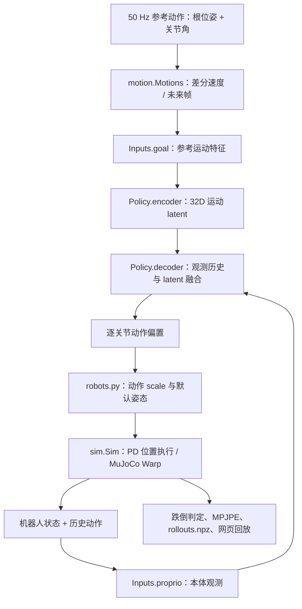
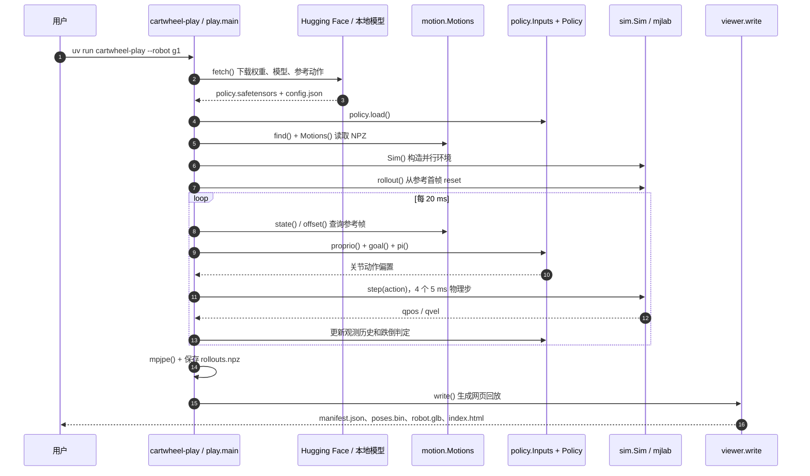

# Cartwheel Control｜全身动作跟踪控制策略

[官方模型卡与权重](https://huggingface.co/andrew-cartwheel/cartwheel-control) · [GitHub 源码](https://github.com/Cartwhl/cartwheel-control) · [官方介绍](https://getcartwheel.com/blog/cartwheel-control)

## 一句话定义

Cartwheel Control 是 Cartwheel 针对三款人形机器人发布的**参考运动条件全身跟踪策略**，在物理仿真中根据未来动作与历史本体状态以 **50 Hz** 输出关节位置目标。作者称训练方法“hardware-agnostic”（与硬件无关），但公开的权重**分别绑定三款机器人**，不能据此宣称单一策略可无修改跨机型部署。

## 英文缩写速查

| 缩写 | 英文全称 | 简要说明 |
|---|---|---|
| DoF | Degrees of Freedom | 机器人策略对应的自由度 |
| IMU | Inertial Measurement Unit | 根部角速度与重力方向等本体状态 |
| PD | Proportional-Derivative | 仿真中的关节位置执行器 |
| MJCF | MuJoCo XML Model Format | 定义机器人模型与关节顺序 |
| MPJPE | Mean Per Joint Position Error | 本仓库实际用相对根部的刚体位置计算均值误差 |
| NPZ | NumPy Compressed Archive | 参考动作文件格式 |

## 为什么重要

- 运动学动作生成不能自动保证物理可执行；学习式全身跟踪器负责把动作参考转成可在仿真中执行的关节命令。
- 同一软件入口同时支持三种不同机器人，并提供各自的权重、模型与参考动作，便于研究跨本体控制接口。
- 可公开检查的观测、控制频率和评测代码，为上游 motion generation / retargeting 提供下游验证端。

## 核心原理与流程总览

下图依据[官方模型卡/README](../../sources/sites/cartwheel-control-huggingface.md)与[已阅读的源码](../../sources/repos/cartwheel-control.md)，描绘**已公开的推理闭环**，不代表未公开的训练方法。



**观测与目标：** `Inputs.proprio` 读取关节相对默认姿态偏移、关节速度、根角速度、根坐标重力、上一动作与参考相对根朝向（6D）。`Inputs.goal` 由未来参考根平移、姿态、速度及关节角/速度组成。官方模型卡写明未来 **10 帧**；源码实际从模型各自的 `config.json` 读取 `goal_frames` 和 `hist`，不应凭宣传资料猜测所有型号的历史窗口长度。

**网络：** `policy.py` 的目标编码器 MLP 隐藏层为 2048/1024/512/256，输出经 `tanh` 的 **32D latent**；解码器把它和归一化后的观测历史拼接，再输出逐关节动作。配合 `robots.py` 的 scale 与默认关节姿态，得到 **PD 位置目标**，而非直接输出关节力矩。

**仿真：** `sim.py` 设置 `timestep=0.005` s、`decimation=4`，即 **200 Hz** 物理步进、**50 Hz** 策略更新。每个参考 motion 初始化一台并行虚拟机器人，从动作首帧执行。

## 公开模型与实验评测

| 权重目录 | 机器人 | 关节数 |
|---|---|---:|
| `rp1/` | RoboParty RP1 | 28 |
| `asimov-1/` | Menlo Asimov-1 | 25 |
| `g1/` | Unitree G1 | 29 |

目录包括 `policy.safetensors`、`config.json`、机器人 MJCF/mesh、`robot.glb`、示例动作。官方的 `play.py` 汇报每段动作是否跌倒、跌倒时刻与相对根部身体位置 MPJPE（mm）。`Inputs.fell` 的条件是相对参考根高度误差 **>0.25 m** 或重力方向 z 分量差 **>0.8**，只是一组仿真回放判据。

**证据界限：** 官方模型卡没有给出跨机器人可直接比较的完整成功率基准；不能从演示视频推出独立可复现的统计结果。

## 源码运行时序图

根据官方 [`pyproject.toml`](https://github.com/Cartwhl/cartwheel-control/blob/main/pyproject.toml)、[`play.py`](https://github.com/Cartwhl/cartwheel-control/blob/main/cartwheel_control/play.py)、[`policy.py`](https://github.com/Cartwhl/cartwheel-control/blob/main/cartwheel_control/policy.py)、[`sim.py`](https://github.com/Cartwhl/cartwheel-control/blob/main/cartwheel_control/sim.py) 与 [`viewer.py`](https://github.com/Cartwhl/cartwheel-control/blob/main/cartwheel_control/viewer.py) 核实运行链：



该图**只覆盖官方已开源的推理与仿真/回放**，不应误作训练流程。仓库未提供可核实的训练入口，不能猜测 PPO、AMP、蒸馏配方或奖励函数。

## 工程实践

```bash
git clone https://github.com/Cartwhl/cartwheel-control
cd cartwheel-control
uv sync
uv run cartwheel-play --robot g1
python -m http.server -d play_out/viewer 8000
```

官方要求 Linux、NVIDIA GPU、uv 0.6+，`pyproject.toml` 要求 Python 3.12+。可使用 `--robot rp1` / `asimov-1`，`--clips dance` 过滤动作，`--motions <folder>` 载入自定义动作。

自定义动作以每段一个 `.npz` 提供 `qpos`，形状 **(frames, 7 + joints)**、采样率 50 Hz：根位置（m）+ 姿态四元数（**wxyz**）+ 对应 MJCF/`config.json` 的关节角（rad）。人体运动需要先转成目标机器人本体运动；不同机器人不能直接复用同一个关节数组。

## 结论

**Cartwheel Control 是公开可运行的仿真级全身跟踪器，而不是已验证的跨本体零样本策略或真机控制系统。**

1. 依据 robot 选择配套权重、默认姿态和 MJCF 关节顺序。
2. 将参考生成、策略位置目标与 PD/物理仿真分别评测。
3. 同时看 MPJPE、跌倒发生时刻和动作覆盖，而不仅看视频。
4. 真机与开放环境能力需要额外 Sim2Real/安全证据，不能由此发布推断。

## 局限与风险

- **仅仿真：** 官方模型卡明确尚未在机器人实机运行。
- **开放程度：** 代码 Apache-2.0；权重 Cartwheel Open Model License；机器人模型各有第三方许可。公开的只是推理、仿真和 viewer，没有训练实现。
- **理想化评测：** `sim.py` 采用摩擦系数 1.0、无随机化/噪声，并关闭自碰撞；结果不能代表真实接触动力学的可靠性。
- **与硬件无关的含义有限：** 三款发布策略各自绑定机器人模型、PD 配置和关节动作 scale。
- **核查范围：** 官方 Hugging Face 模型卡、README 和关键运行源码已通读；官方介绍博客未能完整获取，未从中扩写未经核实的细节。

## 关联页面

- [Whole-Body Control](../concepts/whole-body-control.md) — 与经典 WBC 的接口和方法区别。
- [SONIC](../methods/sonic-motion-tracking.md) — 大规模 motion tracking 路线。
- [SuperMimic](./paper-supermimic.md) — 物理运动跟踪的训练路线。
- [模仿学习](../methods/imitation-learning.md) — 动作示范与控制策略背景。

## 参考来源

- [Hugging Face 模型卡与官方 README 归档](../../sources/sites/cartwheel-control-huggingface.md)
- [官方源码与运行链核查](../../sources/repos/cartwheel-control.md)

## 推荐继续阅读

- [Cartwheel Control 官方模型卡](https://huggingface.co/andrew-cartwheel/cartwheel-control)
- [官方 GitHub README](https://github.com/Cartwhl/cartwheel-control/blob/main/README.md)
- [Cartwheel 官方介绍（未通读）](https://getcartwheel.com/blog/cartwheel-control)
