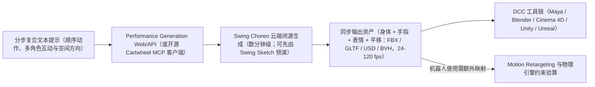

# Swing Choreo：Cartwheel 复合文本到人体动作生成

## 一句话定义

Swing Choreo 是 Cartwheel 面向复杂表演的商用闭源人体动作生成模型，可从一段分步复合文本提示生成连续角色表演，并同时覆盖手指手势、面部表情、多角色互动与空间运动方向。

## 英文缩写速查

| 缩写 | 英文全称 | 简要说明 |
|------|----------|----------|
| DCC | Digital Content Creation | Maya、Blender 等数字内容创作工具 |
| FBX | Filmbox | 角色骨架与动画交换格式 |
| GLTF | GL Transmission Format | 常用于实时渲染和三维内容交换的格式 |
| USD | Universal Scene Description | 三维场景与动画交换格式 |
| BVH | Biovision Hierarchy | 骨架层级与动作数据格式 |

## 为什么重要

传统文本到动作模型常将文本对应到短单动作，复合描述容易遗漏子动作或把不同动作平均化。Choreo 的产品定位是读取按顺序描述的表演，让角色依次完成多个动作并生成连贯过渡。对动画师而言，这可以把自然语言作为动作草稿与分镜输入；多人关系、手势和表情也能随同身体动作一并生成。

它属于角色动画工具链，输出是人体/角色动作资产，**不是机器人原生控制策略**。把生成结果用于机器人学习仍需骨架映射、动作重定向与物理可行性验证。

## 核心原理（产品架构与交互边界）

> 注：Swing Choreo 为商业闭源云端服务（模型内部网络结构与训练权重未公开），下述概括依据 Cartwheel 官方发布文章与 Performance Generation 产品规格文档整理。

| 维度 | 官方发布资料 |
|------|--------------|
| **序列复合动作** | 将多步骤文本指令按时序组织并生成中间过渡（区别于单短语短片段模型） |
| **多角色互动** | 单次生成多名角色的不同动作及交互响应（如交谈、群舞） |
| **全身细节控制** | 同步生成身体动作、手指姿势、面部表情与相对世界/镜头运动方向 |
| **输入方式** | 通过 Performance Generation Web/API 提交分步文本（Swing 家族另含 Sketch 预演与 Edit） |
| **输出格式** | 骨架动画、网格与平移数据（FBX、GLTF、USD、BVH、MB、MA），支持 24 / 30 / 60 / 120 fps |
| **工具链** | Maya、Blender、Cinema 4D、Unity、Unreal Engine；另有开源 API 客户端 Cartwheel MCP |
| **生成耗时** | 官方称 Choreo 一次生成通常需数分钟；Swing Sketch 面向更快草稿迭代 |

## 工程实践

- **动画制作工作流**：先以 Swing Sketch 快速迭代镜头 blocking 与时机，确定长序列后切换 Choreo 细化手势、表情、多角色关系与世界/镜头空间方向。
- **DCC 导入检查**：导入 FBX / GLTF / USD / BVH 后核对骨架映射、根位移与帧率连续性；如需接入机器人仿真，须先经过 [Motion Retargeting](../concepts/motion-retargeting.md) 并在物理引擎中验算接触、关节限位与力矩约束。

## 机制与架构图

## 局限与风险

- **商业闭源且权重/源码未公开**：官方模型页、发布文章与产品规格均未开放训练权重、推理源码或训练集（官方称内部自建数万小时动捕+时序标注）；外部 [Cartwheel MCP](../../sources/repos/cartwheel-mcp.md) 仅为 API 调用客户端而非模型实现。
- **评测多为发布方自测**：盲测成对偏好（与前代 Swing Sketch 对比：整体 88%、复合 92%、手指 94%、多人 100%）及 61/100 匿名对照内部基准尚缺独立公开数据集与可复现评测脚本（API 文档站点 `api-docs.getcartwheel.com` 为客户端 SPA，无头文本抓取未展开端点明细）。
- **非实时控制器**：数分钟级云端生成耗时仅面向动画生产管线，不能直接用于人形机器人在环实时控制或高频重规划。

## 关联页面

- [Character Animation vs Robotics](../concepts/character-animation-vs-robotics.md) — 区分角色表演生成与机器人可控动作
- [Diffusion-based Motion Generation](../methods/diffusion-motion-generation.md) — 条件运动生成方法与相关工作
- [Motion Retargeting](../concepts/motion-retargeting.md) — 将人体动作映射到机器人或目标角色骨架

- [AI 模型推理与服务部署](../methods/ai-model-serving-inference.md)：对照运行时接口、延迟与资源。

## 参考来源

- [Swing Choreo 官方发布文章归档](../../sources/blogs/cartwheel_swing_choreo.md)
- [Swing 官方模型与产品规格归档](../../sources/sites/cartwheel-swing.md)
- [Cartwheel Swing 模型家族页](https://getcartwheel.com/model/swing)
- [Performance Generation 产品规格](https://getcartwheel.com/product/performance-generation)

## 推荐继续阅读

- [Cartwheel：Introducing Swing Choreo](https://getcartwheel.com/blog/swing-choreo)
- [Cartwheel：Swing 模型家族](https://getcartwheel.com/model/swing)
