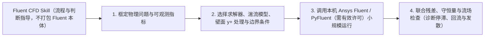

# Fluent CFD Skill（cavoiie/fluent-cfd-skill）

## 一句话定义

Fluent CFD Skill（cavoiie/fluent-cfd-skill）是面向 Ansys Fluent/PyFluent 的判断与流程指导，不打包 Fluent 本体。

## 英文缩写速查

| 缩写 | 英文全称 | 简要说明 |
|------|----------|----------|
| CFD | Computational Fluid Dynamics | 计算流体力学计算流程 |
| MCP | Model Context Protocol | 让代理发现并调用外部工具的协议 |
| y+ | Dimensionless Wall Distance | 壁面网格分辨率相关的无量纲距离 |

## 为什么重要

对 CAE 自动化而言，代理能否稳定完成任务，取决于工程步骤是否清楚、工具边界是否明确、结果是否保留可审查证据。面向 Ansys Fluent/PyFluent 的判断与流程指导，不打包 Fluent 本体；覆盖问题定义、求解器/湍流模型/壁面处理、边界条件、收敛判据，以及残差停滞、回流和发散诊断。

## 核心原理

**项目自身范围：** Codex skill for Ansys Fluent and PyFluent CFD workflows.

**工作流：** 先框定物理问题与可观测指标，再选择模型及数值设置，最后联合残差、守恒量和流场检查判断是否收敛。

## 工程实践

1. 从目标问题识别所需的 Skill、MCP、CLI 或软件接口，不把指导文件当成求解器。
2. 依照仓库 README 检查安装前提、软件/许可证、输入文件和输出证据。
3. 小规模运行并逐项核对几何、网格、边界、求解状态和物理量，再决定是否扩大任务。

文章所述的项目特征：面向 Ansys Fluent/PyFluent 的判断与流程指导，不打包 Fluent 本体；覆盖问题定义、求解器/湍流模型/壁面处理、边界条件、收敛判据，以及残差停滞、回流和发散诊断。

## 机制与架构图

## 局限与风险

残差下降不等于收敛；执行 Fluent、PyFluent 操作需本机软件、有效许可和可用接口。

源码状态核验：该 GitHub 仓库于 2026-10-07 可公开访问。仓库 API 报告许可证为 MIT。 涉及商业软件时，安装包和有效许可证需由使用者自行提供。

## 关联页面

- [CAE / CFD 代理工具项目总览](../overview/cae-cfd-agent-skills-landscape.md)
- [FEMIS Skill](./test1card-femis-skill.md)
- [Engineering Simulation and Verification Workflow · 工程仿真建模与验证流程](../methods/engineering-simulation-workflow.md)：对照 CFD 仿真中几何网格、边界条件设置与残差收敛判据的工程验证流程。
- [Agent Skill Packaging · 智能体技能封装](../methods/agent-skill-packaging.md)：参考将 Ansys Fluent 与 PyFluent 建模诊断规则封装为智能体技能的组织规范。

## 参考来源

- [公众号文章原始资料归档](../../sources/blogs/wechat_cae_cfd_agent_skills_2026-10-07.md)
- [GitHub 仓库资料归档](../../sources/repos/cavoiie-fluent-cfd-skill.md)
- [cavoiie/fluent-cfd-skill 官方仓库](<https://github.com/cavoiie/fluent-cfd-skill>)

## 推荐继续阅读

- [项目 README](<https://github.com/cavoiie/fluent-cfd-skill/blob/main/README.md>)