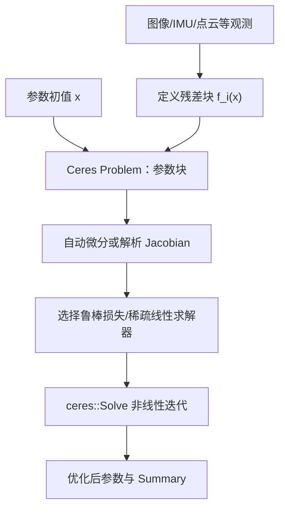
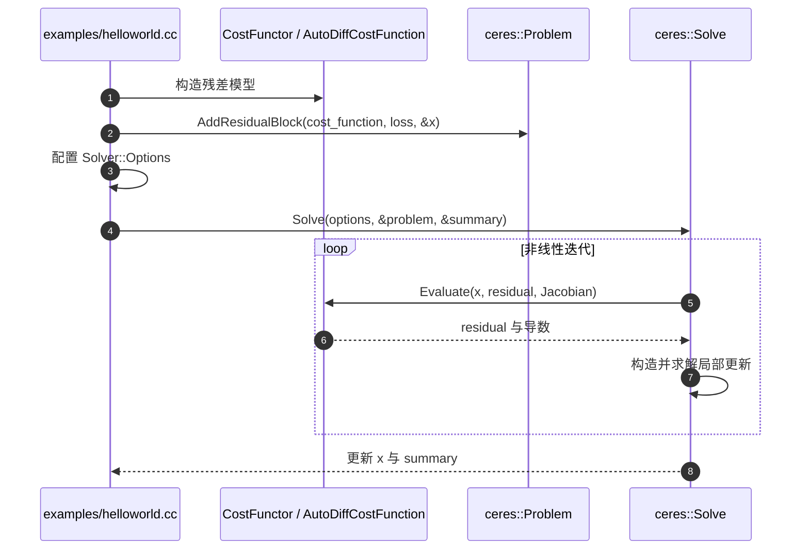

# Ceres Solver：原始文档、方法与源码

## 一句话定义

Ceres Solver 是面向非线性最小二乘、鲁棒损失和参数流形优化的 C++ 求解器，典型用途包括相机标定、Bundle Adjustment 和姿态图优化。

## 英文缩写速查

| 缩写 | 英文全称 | 简要说明 |
|---|---|---|
| NLLS | Nonlinear Least Squares | 非线性最小二乘 |
| BA | Bundle Adjustment | 同时优化相机位姿与3D特征 |
| GN | Gauss–Newton | 利用局部一阶近似反复更新参数 |
| LM | Levenberg–Marquardt | 阻尼信赖域优化 |
| SE(3) | Special Euclidean Group 3D | 三维刚体位姿流形 |
| SLAM | Simultaneous Localization and Mapping | 利用优化求解位姿/地图 |

## 为什么重要

SLAM 后端中的重投影误差、IMU 约束和点到线/面距离通常不是关于状态的线性函数；Ceres 用 ResidualBlock、参数块和 LossFunction 构建残差模型，并通过自动微分/数值微分/解析 Jacobian 及稀疏求解器做优化。与 GTSAM 不同，它更专注通用非线性最小二乘问题的表达与求解，而非完整机器人因子图建模框架。

## 核心原理与方法

1. 对变量参数块 `x` 定义多个残差 `f_i(x)`，最小化 `1/2 * sum_i rho_i(||f_i(x)||^2)`，`rho_i` 为可选鲁棒损失；需符合参数范围与 manifold 结构。
2. 官方入门 `examples/helloworld.cc` 定义一个代价 functor，再将 `AutoDiffCostFunction` 注册进 `ceres::Problem::AddResidualBlock`，最后传入 `ceres::Solver::Options` 并执行 `ceres::Solve`。
3. `docs/source/nnls_tutorial.rst` 依次讨论残差块、参数、损失、约束和不同求导策略；SLAM 示例 `examples/slam/pose_graph_2d/pose_graph_2d.cc` 读取 g2o 格式轨迹约束并构建优化问题。
4. 闭环误匹配会引入大残差，可采用 Huber/Cauchy 等鲁棒损失而非所有残差同等加权；但损失函数不是错误数据的万能补丁。
5. 对四元数/旋转使用合适的 manifold/local parameterization，不能把冗余参数当成任意欧氏向量调整。

## 流程总览（官方算法步骤）

## 源码运行时序图

**范围**：根据官方 README 与 CLI / demo 实际入口建图，不声称已在本机编译运行。

## 实验与评测

Ceres 是求解器库，不提供“标准 SLAM 精度值”。评测应固定残差定义、初值、观测噪声、鲁棒核、迭代预算、迭代时间与终止条件，再比较重投影 RMSE、收敛率和解算时间。不能将例子 `x→10` 的最小二乘演示当真实视觉标定算法。

## 结论

把传感器几何/物理关系转成可检查的残差和 Jacobian，比盲目调优化器参数更重要；Ceres 提供计算工具而不是机器人状态估计系统的全部逻辑。

## 工程实践

官方 `examples/helloworld.cc` 是最小入门；视觉工程先从重投影残差的 BA 开始，再加入内参/外参的适当固定策略与鲁棒核。对大规模稀疏问题选合适的 Schur / 线性求解配置，考虑线程数和内存。姿态图示例 `examples/slam/pose_graph_2d/pose_graph_2d.cc` 可用 g2o 格式追踪位姿图与回环约束。具体 build 命令须参考当前官方 Ceres 文档。

## 局限与风险

微分方法、参数尺度和初值决定数值稳定性；错误的噪声与鲁棒核容易造成看似收敛但有偏的解。优化器不自动处理时间同步或坐标系标定，也不能证明残差来自正确的数据关联。最新 master 可能和旧依赖的 Ceres API 不一致，需锁定发布版本。

## 关联页面

- [GTSAM](./gtsam.md)
- [COLMAP](./colmap.md)

## 参考来源

- [原作者代码与教程来源归档](../../sources/repos/vision3d_ceres_solver_20261108.md)
- [官方代码和技术文档](https://github.com/ceres-solver/ceres-solver)

## 推荐继续阅读

- [官方文档/源码完整入口](https://github.com/ceres-solver/ceres-solver)
