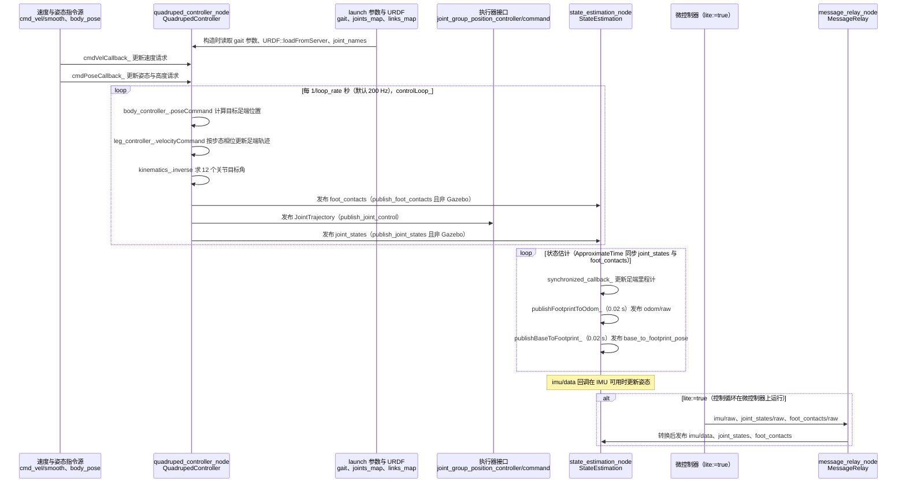

# CHAMP

**CHAMP**（[GitHub](https://github.com/chvmp/champ)）来自 [古月居转载的四足机器人开源项目综述](https://mp.weixin.qq.com/s/pRGoPm41qYCNyHPWR6Dl6A)，属「优化控制（MPC / WBC）」组。

## 一句话定义

**CHAMP 是用于搭建新四足机器人与开发控制算法的 ROS 开源框架，控制框架基于 MIT Cheetah 的「模式调制 + 阻抗控制」分层控制器论文。**

## 英文缩写速查

| 缩写 | 英文全称 | 简要说明 |
|------|----------|----------|
| CHAMP | Quadruped Controller（CHAMP 框架） | ROS 四足控制框架 |
| URDF | Unified Robot Description Format | 机器人描述格式 |

## 为什么重要

- 综述把它放在「优化控制（MPC / WBC）」这条技术路线下，作为可读源码的参照项目；横向对比见 [四足机器人开源项目技术地图：从极简运动学到研究级硬件（36 个 GitHub 项目）](../overview/quadruped-open-source-projects-technology-map.md)。
- 文中星标：2196；分支 428（文章表述，入库日未复核）。

## 核心信息

| 项 | 内容 |
|----|------|
| **仓库** | [chvmp/champ](https://github.com/chvmp/champ) |
| **最近提交** | 2024-07-04 |
| **可达性** | `git ls-remote` 可达（2026-11-01） |
| **文章归类** | 优化控制（MPC / WBC） |

## 文章说法核对

- **文章：** 文章把它描述为实现了完整 MPC：SRBD 模型、`convex_mpc` 模块与摩擦锥线性化 QP，另提及 champ_setup_assistant 与多个预配置机器人模型。
- **README / 核查：** README 核心特性：基于 ROS 导航栈的自主能力、setup-assistant 配置新机器人、预配置 URDF（Anymal、MIT Mini Cheetah、Spot、LittleDog）、Gazebo 仿真，并兼容 SpotMicroAI 与 OpenQuadruped。README 称控制框架依据的是 MIT「Hierarchical controller for highly dynamic locomotion utilizing pattern modulation and impedance control」论文。
- **差异与保留：** **文章的 MPC / `convex_mpc` / 摩擦锥 QP 描述与 README 不符**：README 指向的是模式调制 + 阻抗控制的分层控制器，未提 MPC。本节点以 README 为准；文章说法未核实，勿据此判断 CHAMP 含凸 MPC。

## 源码运行时序图

入口：`roslaunch champ_config bringup.launch rviz:=true`（README；`champ_config/launch/bringup.launch` 包含 `champ_bringup/launch/bringup.launch`，后者启动 `quadruped_controller_node`、`state_estimation_node`，`lite:=true` 时改启 `message_relay_node`）

图依据：chvmp/champ@7f7d917，读过 `README.md`、`champ_config/launch/bringup.launch`、`champ_bringup/launch/bringup.launch`、`champ_base/src/quadruped_controller_node.cpp`、`champ_base/src/quadruped_controller.cpp`（构造函数、`controlLoop_`、`publishJoints_`、`publishFootContacts_`）、`champ_base/src/state_estimation.cpp`（构造函数、`synchronized_callback_`、定时发布）、`champ_base/src/message_relay.cpp`（构造函数与话题声明）。`robot_localization` 的 EKF 输入映射、`body_controller_`/`leg_controller_` 的内部算法与 `hardware` 侧驱动未逐行核对；未运行代码。

## 关联页面

- [quadruped-robot](../entities/quadruped-robot.md)
- [locomotion](../tasks/locomotion.md)
- [open-quadruped](../entities/open-quadruped.md)
- [spotmicro](../entities/spotmicro.md)
- [quadruped-open-source-projects-technology-map](../overview/quadruped-open-source-projects-technology-map.md)

## 参考来源

- [champ_quadruped_controller.md](../../sources/repos/champ_quadruped_controller.md)
- [wechat_guyueju_quadruped_opensource_deep_dive_2026-11-01.md](../../sources/blogs/wechat_guyueju_quadruped_opensource_deep_dive_2026-11-01.md)
- [原文（微信公众号）](https://mp.weixin.qq.com/s/pRGoPm41qYCNyHPWR6Dl6A)
- 源码核对（2026-11-02）：chvmp/champ@7f7d917，读过 README.md、champ_config/launch/bringup.launch、champ_bringup/launch/bringup.launch、champ_base/src/quadruped_controller_node.cpp、champ_base/src/quadruped_controller.cpp、champ_base/src/state_estimation.cpp、champ_base/src/message_relay.cpp；时序图依据以上文件，未运行代码。
