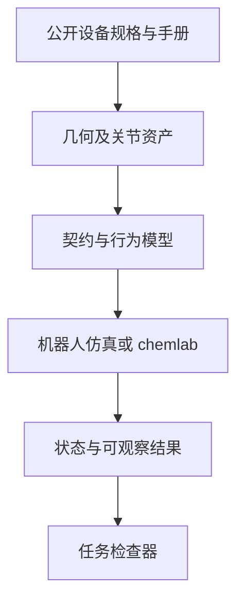
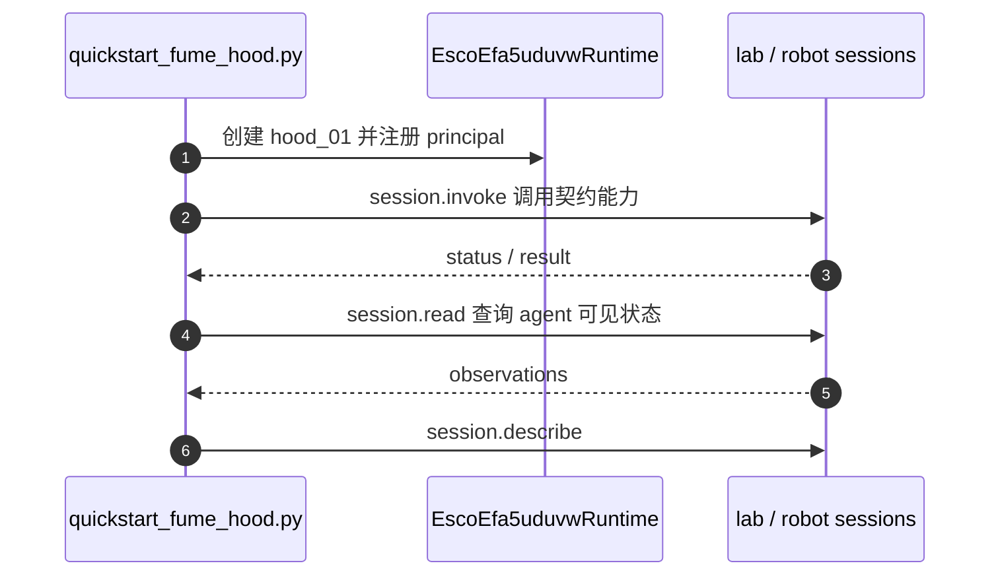

# ChemLab-Assets：可仿真化学实验室设备资产（Simulation-Ready Chemistry Laboratory Instruments）

## 一句话定义

将实验设备几何、可动关节、面板、行为模型与机器可读契约打包，支持机器人仿真及命令行智能体操作。

## 英文缩写速查

| 缩写 | 英文全称 | 简要说明 |
|---|---|---|
| URDF | Unified Robot Description Format | 关节、连杆和碰撞几何 |
| GLB | Binary glTF | 三维可视化资产 |
| CLI | Command-Line Interface | chemlab 命令入口 |
| SI | International System of Units | 契约状态的度量单位 |

## 为什么重要

零件级关节、行为契约与可操作仿真资产。将其作为可比较的独立研究或工程入口，而不是仅记录热度。

## 核心信息

| 字段 | 内容 |
|---|---|
| 机构 | 穆罕默德·本·扎耶德人工智能大学（MBZUAI） |
| 开放状态 | 代码 MIT；三维资产与数据 CC BY-NC 4.0，商用须单独核对。1.5.0（2026-10）发布。 |

## 核心原理与流程总览

每台设备提供 GLB/URDF/OBJ/Blender 几何、asset.contract.json 和可执行行为模型。契约定义关节、单位、状态可见性、能力参数及错误；机器人可经仿真器操作，语言智能体可经 chemlab 调用相同设备能力。仿真时钟、可观察状态与评估器隐藏真值分离，任务检查器读取执行后的状态。

以下为已查阅官方资料支持的概念流程，完整原文核对待补。

## 源码运行时序图

`examples/quickstart_fume_hood.py` 读取 `asset_runtime.esco_efa5uduvw`，调用 session.invoke/read/describe；运行 `python examples/quickstart_fume_hood.py`。`chemlab/chemlab/gserve.py` 另提供 `GenericLab(...).start()` 入口。

## 工程实践

代码 MIT；三维资产与数据 CC BY-NC 4.0，商用须单独核对。1.5.0（2026-10）发布。 复现入口与版本依赖见参考来源。本次未执行训练、推理或仿真复现。

## 实验与评测

官方 1.5.0 报告 203 套设备、119 家厂商、16 个领域，106 个设备带工作菜单；提供 276 个可自动检查任务。官方展示 Isaac Sim 机器人场景以及命令行交互；Matterix 仿真场景本身不在本次发布范围。

## 结论

将实验设备几何、可动关节、面板、行为模型与机器可读契约打包，支持机器人仿真及命令行智能体操作。 工程选型时应同时验证指标口径及使用边界。

- 资产验收同时检查关节、碰撞、行为和契约。
- 区分仿真设备可见状态与评估器真值。
- 需要商业应用或真机化学实验时重新核查许可与物理校准。

## 局限与风险

模型根据公开手册和文献构建，并非原厂 CAD，未用实体设备标定；行为模型不是任意化学过程的真实精度保证。资产非商业许可与代码 MIT 不可混淆。

**核对状态：** 草稿；完整原文及必要源码尚未通读，不宣称健康度满分。

## 关联页面

- [nvidia-simready-central](./nvidia-simready-central.md)
- [visloc-rs](./visloc-rs.md)
- [相关纵深路线](../../roadmap/depth-real2sim.md)

## 参考来源

- [sites：chemlab-assets](../../sources/sites/chemlab-assets.md)
- [repos：chemlab-assets](../../sources/repos/chemlab-assets.md)

## 推荐继续阅读

- [官方项目页](https://mbzuai-nlp.github.io/ChemLab-Assets/)
- [官方源码](https://github.com/mbzuai-nlp/ChemLab-Assets)
- [资产数据集](https://huggingface.co/datasets/MBZUAI/ChemLab-Assets)
- [3D 浏览器](https://huggingface.co/spaces/MBZUAI/ChemLab-Assets-Explorer)
