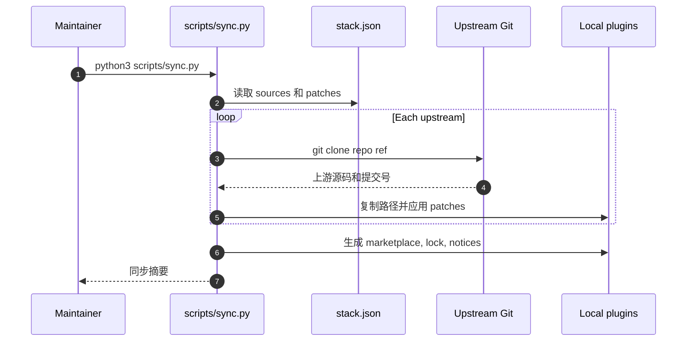

# Claude Code Frontend Skills｜多套 Skill 去冲突编排

## 一句话定义

它不是第八套独立审美，而是 Claude Code 的**多 Skill 编排与版本同步层**：选择主导技能，限制辅助加载，并明确冲突发生时谁优先。

## 英文缩写速查

| 缩写 | 英文全称 | 简要说明 |
|---|---|---|
| UI | User Interface | 需要被构建或审查的界面 |
| UX | User Experience | 体验规则分工 |
| PR | Pull Request | 上游同步的审查入口 |
| CLI | Command-Line Interface | 同步与检查的执行接口 |
| JSON | JavaScript Object Notation | `stack.json` 的源配置 |

## 为什么重要

将 Anthropic、Impeccable、UI/UX Pro Max、Taste 和 Emil 全部安装，可能对**动效时长、字体、颜色和 `DESIGN.md` 的所有权**给出冲突建议。整合仓写出优先级并强制一次只由一套 Skill 领导，减少多提示词同时抢夺设计方向。

## 核心原理

- **路由：** `frontend-stack` 读取任务、项目与上下文，指定主技能和最多两套辅助技能；已有 UI 审查优先 Impeccable，动效由 Emil，产品 UI 的基本方向由 Anthropic，营销页面可由 Taste。
- **显式冲突裁决：** 产品交互短、可中断且遵守 reduced-motion；营销滚动故事由 Taste 主导，但按钮/菜单动效仍由 Emil 决定；历史风格 preset 不自动介入。
- **同步边界：** `stack.json` 为权威清单；`UPSTREAM.lock` 记录版本，`THIRD_PARTY_NOTICES.md` 记录原作者及许可，`scripts/sync.py` 支持重新同步与只校验。
- **重要区分：** marketplace 下安装/启用是不同动作；仅 `.claude/settings.json` 声明 enabled 不足以让插件出现在新机器上。

## 流程总览

## 源码运行时序图

此图对应官方 `python3 scripts/sync.py` 的上游更新路径，而非声称前端路由是后台服务。

## 工程实践

1. Claude Code 内添加 marketplace：`/plugin marketplace add JaimeJunr/claude-code-frontend-skills`，再安装 `frontend-stack@frontend-stack` 等需要的插件。
2. 若已有同名独立插件，依官方 README 先移除冲突副本；项目 `enabledPlugins` 配置**不是安装记录**。
3. 维护上游版本：`python3 scripts/sync.py --check` 校验，升级前审核对 `plugins/` 的补丁与第三方许可变更。

## 局限与风险

- 冲突表是**该整合项目的设计选择**，不意味着所有上游作者认同，也不自动适用于 Cursor/Codex。
- 周更同步依赖网络、GitHub Token/CI 许可；上游发生目录或 frontmatter 改动时 patch 可能需维护。
- Skill 文本应当作外部代码/指令依赖审查，不等于安全执行沙箱。

## 关联页面

- [Claude Code 动态工作流](../methods/claude-code-dynamic-workflows.md) — 对比脚本编排与本项目的 Skill router 优先级
- [Coding Agent 验证闭环](../methods/coding-agent-verification-loops.md) — 分开产出 Skill 与独立验证交付质量

- [frontend-design](anthropic-frontend-design-skill.md) — 基础方向
- [UI/UX Pro Max](ui-ux-pro-max-skill.md) — 设计规则查询
- [Impeccable](impeccable.md) — UX/视觉审查
- [Emil Skills](emil-kowalski-skills.md) — 动效与交互
- [Taste](taste-skill.md) 和 [Classics](taste-skill-classics.md) — 风格主线与旧版 preset

## 参考来源

- [Frontend Stack 原文及源码归档](../../sources/repos/jaimejunr-claude-code-frontend-skills.md)

## 推荐继续阅读

- [官方 Router SKILL](https://github.com/JaimeJunr/claude-code-frontend-skills/blob/main/plugins/frontend-stack/skills/frontend-stack/SKILL.md)
- [官方冲突裁决](https://github.com/JaimeJunr/claude-code-frontend-skills/blob/main/plugins/frontend-stack/skills/frontend-stack/references/conflicts.md)
