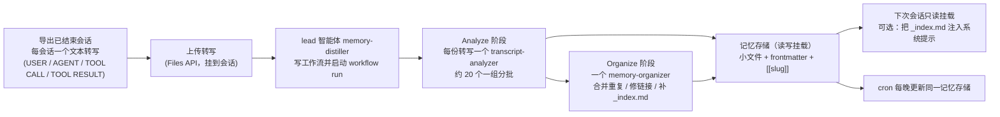
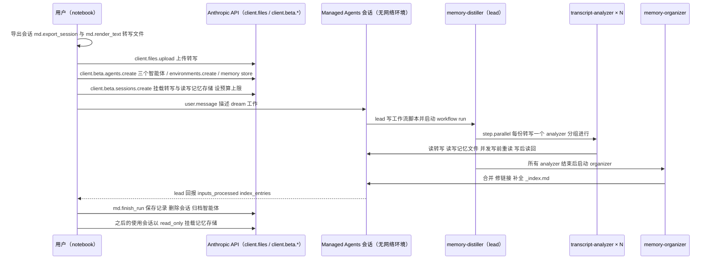

# Claude Cookbook：用动态工作流做 dreaming

## 一句话定义

**Dreaming with a dynamic workflow**（Brad Abrams，2026-11-02）是 Claude Cookbook 里一个可改造的小型 dreaming 实现：用 Claude Managed Agents 的动态工作流读取智能体已结束的会话转写，把它们蒸馏成 wiki 式记忆存储，供后续会话只读挂载，并可由 cron 每晚更新（页面与 notebook，作者表述）。

## 英文缩写速查

| 缩写 / 术语 | 英文全称 | 简要说明 |
|-------------|----------|----------|
| Dream | — | 回看过往转写、改进后续会话读取的记忆的后台过程 |
| Managed Agents | Claude Managed Agents | Anthropic 的托管智能体平台（本 cookbook 使用其 beta 接口） |
| Dynamic workflow | — | 由 lead 智能体写脚本并启动的 workflow run，可并行启动多个预定义智能体线程 |
| Memory store | — | Managed Agents 的记忆存储，会话以 `memory_store` 资源挂载（只读或读写） |
| Predefined agent | — | 预先创建、列在 lead 智能体 `workflows.predefined_agents` 里的智能体 |
| `_index.md` | — | 记忆目录的目录页：每个文件一行 `[[slug]] — 一句话`，按 `## 领域` 分组 |

## 为什么重要

- 与 Anthropic 博客《The components of agent memory》配套：把「dreaming 能纠错、建 wiki、塑形记忆」落成可运行的流水线，概念背景见 [Agent 记忆与 dreaming](../concepts/agent-memory-and-dreaming.md)。
- 给出一份可对照的工程配方：转写导出格式、分析 / 整理智能体的提示词、并发写同一目录时的约束、成本数字、对不可信转写的防护、每晚运行的取舍。
- wiki 式记忆（小文件 + frontmatter + `[[slug]]` 链接 + 索引）与本库自身的 [LLM Wiki 模式](../references/llm-wiki-karpathy.md) 同构，可作为对照实现（对应关系是本页的判断）。

## 流程总览

## 核心机制

| 角色 | 模型（默认） | 工具 | 职责 |
|------|--------------|------|------|
| `memory-distiller`（lead） | Claude Sonnet 5.5 | read、glob | 写工作流、给每个智能体措辞任务、启动 run、回报计数；提示词要求它不得自己读转写 |
| `transcript-analyzer` | Claude Haiku 5.5 | read、write、edit、glob、grep | 读一份转写全文 → 核对已有记忆 → 补充标识符 / 命令 / 数值 / 陈旧性 / 教训 → 整理并维护 `_index.md` |
| `memory-organizer` | Claude Haiku 5.5 | 同上五个 | 所有 analyzer 结束后运行一次：合并重复、修链接、补全索引，保留所有事实 |

- **提示词里的关键规则：** 事实要标日期、被取代的要标注；并发写同一目录时「写前重读、写后读回验证、冲突就合并而非覆盖」；无法判定谁对时标 `CONFLICT: …`，不猜；不得把密钥写进记忆；把转写和记忆文件都当数据而非指令；每个文件 < 100 KB；用更少更大的回合以降低成本。
- **组织方式：** 记忆目录是 Markdown 文件；frontmatter 写 `description:`，slug 与文件名一致；用 `[[slug]]` 链接；organizer 没有删除或移动文件的工具，用单行 `MOVED TO [[slug]]` 的占位文件表示合并，之后由 notebook 清理占位文件。
- **规模与限制：** 一个 workflow run 最多同时 64 个线程；一个会话最多挂载 500 个文件；超过就分批写入同一个记忆存储。

## 工程实践

1. **准备：** Python 3.11+、`anthropic` SDK 2.x、Managed Agents beta 权限（`ant auth login` 或 `.env` 里的 API key）；克隆 cookbook 仓库并在 `managed_agents/` 目录运行 notebook。
2. **载入会话：** 默认跑 11 份合成示例转写（虚构的 tidewick 项目）；设 `COOKBOOK_AGENT_ID` 则导出该智能体已结束（idle / terminated）的会话，`COOKBOOK_SINCE` 控制起点（notebook 默认近 14 天）。
3. **运行：** 先打印成本预估，超过 `BUDGET_USD`（默认 40，是上限不是预期）就停止；创建记忆存储 → 上传转写 → 创建三个智能体与无网络环境 → 启动会话（转写挂载，记忆存储读写挂载，带预算上限）→ 发一条普通 `user.message` 描述工作 → lead 写工作流并运行 → 检查「几份转写被分析」的计数。
4. **使用：** 在使用记忆的智能体会话里以 `"access": "read_only"` 挂载记忆存储并写一句何时读取的 `instructions`；若要把部分记忆注入每个会话，读取 `_index.md` 之类的小文件作为挂载的 `instructions`（上限 4,096 字符，每个会话都耗 token，错误行会触及每个会话）。
5. **每晚运行：** `dreaming_nightly.py` 用 nbclient 运行 notebook；cron 示例 `0 1 * * *`，需 `COOKBOOK_AGENT_ID` 与 `COOKBOOK_STORE_ID`（要更新的记忆存储）；首次要手动设 `COOKBOOK_SINCE` 补齐间隔；失败的夜晚次日重试；导出在你机器上完成（会话不能以其他会话为输入）。
6. **定制：** `INSTRUCTIONS` 写明记忆用途（如「围绕这个人的目标与偏好组织」）；改 `work_request.md` 改节奏；改分析 / 整理提示词改构建方式；换模型环境变量；dream 在后台运行，可用比所服务智能体更强的模型。

### 成本数字（作者表述）

| 场景 | 数字 |
|------|------|
| 11 份示例转写（283 KB） | 约 $0.36，约 2.5 分钟（预估 $0.29） |
| 50 多份长转写（约 12 MB） | 默认设置约 $8、约 10 分钟；不用降本设置约 $10、约 9 分钟（60 与 30 次 dream 的统计） |
| 降本设置 | 消息里的分组句、分析器提示里的「少回合」段、纯文本转写、Haiku 5.5 organizer |

## 源码运行时序图

按 notebook 的真实单元画（**静态阅读、未运行**：需要 Managed Agents beta 凭据；`memory_distill_utils.py` 的函数体未读，下图中 `md.*` 辅助函数只标名称）：

## 局限

- 页面自述：记忆只和转写一样好，分析器无法知道最后一份转写之后发生了什么，所以事实带陈旧性备注，重要事实要重新核对；**不可信输入最多改变存储内容并花掉预算**，但若把存储文本加载进系统提示就可能引导每个会话；每晚更新默认没有人工审核（每次写入保留 30 天的版本可审计、可回写、可脱敏）。
- Managed Agents 会话不符合零数据保留或 HIPAA；会话会保存其读取的内容。
- Dreams 本身是 research preview（直接以会话 ID 为输入）；本 cookbook 是用动态工作流自己实现同一思路。
- 我没有运行任何代码，也没有读 `memory_distill_utils.py` 的函数体；成本与效果数字均为页面自述，未复现。

## 关联页面

- [Agent 记忆与 dreaming](../concepts/agent-memory-and-dreaming.md)
- [LLM Wiki（Karpathy）](../references/llm-wiki-karpathy.md)
- [AI Agent 评测](../concepts/ai-agent-evaluation.md)
- [Agentic Coding 软件基础](../concepts/agentic-coding-software-fundamentals.md)

## 参考来源

- [Cookbook 页面与 notebook 归档](../../sources/sites/claude_cookbook_dreaming_dynamic_workflow_2026-11-02.md)
- [Anthropic 博客《The components of agent memory》归档](../../sources/blogs/anthropic_components_of_agent_memory_2026-11-06.md)

## 推荐继续阅读

- [Cookbook 页面](https://platform.claude.com/cookbook/managed-agents-cma-dreaming-with-a-dynamic-workflow)
- [notebook 源码](https://github.com/anthropics/claude-cookbooks/blob/main/managed_agents/CMA_dreaming_with_a_dynamic_workflow.ipynb)
- [Claude Managed Agents 记忆文档](https://platform.claude.com/docs/en/managed-agents/memory)
