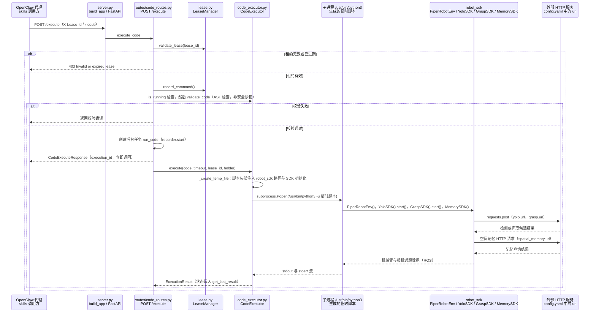

# ABot-Claw

## 一句话定义

**ABot-Claw** 是 [阿里巴巴](https://github.com/amap-cvlab) 公开的 **VLA/操作模型** 开源项目：统一 VLN、VLA、WAM 与视觉记忆的持续协作机器人框架

## 英文缩写速查

| 缩写 | 英文全称 | 简要说明 |
|------|----------|----------|
| SDK | Software Development Kit | 真机控制与状态读取接口 |
| RL | Reinforcement Learning | 强化学习训练与策略优化 |
| VLA | Vision-Language-Action | 视觉–语言–动作统一策略 |
| Sim2Real | Simulation to Real | 仿真策略迁移真机 |
| URDF | Unified Robot Description Format | 机器人描述与仿真资产 |

## 为什么重要

- 收录于 [国内具身智能开源全景（76 家 · 424 项）](../overview/china-domestic-embodied-opensource-76-companies-technology-map.md) 的 **第四层** 分组。
- 与 [Humanoid Motion Intelligence](../entities/humanoid-motion-intelligence.md) 同源策展；本页为 **独立详情节点**，便于从公司清单跳到机制与入口说明。

## 核心原理

| 字段 | 内容 |
|------|------|
| 机构 | 阿里巴巴 |
| 类别 | VLA/操作模型 |
| 官方组织 | https://github.com/amap-cvlab、https://github.com/alibaba-damo-academy |

## 工程实践

1. 从官方 GitHub/Gitee 组织检索 `ABot-Claw` 仓库并核对 README 许可与依赖。
2. 对照本库 [424 项覆盖索引](../queries/china-domestic-opensource-424-coverage.md) 查看同公司其它入口是否共用训练/部署链路。
3. 若与既有方法页（如 RL 框架、VLA、SDK）主题相同，优先读关联页中的「开源入口」小节，避免重复维护平行叙事。

## 局限与风险

- 公众号清单为 **策展快照**（2026-09-06）；仓库更名、归档或许可证变化须回官方组织页核实。
- **开源状态**：以仓库 README 与 release 为准（入库日按文章描述归纳，未逐仓 clone 验证）。

## 源码运行时序图

范围说明：本图只覆盖机器人侧 agent server（`robot_layer/arm_piper/agent_server`）的代码执行链路。OpenClaw 侧的技能与服务侧（`service_layer`）只在图中以外部 HTTP 服务出现，未逐一展开。

入口：`cd robot_layer/arm_piper/agent_server && python3 server.py --host 0.0.0.0 --port 8888`（先 `pip3 install -r requirements.txt`；`server.py` 的 `main()` 支持 `--dry-run`，不连接真机）

图依据：amap-cvlab/ABot-Claw@39c9ffc，读过 `README.md`、`robot_layer/arm_piper/agent_server/server.py`（`build_app`、`main`、路由注册）、`robot_layer/arm_piper/agent_server/routes/code_routes.py`（`/execute`、`/validate`、后台任务）、`robot_layer/arm_piper/agent_server/code_executor.py`（`CodeValidator`、`execute`、`_create_temp_file` 的脚本模板）、`robot_layer/arm_piper/agent_server/lease.py`（`validate_lease`、`record_command`）、`robot_layer/arm_piper/agent_server/robot_sdk/yolo_sdk.py`、`robot_layer/arm_piper/agent_server/robot_sdk/grasp_sdk.py`（HTTP 请求）、`robot_layer/arm_piper/agent_server/robot_sdk/memory_sdk.py`（`base_url`）、`robot_layer/arm_piper/agent_server/robot_sdk/config.yaml`。`PiperRobotEnv` 的 ROS 细节、`MemorySDK` 的具体查询接口、OpenClaw 技能与 `service_layer` 服务未逐行核对；未运行代码。

## 关联页面

- [国内具身开源全景技术地图](../overview/china-domestic-embodied-opensource-76-companies-technology-map.md)
- [HMI 开源项目主表导读](../queries/hmi-opensource-projects-coverage.md)
- [Humanoid Motion Intelligence](../entities/humanoid-motion-intelligence.md)

## 参考来源

- [ABot-Claw 源码归档](../../sources/repos/abot-claw.md)（<https://github.com/amap-cvlab/ABot-Claw>）

- [国内具身智能开源全景（微信公众号）](../../sources/blogs/wechat_embodied_station_domestic_opensource_panorama_2026-09-06.md)
- 源码核对（2026-11-02）：amap-cvlab/ABot-Claw@39c9ffc，读过 README.md、robot_layer/arm_piper/agent_server/server.py、robot_layer/arm_piper/agent_server/routes/code_routes.py、robot_layer/arm_piper/agent_server/code_executor.py、robot_layer/arm_piper/agent_server/lease.py、robot_layer/arm_piper/agent_server/robot_sdk/yolo_sdk.py、robot_layer/arm_piper/agent_server/robot_sdk/grasp_sdk.py、robot_layer/arm_piper/agent_server/robot_sdk/memory_sdk.py、robot_layer/arm_piper/agent_server/robot_sdk/config.yaml；时序图依据以上文件，未运行代码。

## 推荐继续阅读

- [阿里巴巴 官方组织](https://github.com/amap-cvlab)
