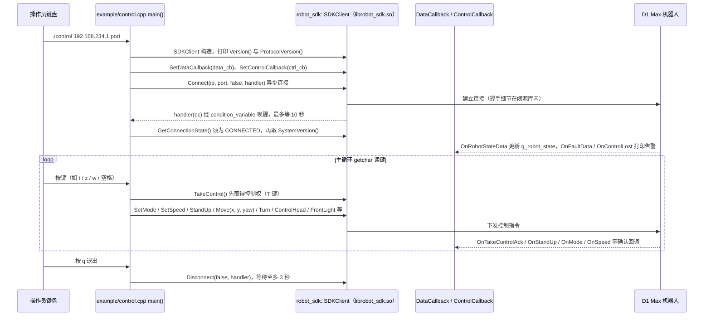

# Agibot_D1_Max

## 一句话定义

**Agibot_D1_Max** 是 [智元机器人](https://github.com/AgibotTech) 公开的 **SDK/驱动** 开源项目：C++ SDK通过高层运动接口、状态回调和模式切换连接D1 Max本体，仓库同时提供头文件、示例、URDF和按架构编译的动态库；系统版本与SDK兼容表决定哪些接口可以使用。

## 英文缩写速查

| 缩写 | 英文全称 | 简要说明 |
|------|----------|----------|
| SDK | Software Development Kit | 真机控制与状态读取接口 |
| RL | Reinforcement Learning | 强化学习训练与策略优化 |
| VLA | Vision-Language-Action | 视觉–语言–动作统一策略 |
| Sim2Real | Simulation to Real | 仿真策略迁移真机 |
| URDF | Unified Robot Description Format | 机器人描述与仿真资产 |

## 为什么重要

- 收录于 [国内具身智能开源全景（76 家 · 424 项）](../overview/china-domestic-embodied-opensource-76-companies-technology-map.md) 的 **第一层** 分组。
- 与 [Humanoid Motion Intelligence](../entities/humanoid-motion-intelligence.md) 同源策展；本页为 **独立详情节点**，便于从公司清单跳到机制与入口说明。

## 核心原理

| 字段 | 内容 |
|------|------|
| 机构 | 智元机器人 |
| 类别 | SDK/驱动 |
| 官方组织 | https://github.com/AgibotTech、https://github.com/AimRT、https://github.com/OpenDriveLab |

## 工程实践

1. 从官方 GitHub/Gitee 组织检索 `Agibot_D1_Max` 仓库并核对 README 许可与依赖。
2. 对照本库 [424 项覆盖索引](../queries/china-domestic-opensource-424-coverage.md) 查看同公司其它入口是否共用训练/部署链路。
3. 若与既有方法页（如 RL 框架、VLA、SDK）主题相同，优先读关联页中的「开源入口」小节，避免重复维护平行叙事。

## 局限与风险

- 公众号清单为 **策展快照**（2026-09-06）；仓库更名、归档或许可证变化须回官方组织页核实。
- **开源状态**：以仓库 README 与 release 为准（入库日按文章描述归纳，未逐仓 clone 验证）。

## 源码运行时序图

入口：`cd example && mkdir build && cd build && cmake .. && make -j6`，随后 `./control <ip> <port>`（交互遥控示例；机器人默认 IP 为 `192.168.234.1`）。仓库公开的是头文件 `include/robot_sdk/*.hpp`、示例 `example/*.cpp` 与预编译的 `lib/<arch>/librobot_sdk.so`；SDK 内部的协议与运动控制在闭源动态库中，以下只画示例代码对公开接口的调用，不推断库内部实现。

图依据：AgibotTech/Agibot_D1_Max@83bdebb，读过 `README.md`、`ubuntu22.04(x86_64_arm64)/RobotSDK-0.1.1/example/control.cpp`、`example/sync.cpp`（前 120 行）、`example/CMakeLists.txt`、`include/robot_sdk/sdk_client.hpp`（仅 grep 接口签名）。其余示例（async、auto_reconnect、data、take_control 等）与 `docs/source` 文档未逐一读；`urdf/` 为机器人描述，不在本图范围。

## 关联页面

- [国内具身开源全景技术地图](../overview/china-domestic-embodied-opensource-76-companies-technology-map.md)
- [HMI 开源项目主表导读](../queries/hmi-opensource-projects-coverage.md)
- [Humanoid Motion Intelligence](../entities/humanoid-motion-intelligence.md)

## 参考来源

- [Agibot_D1_MaxPro 源码归档](../../sources/repos/agibot_d1_maxpro.md)（<https://github.com/AgibotTech/Agibot_D1_MaxPro>）

- [Agibot_D1_Max 源码归档](../../sources/repos/agibot_d1_max.md)（<https://github.com/AgibotTech/Agibot_D1_Max>）

- [国内具身智能开源全景（微信公众号）](../../sources/blogs/wechat_embodied_station_domestic_opensource_panorama_2026-09-06.md)
- 源码核对（2026-11-02）：AgibotTech/Agibot_D1_Max@83bdebb，读过 README.md、ubuntu22.04(x86_64_arm64)/RobotSDK-0.1.1/example/control.cpp、example/sync.cpp（前段）、example/CMakeLists.txt、include/robot_sdk/sdk_client.hpp（接口签名）；时序图依据以上文件，未运行代码。

## 推荐继续阅读

- [智元机器人 官方组织](https://github.com/AgibotTech)
