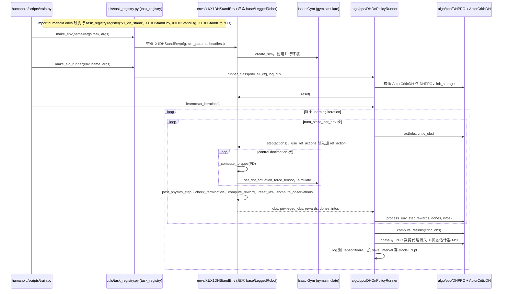

# agibot_x1_train

## 一句话定义

**agibot_x1_train** 是 [智元机器人](https://github.com/AgibotTech) 公开的 **运动RL/技能训练** 开源项目：并行 RL 运动训练框架（含仿真任务与策略导出链路）

## 英文缩写速查

| 缩写 | 英文全称 | 简要说明 |
|------|----------|----------|
| SDK | Software Development Kit | 真机控制与状态读取接口 |
| RL | Reinforcement Learning | 强化学习训练与策略优化 |
| VLA | Vision-Language-Action | 视觉–语言–动作统一策略 |
| Sim2Real | Simulation to Real | 仿真策略迁移真机 |
| URDF | Unified Robot Description Format | 机器人描述与仿真资产 |

## 为什么重要

- 收录于 [国内具身智能开源全景（76 家 · 424 项）](../overview/china-domestic-embodied-opensource-76-companies-technology-map.md) 的 **第一层** 分组。
- 与 [Humanoid Motion Intelligence](../entities/humanoid-motion-intelligence.md) 同源策展；本页为 **独立详情节点**，便于从公司清单跳到机制与入口说明。

## 核心原理

| 字段 | 内容 |
|------|------|
| 机构 | 智元机器人 |
| 类别 | 运动RL/技能训练 |
| 官方组织 | https://github.com/AgibotTech、https://github.com/AimRT、https://github.com/OpenDriveLab |

## 工程实践

1. 从官方 GitHub/Gitee 组织检索 `agibot_x1_train` 仓库并核对 README 许可与依赖。
2. 对照本库 [424 项覆盖索引](../queries/china-domestic-opensource-424-coverage.md) 查看同公司其它入口是否共用训练/部署链路。
3. 若与既有方法页（如 RL 框架、VLA、SDK）主题相同，优先读关联页中的「开源入口」小节，避免重复维护平行叙事。

## 局限与风险

- 公众号清单为 **策展快照**（2026-09-06）；仓库更名、归档或许可证变化须回官方组织页核实。
- **开源状态**：以仓库 README 与 release 为准（入库日按文章描述归纳，未逐仓 clone 验证）。

## 源码运行时序图

入口：`python scripts/train.py --task=x1_dh_stand --run_name=<run_name> --headless`（README 写法；仓库内文件实际位于 `humanoid/scripts/train.py`，需 Isaac Gym Preview 4 与 `pip install -e .`）。

下游脚本（只读过入口与关键调用，未画细节）：`play.py` 加载检查点回放，`export_policy_dh.py` / `export_onnx_dh.py` 导出 JIT / ONNX，`sim2sim.py` 用 `torch.jit.load` 载入策略后在 MuJoCo（`mujoco.mj_step`，`pd_control`）里跑。

图依据：AgibotTech/agibot_x1_train@e6651b9，读过 README.md、humanoid/scripts/train.py、humanoid/envs/__init__.py、humanoid/utils/task_registry.py、humanoid/algo/ppo/dh_on_policy_runner.py、humanoid/algo/ppo/dh_ppo.py（update 片段）、humanoid/envs/base/legged_robot.py（step / post_physics_step）、humanoid/envs/x1/x1_dh_stand_env.py（step 与函数清单）、humanoid/scripts/sim2sim.py（函数清单）。

## 关联页面

- [国内具身开源全景技术地图](../overview/china-domestic-embodied-opensource-76-companies-technology-map.md)
- [HMI 开源项目主表导读](../queries/hmi-opensource-projects-coverage.md)
- [Humanoid Motion Intelligence](../entities/humanoid-motion-intelligence.md)

## 参考来源

- [agibot_x1_train 源码归档](../../sources/repos/agibot_x1_train.md)（<https://github.com/AgibotTech/agibot_x1_train>）

- [国内具身智能开源全景（微信公众号）](../../sources/blogs/wechat_embodied_station_domestic_opensource_panorama_2026-09-06.md)

- 源码核对（2026-11-02）：AgibotTech/agibot_x1_train@e6651b9，读过 README.md、humanoid/scripts/train.py、humanoid/envs/__init__.py、humanoid/utils/task_registry.py、humanoid/algo/ppo/dh_on_policy_runner.py、dh_ppo.py、humanoid/envs/base/legged_robot.py、humanoid/envs/x1/x1_dh_stand_env.py、humanoid/scripts/sim2sim.py；时序图依据以上文件，未运行代码。

## 推荐继续阅读

- [智元机器人 官方组织](https://github.com/AgibotTech)
