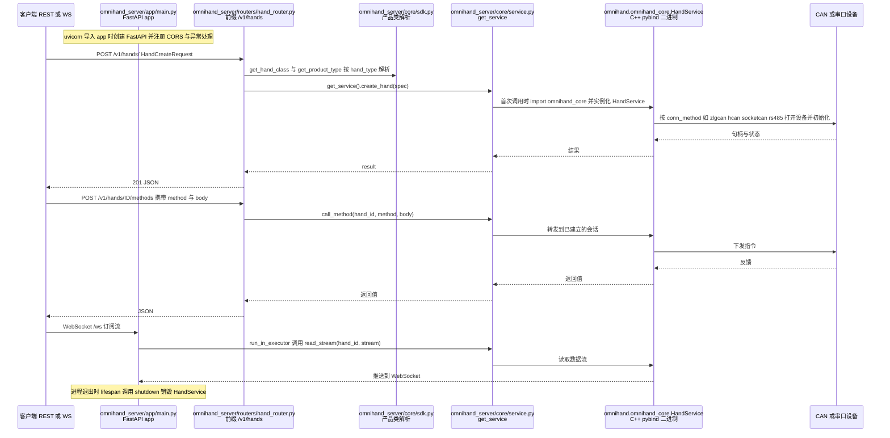

# agillink_omnihand_sdk

## 一句话定义

**agillink_omnihand_sdk** 是 [智元机器人](https://github.com/AgibotTech) 公开的 **SDK/驱动** 开源项目：官方 SDK：真机控制与状态读取的统一接入层

## 英文缩写速查

| 缩写 | 英文全称 | 简要说明 |
|------|----------|----------|
| SDK | Software Development Kit | 真机控制与状态读取接口 |
| RL | Reinforcement Learning | 强化学习训练与策略优化 |
| VLA | Vision-Language-Action | 视觉–语言–动作统一策略 |
| Sim2Real | Simulation to Real | 仿真策略迁移真机 |
| URDF | Unified Robot Description Format | 机器人描述与仿真资产 |

## 为什么重要

- 收录于 [国内具身智能开源全景（76 家 · 424 项）](../overview/china-domestic-embodied-opensource-76-companies-technology-map.md) 的 **第一层** 分组。
- 与 [Humanoid Motion Intelligence](../entities/humanoid-motion-intelligence.md) 同源策展；本页为 **独立详情节点**，便于从公司清单跳到机制与入口说明。

## 核心原理

| 字段 | 内容 |
|------|------|
| 机构 | 智元机器人 |
| 类别 | SDK/驱动 |
| 官方组织 | https://github.com/AgibotTech、https://github.com/AimRT、https://github.com/OpenDriveLab |

## 工程实践

1. 从官方 GitHub/Gitee 组织检索 `agillink_omnihand_sdk` 仓库并核对 README 许可与依赖。
2. 对照本库 [424 项覆盖索引](../queries/china-domestic-opensource-424-coverage.md) 查看同公司其它入口是否共用训练/部署链路。
3. 若与既有方法页（如 RL 框架、VLA、SDK）主题相同，优先读关联页中的「开源入口」小节，避免重复维护平行叙事。

## 局限与风险

- 公众号清单为 **策展快照**（2026-09-06）；仓库更名、归档或许可证变化须回官方组织页核实。
- **开源状态**：以仓库 README 与 release 为准（入库日按文章描述归纳，未逐仓 clone 验证）。

## 源码运行时序图

入口：在 `linux/x64/` 目录下执行 `PYTHONPATH=python uvicorn omnihand_server.app.main:app --reload --port 8000`（REST/WS 服务路径）。另有直接调用 SDK 的 demo：`python python/demo/omnihand_2025/demo_set_angle.py -d zlgcan`，其调用链为 demo 直接 `from omnihand import OmniHand2025`，不经过服务层，本图未展开。

说明：仓库内 `omnihand` 原生模块仅以 `python/*.whl` 与 `cpp/include`、`cpp/lib` 形式提供，C++ 核心实现源码不在仓库内，图中 `HandService` 段仅记录 Python 侧可见的调用边界。

图依据：AgibotTech/agillink_omnihand_sdk@1b552ea，读过 linux/x64/python/omnihand_server/app/main.py、routers/hand_router.py、core/service.py、core/sdk.py（函数列表）、linux/x64/python/omnihand_server/readme.md、linux/x64/python/demo/omnihand_2025/demo_set_angle.py、doc/en/QUICK_START.md；routers/ws.py 仅读取 read_stream 调用行。

## 关联页面

- [国内具身开源全景技术地图](../overview/china-domestic-embodied-opensource-76-companies-technology-map.md)
- [HMI 开源项目主表导读](../queries/hmi-opensource-projects-coverage.md)
- [Humanoid Motion Intelligence](../entities/humanoid-motion-intelligence.md)

## 参考来源

- [agillink_omnihand_sdk 源码归档](../../sources/repos/agillink_omnihand_sdk.md)（<https://github.com/AgibotTech/agillink_omnihand_sdk>）

- [国内具身智能开源全景（微信公众号）](../../sources/blogs/wechat_embodied_station_domestic_opensource_panorama_2026-09-06.md)
- 源码核对（2026-11-02）：AgibotTech/agillink_omnihand_sdk@1b552ea，读过 linux/x64/python/omnihand_server/app/main.py、routers/hand_router.py、core/service.py、core/sdk.py、readme.md、linux/x64/python/demo/omnihand_2025/demo_set_angle.py、doc/en/QUICK_START.md；时序图依据以上文件，未运行代码。

## 推荐继续阅读

- [智元机器人 官方组织](https://github.com/AgibotTech)
