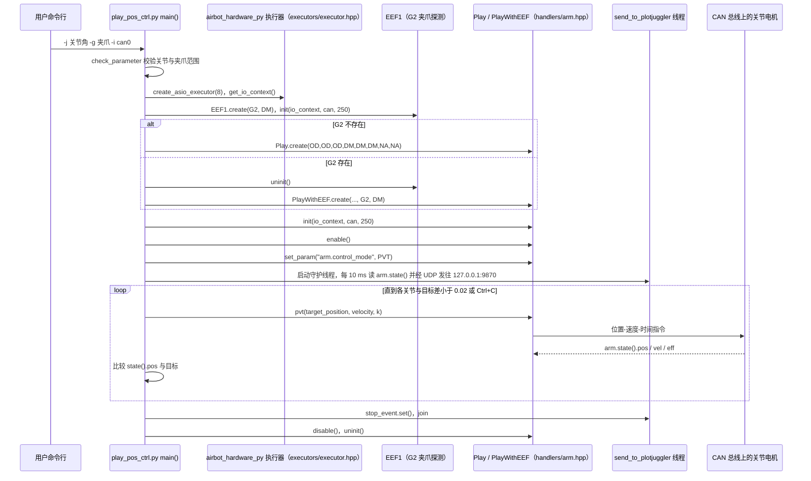

# AIRBOT-Play-Hardware

## 一句话定义

**AIRBOT-Play-Hardware** 是 [求之科技](https://github.com/discoverse-dev) 公开的 **本体模型资产** 开源项目：AIRBOT Play 双臂硬件开源包

## 英文缩写速查

| 缩写 | 英文全称 | 简要说明 |
|------|----------|----------|
| SDK | Software Development Kit | 真机控制与状态读取接口 |
| RL | Reinforcement Learning | 强化学习训练与策略优化 |
| VLA | Vision-Language-Action | 视觉–语言–动作统一策略 |
| Sim2Real | Simulation to Real | 仿真策略迁移真机 |
| URDF | Unified Robot Description Format | 机器人描述与仿真资产 |

## 为什么重要

- 收录于 [国内具身智能开源全景（76 家 · 424 项）](../overview/china-domestic-embodied-opensource-76-companies-technology-map.md) 的 **第二层** 分组。
- 与 [Humanoid Motion Intelligence](../entities/humanoid-motion-intelligence.md) 同源策展；本页为 **独立详情节点**，便于从公司清单跳到机制与入口说明。

## 核心原理

| 字段 | 内容 |
|------|------|
| 机构 | 求之科技 |
| 类别 | 本体模型资产 |
| 官方组织 | https://github.com/discoverse-dev、https://github.com/DISCOVER-Robotics |

## 工程实践

1. 从官方 GitHub/Gitee 组织检索 `AIRBOT-Play-Hardware` 仓库并核对 README 许可与依赖。
2. 对照本库 [424 项覆盖索引](../queries/china-domestic-opensource-424-coverage.md) 查看同公司其它入口是否共用训练/部署链路。
3. 若与既有方法页（如 RL 框架、VLA、SDK）主题相同，优先读关联页中的「开源入口」小节，避免重复维护平行叙事。

## 局限与风险

- 公众号清单为 **策展快照**（2026-09-06）；仓库更名、归档或许可证变化须回官方组织页核实。
- **开源状态**：以仓库 README 与 release 为准（入库日按文章描述归纳，未逐仓 clone 验证）。

## 源码运行时序图

入口：`python example/python/product/play_pos_ctrl.py -j <6个关节角> [-g 夹爪] [-i can0]`（仓库内最直接的 Python 示例；底层驱动 `airbot_hardware_py` 以 `.deb`/`.whl` 二进制分发，仓库只含头文件 `airbot_hardware/` 与示例，驱动内部实现未公开，下图只画示例脚本与头文件接口层面的调用）

图依据：DISCOVER-Robotics/AIRBOT-Play-Hardware@56ea490，读过 `README.md`、`example/python/product/play_pos_ctrl.py`、`example/python/product/play_mit_swing.py`（开头部分）、`airbot_hardware/handlers/arm.hpp`、`airbot_hardware/executors/executor.hpp`（仅接口声明）；`pvt` 内部到 CAN 帧的转换为闭源二进制，图中 `A->>HW` 与 `HW-->>A` 依 README 通讯流程说明与 `arm.hpp` 的接口注释推断，非源码可见。

## 关联页面

- [国内具身开源全景技术地图](../overview/china-domestic-embodied-opensource-76-companies-technology-map.md)
- [HMI 开源项目主表导读](../queries/hmi-opensource-projects-coverage.md)
- [Humanoid Motion Intelligence](../entities/humanoid-motion-intelligence.md)

## 参考来源

- [AIRBOT-Play-Hardware 源码归档](../../sources/repos/airbot-play-hardware.md)（<https://github.com/DISCOVER-Robotics/AIRBOT-Play-Hardware>）

- [国内具身智能开源全景（微信公众号）](../../sources/blogs/wechat_embodied_station_domestic_opensource_panorama_2026-09-06.md)
- 源码核对（2026-11-02）：DISCOVER-Robotics/AIRBOT-Play-Hardware@56ea490，读过 README.md、example/python/product/play_pos_ctrl.py、example/python/product/play_mit_swing.py（开头部分）、airbot_hardware/handlers/arm.hpp、airbot_hardware/executors/executor.hpp；时序图依据以上文件，未运行代码。

## 推荐继续阅读

- [求之科技 官方组织](https://github.com/discoverse-dev)
