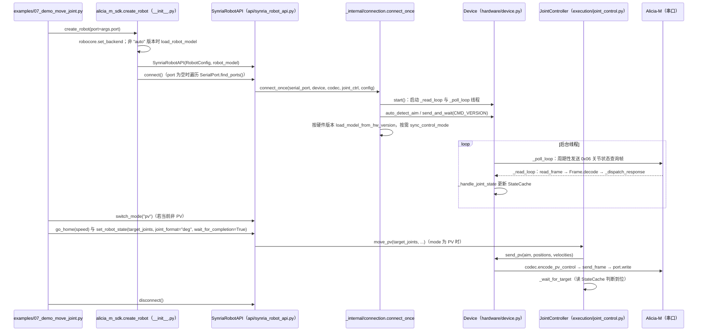

# Alicia-M-SDK

## 一句话定义

**Alicia-M-SDK** 是 [玄雅科技](https://github.com/Synria-Robotics) 公开的 **SDK/驱动** 开源项目：Alicia-M 机械臂 SDK

## 英文缩写速查

| 缩写 | 英文全称 | 简要说明 |
|------|----------|----------|
| SDK | Software Development Kit | 真机控制与状态读取接口 |
| RL | Reinforcement Learning | 强化学习训练与策略优化 |
| VLA | Vision-Language-Action | 视觉–语言–动作统一策略 |
| Sim2Real | Simulation to Real | 仿真策略迁移真机 |
| URDF | Unified Robot Description Format | 机器人描述与仿真资产 |

## 为什么重要

- 收录于 [国内具身智能开源全景（76 家 · 424 项）](../overview/china-domestic-embodied-opensource-76-companies-technology-map.md) 的 **第五层** 分组。
- 与 [Humanoid Motion Intelligence](../entities/humanoid-motion-intelligence.md) 同源策展；本页为 **独立详情节点**，便于从公司清单跳到机制与入口说明。

## 核心原理

| 字段 | 内容 |
|------|------|
| 机构 | 玄雅科技 |
| 类别 | SDK/驱动 |
| 官方组织 | https://github.com/Synria-Robotics |

## 工程实践

1. 从官方 GitHub/Gitee 组织检索 `Alicia-M-SDK` 仓库并核对 README 许可与依赖。
2. 对照本库 [424 项覆盖索引](../queries/china-domestic-opensource-424-coverage.md) 查看同公司其它入口是否共用训练/部署链路。
3. 若与既有方法页（如 RL 框架、VLA、SDK）主题相同，优先读关联页中的「开源入口」小节，避免重复维护平行叙事。

## 局限与风险

- 公众号清单为 **策展快照**（2026-09-06）；仓库更名、归档或许可证变化须回官方组织页核实。
- **开源状态**：以仓库 README 与 release 为准（入库日按文章描述归纳，未逐仓 clone 验证）。

## 源码运行时序图

入口：`python examples/07_demo_move_joint.py --port <串口>`（Python SDK，PV 模式关节运动示例；所有示例均从 `alicia_m_sdk.create_robot()` 起步）。

图依据：Synria-Robotics/Alicia-M-SDK@52dc617，读过 docs/ARCHITECTURE.md（开头，标注为历史文档）、examples/07_demo_move_joint.py、alicia_m_sdk/__init__.py、api/synria_robot_api.py、execution/joint_control.py、hardware/device.py、_internal/connection.py（后四者为部分阅读，未读 serial_port.py、codec.py、frame.py）。

## 关联页面

- [国内具身开源全景技术地图](../overview/china-domestic-embodied-opensource-76-companies-technology-map.md)
- [HMI 开源项目主表导读](../queries/hmi-opensource-projects-coverage.md)
- [Humanoid Motion Intelligence](../entities/humanoid-motion-intelligence.md)

## 参考来源

- [Alicia-M-SDK 源码归档](../../sources/repos/alicia-m-sdk.md)（<https://github.com/Synria-Robotics/Alicia-M-SDK>）

- [国内具身智能开源全景（微信公众号）](../../sources/blogs/wechat_embodied_station_domestic_opensource_panorama_2026-09-06.md)
- 源码核对（2026-11-02）：Synria-Robotics/Alicia-M-SDK@52dc617，读过 examples/07_demo_move_joint.py、alicia_m_sdk/__init__.py、alicia_m_sdk/api/synria_robot_api.py、alicia_m_sdk/execution/joint_control.py、alicia_m_sdk/hardware/device.py、alicia_m_sdk/_internal/connection.py（后四者为部分阅读）；时序图依据以上文件，未运行代码。

## 推荐继续阅读

- [玄雅科技 官方组织](https://github.com/Synria-Robotics)
