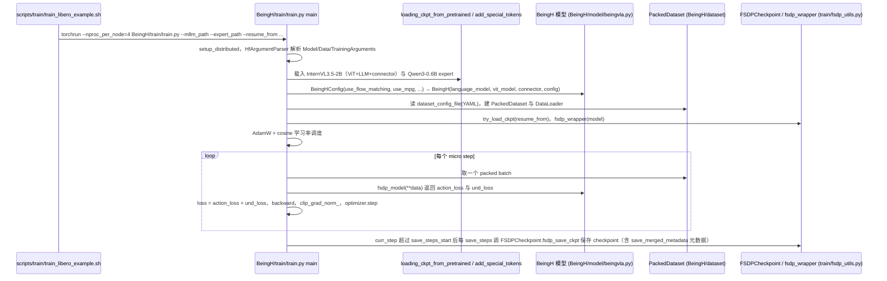
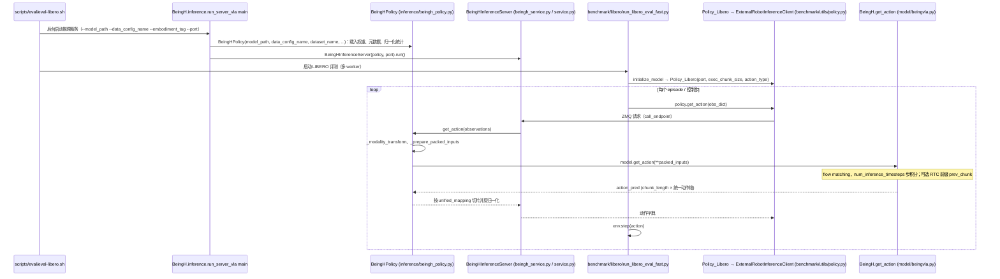

# Being-H

## 一句话定义

**Being-H** 是 [智在无界](https://github.com/BeingBeyond) 公开的 **VLA/操作模型** 开源项目：从大规模第一视角人类操作视频学习手部动作和任务结构，再通过目标机器人数据适配到灵巧手操作；仓库连接非本体预训练、动作表示和真机后训练。

## 英文缩写速查

| 缩写 | 英文全称 | 简要说明 |
|------|----------|----------|
| SDK | Software Development Kit | 真机控制与状态读取接口 |
| RL | Reinforcement Learning | 强化学习训练与策略优化 |
| VLA | Vision-Language-Action | 视觉–语言–动作统一策略 |
| Sim2Real | Simulation to Real | 仿真策略迁移真机 |
| URDF | Unified Robot Description Format | 机器人描述与仿真资产 |

## 为什么重要

- 收录于 [国内具身智能开源全景（76 家 · 424 项）](../overview/china-domestic-embodied-opensource-76-companies-technology-map.md) 的 **第二层** 分组。
- 与 [Humanoid Motion Intelligence](../entities/humanoid-motion-intelligence.md) 同源策展；本页为 **独立详情节点**，便于从公司清单跳到机制与入口说明。

## 核心原理

| 字段 | 内容 |
|------|------|
| 机构 | 智在无界 |
| 类别 | VLA/操作模型（原清单归为「数据集/Benchmark」；仓库描述为 Human-centric embodied foundation model family，官网 Being-H0.5 / H0.7 均指向此仓库，2026-10-12 核对） |
| 官方组织 | https://github.com/BeingBeyond |

## 工程实践

1. 从官方 GitHub/Gitee 组织检索 `Being-H` 仓库并核对 README 许可与依赖。
2. 对照本库 [424 项覆盖索引](../queries/china-domestic-opensource-424-coverage.md) 查看同公司其它入口是否共用训练/部署链路。
3. 若与既有方法页（如 RL 框架、VLA、SDK）主题相同，优先读关联页中的「开源入口」小节，避免重复维护平行叙事。

## 局限与风险

- 公众号清单为 **策展快照**（2026-09-06）；仓库更名、归档或许可证变化须回官方组织页核实。
- **开源状态**：以仓库 README 与 release 为准（入库日按文章描述归纳，未逐仓 clone 验证）。

## 源码运行时序图

仓库含 `Being-H05/`（H0.5，VLA，含训练 / 推理 / 评测代码）与 `Being-H07/`（目前只有 README，无代码）。以下两图均只针对 `Being-H05/`。

训练入口：`bash scripts/train/train_libero_example.sh`（内部 `torchrun ... BeingH/train/train.py`）

评测 / 推理入口：`bash scripts/eval/eval-libero.sh`（脚本先起 `python -u -m BeingH.inference.run_server_vla`，再起 `python -m BeingH.benchmark.libero.run_libero_eval_fast`）

图依据：BeingBeyond/Being-H@27ec67b，读过 `README.md`、`Being-H05/README.md`、`Being-H05/docs/inference.md`、`Being-H05/scripts/train/train_libero_example.sh`、`Being-H05/scripts/eval/eval-libero.sh`、`BeingH/train/train.py`（main）、`BeingH/inference/run_server_vla.py`、`beingh_policy.py`（get_action）、`beingh_service.py` / `service.py` 的类签名、`BeingH/benchmark/libero/run_libero_eval_fast.py` 与 `benchmark/utils/policy.py`（局部）、`BeingH/model/beingvla.py`（get_action 局部）。`BeingH.forward` 内部损失细节、MPG 实现、RoboCasa 评测与 `Being-H07` 未读。

## 关联页面

- [国内具身开源全景技术地图](../overview/china-domestic-embodied-opensource-76-companies-technology-map.md)
- [HMI 开源项目主表导读](../queries/hmi-opensource-projects-coverage.md)
- [Humanoid Motion Intelligence](../entities/humanoid-motion-intelligence.md)

## 参考来源

- [Being-H 源码归档](../../sources/repos/being-h.md)（<https://github.com/BeingBeyond/Being-H>）

- [国内具身智能开源全景（微信公众号）](../../sources/blogs/wechat_embodied_station_domestic_opensource_panorama_2026-09-06.md)
- 源码核对（2026-11-02）：BeingBeyond/Being-H@27ec67b，读过 README.md、Being-H05/README.md、Being-H05/docs/inference.md、scripts/train/train_libero_example.sh、scripts/eval/eval-libero.sh、BeingH/train/train.py（main）、BeingH/inference/run_server_vla.py 与 beingh_policy.py（get_action）、beingh_service.py、service.py、benchmark/libero/run_libero_eval_fast.py 与 benchmark/utils/policy.py（局部）、BeingH/model/beingvla.py（get_action 局部）、Being-H07/README.md；时序图依据以上文件，未运行代码。

## 推荐继续阅读

- [智在无界 官方组织](https://github.com/BeingBeyond)
