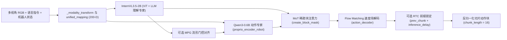
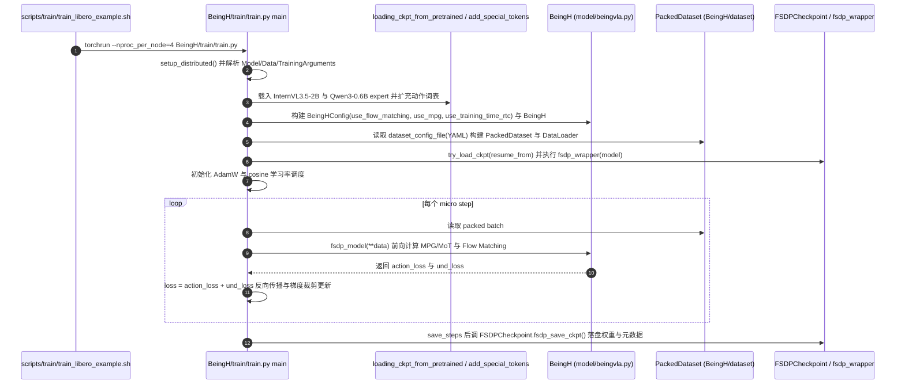
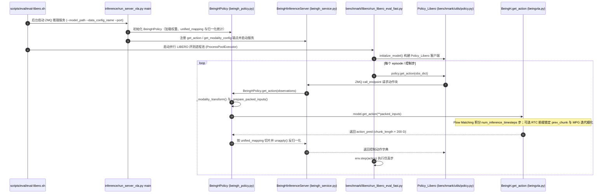

# Being-H

## 一句话定义

**Being-H** 是 [智在无界（BeingBeyond）](./beingbeyond.md) 的人形与灵巧操作 VLA 基础模型家族官方仓库，在 `main` 分支中提供了 **Being-H0.5** 完整代码（基于 MoT 架构、200 维统一动作空间、Flow Matching、MPG 与 Training-Time RTC 的训练与 ZMQ 推理评测栈），并聚合 **Being-H0**（`being-h0` 分支）、**Being-H0.7**（潜空间世界-动作模型项目入口）与教学教程 **Being-H-EDU**。

## 英文缩写速查

| 缩写 | 英文全称 | 简要说明 |
|------|----------|----------|
| VLA | Vision-Language-Action | 视觉-语言-动作统一基础模型 |
| MoT | Mixture-of-Transformers | `InternVL3.5-2B` 理解主干与 `Qwen3-0.6B` 动作专家双流架构 |
| UAC | Unified Action Space | `Being-H05` 用于跨本体对齐的 200 维统一状态/动作编码空间 |
| MPG | Manifold-Preserving Gating | 保持本体动作流形结构的门控最优传输对齐机制 |
| RTC | Real-Time Chunking | 推理期锁定前序动作片段前缀的实时动作块平滑策略 |
| MANO | hand Model with Articulated and Non-rigid defOrmations | `Being-H0` 从第一视角人类视频中提取的 3D 手部参数化表示 |

## 为什么重要

- **国内开源具身 VLA 的代表性工程栈**：同时收录于 [国内具身智能开源全景（76 家 · 424 项）](../overview/china-domestic-embodied-opensource-76-companies-technology-map.md) 与 [Humanoid Motion Intelligence](./humanoid-motion-intelligence.md) 策展主线，连接以人为中心的视频预训练与真机后训练闭环。
- **跨本体统一接口落地**：`Being-H05` 通过 `unified_mapping` 与 200 维状态/动作投影掩码（`action_valid_mask`），在同一模型权重大框架下兼容 LIBERO、RoboCasa、人手运动与多构型双臂/灵巧手任务。
- **训练-推理工程完整性高**：不仅提供 FSDP 大规模多卡训练入口，还内置 `BeingHInferenceServer`/`Client` ZMQ 解耦架构、Training-Time RTC 延时模拟训练以及教学版 `Being-H-EDU`。

## 核心原理

仓库目录与三代模型映射关系：

| 子目录 / 分支 | 对应论文 | 开源与代码现状（`@27ec67b`） | 核心机制 |
|---------------|----------|-------------------------------|----------|
| `being-h0` 分支 | [Being-H0](./paper-notebook-being-h0-vision-language-action-pretraining-from.md)（arXiv:2507.15597） | 独立分支托管 | UniHand 大规模人类操作视频预训练、弱透视物理空间对齐与 MANO 运动分词 |
| `Being-H05/` | [Being-H0.5](./paper-being-h05.md)（arXiv:2601.12993） | 已开源（含训练、FSDP 保存、ZMQ 推理与 LIBERO/RoboCasa 评测） | MoT 双专家、200 维统一动作空间、Flow Matching、MPG 对齐与 Training-Time RTC |
| `Being-H07/` | [Being-H0.7](./paper-rcl-2605-00078-being-h0-7-a-latent-world-action-model-from-egoc.md)（arXiv:2605.00078） | 目前仅含 `README.md`，训练与推理代码待发布 | 隐空间世界-动作模型（双分支 prior/posterior 打包注意力与反坍缩正则） |
| `tutorials/Being-H-EDU/` | — | 已开源教学指南 | 面向入门与高校教学的端到端微调和硬件适配步骤 |

## 源码运行时序图

仓库当前 `main` 分支的可运行代码主要位于 `Being-H05/`（`Being-H07/` 目前仅含 `README.md`）。

训练入口：`bash scripts/train/train_libero_example.sh`（内部执行 `torchrun ... BeingH/train/train.py`）。

评测与推理入口：`bash scripts/eval/eval-libero.sh`（后台启动 `python -u -m BeingH.inference.run_server_vla`，再启动 `python -m BeingH.benchmark.libero.run_libero_eval_fast`）。

## 工程实践

1. **微调与跨本体训练**
   - 参考 `Being-H05/scripts/train/train_libero_example.sh` 与 `train_cross_emb_example.sh`，准备 YAML 数据集配置并指定 `InternVL3.5-2B`（`--mllm_path`）与 `Qwen3-0.6B`（`--expert_path`）权重路径；`train.py` 会在 `--use_flow_matching` 开启时自动将 `action_token_num` 对齐到 `action_chunk_length`（默认 `16`）。
2. **解耦式 ZMQ 推理与并行基准评测**
   - 推荐直接沿用 `Being-H05/scripts/eval/eval-libero.sh` 与 `eval-robocasa.sh` 的 C/S 架构：将单卡/多卡大模型推理留在 `run_server_vla` 服务端，仿真环境 worker 通过 `ExternalRobotInferenceClient` 并发请求动作，避免仿真渲染与模型显存互相挤占。
   - 开启实时异步控制（RTC）时，客户端需在观测字典中传回上一周期的归一化统一动作块 `prev_chunk`（必须为模型 `unified_action_dim = 200` 维而非切片后的原始维度）及估算延时 `inference_delay`。
3. **教学入门路径**
   - 若面向教学复现或首次部署灵巧手硬件，建议先阅读 `tutorials/Being-H-EDU/README.md`，了解标定、遥操作数据转换与最小微调链路。

## 常见误区与局限

- **`Being-H07/` 尚无代码落地**：尽管 `Being-H07` 论文（arXiv:2605.00078）已公开发表且在主仓库设有子目录，但本地 `@27ec67b` 下 `Being-H07/` 仅包含 `README.md`，切勿将 `Being-H05/` 的单分支前向误当成 `H0.7` 的双分支潜世界-动作模型源码。
- **版本分布在多分支与多子目录**：`Being-H0` 原版实现位于 `being-h0` 分支而非 `main`；大规模 UniHand 2.0 跨本体人类视频预训练脚本在 `Being-H05/README.md` 中仍标注为待补充（TODO），当前主干脚本更偏向后训练微调与仿真评测。
- **RTC 输入维度陷阱**：调用 `BeingHPolicy.get_action()` 启用 `enable_rtc` 时，`prev_chunk` 必须是未切片的 200 维 `action_unified`（由上一步服务端返回值提供），传入原始机械臂低维关节向量会触发 `prev_chunk dimension mismatch` 异常。

## 关联页面

- 家族公司入口：[BeingBeyond（智在无界）](./beingbeyond.md)
- 家族三代论文实体：
  - [Being-H0（第一代人类视频预训练）](./paper-notebook-being-h0-vision-language-action-pretraining-from.md)
  - [Being-H0.5（统一动作空间 MoT VLA）](./paper-being-h05.md)
  - [Being-H0.7（潜空间世界-动作模型）](./paper-rcl-2605-00078-being-h0-7-a-latent-world-action-model-from-egoc.md)
- 开源全景图谱：[国内具身智能开源全景（76 家 · 424 项）](../overview/china-domestic-embodied-opensource-76-companies-technology-map.md)、[HMI 开源项目主表导读](../queries/hmi-opensource-projects-coverage.md)、[Humanoid Motion Intelligence](./humanoid-motion-intelligence.md)

## 参考来源

- [being-h.md](../../sources/repos/being-h.md)（`BeingBeyond/Being-H@27ec67b` 源码与家族论文核对归档）
- [being-h05_arxiv_2601_12993.md](../../sources/papers/being-h05_arxiv_2601_12993.md)（Being-H0.5 论文精读归档）
- [wechat_embodied_station_domestic_opensource_panorama_2026-09-06.md](../../sources/blogs/wechat_embodied_station_domestic_opensource_panorama_2026-09-06.md)

## 推荐继续阅读

- [BeingBeyond/Being-H 官方 GitHub 仓库](https://github.com/BeingBeyond/Being-H)
- [智在无界（BeingBeyond）GitHub 组织](https://github.com/BeingBeyond)
