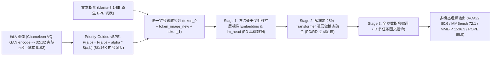
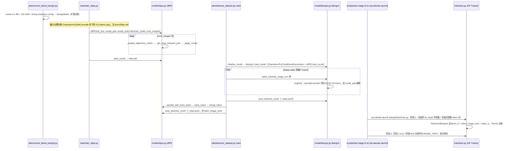

# Being-VL-0.5：基于视觉字节对编码（vBPE）的统一离散多模态理解模型

## 一句话定义

**Being-VL-0.5**（`arXiv:2506.23639`，ICCV 2025）是智在无界（BeingBeyond）开源的**全离散多模态理解大语言模型（MLLM）**（注：早先外部分类曾将其误标为“世界模型”，实则专注于多模态视觉-语言理解而非世界预测）：在 Llama-3.1-8B 词表内统一接入 VQ-GAN 图像离散码与**空间优先级视觉字节对编码（vBPE）**，无需连续 ViT+MLP 投影器即可取得高对齐度多模态理解表现。

## 英文缩写速查

| 缩写 | 英文全称 | 简要说明 |
|------|----------|----------|
| vBPE | Priority-Guided Visual Byte-Pair Encoding | 在标准 BPE 合并频次中注入空间邻接权重的新型二维视觉分词压缩算法 |
| VQ-GAN | Vector Quantized Generative Adversarial Network | 本作用于将图像编码为 32×32、码本 8192 的离散空间令牌前置模块 |
| MLLM | Multimodal Large Language Model | 将视觉感知与语言自回归推理统一在单一骨干中的多模态理解模型 |
| FD / PD / RD / ID | Foundational / Positional / Region-level / Instructional Data | 本作四级分层多模态理解课程训练配方 |

## 为什么重要

1. **证明「纯离散端到端令牌化」可追平连续 ViT 理解底座**：传统离散 MLLM（如早期 Chameleon / Being-VL-0）受限于每图上千个碎裂 VQ token 导致上下文冗余、空间关联弱（Being-VL-0 在 MMBench 仅 `44.0`）。vBPE 将相邻语义视觉块预先融合为短视觉子词，把 MMBench 直接推高至 **72.1**（VQAv2 **80.6**）。
2. **确立后续具身多模态理解底座演进起点**：虽不直接输出底层机器人控制律，但其与文本同构离散化的扩展词表训练与三阶段渐进解冻经验直接服务于公司上层视觉理解与语言指令接口。

## 核心原理

1. **Priority-Guided Visual Byte-Pair Encoding（vBPE）**：针对纯频次 BPE 会破坏图像二维空间邻近关系、优先合并孤立高频噪声的问题，设计带空间距离高斯核加权的合并优先级函数：
   $$P(a, b) = F(a, b) + \alpha \cdot S(a, b), \quad (\alpha=0.3, \sigma=2.0)$$
   从 Chameleon VQ-GAN（8192 码本）得到的 32×32 网格提取紧凑视觉子词，分别训练出 +8K 与 +16K 扩展词表版本，使每幅图像的平均视觉令牌数量与熵平衡显著改善。
2. **三阶段渐进解冻与四级课程数据**：
   - 课程配方划分为 **FD**（基础描述/概念对齐）、**PD**（位置/朝向感知）、**RD**（局部区域细节）、**ID**（复杂图文指令遵循）；
   - 训练采取渐进解冻：Stage 1 仅调新接入图像令牌头与 `lm_head` -> Stage 2 解冻前 **25% 浅层 Transformer** 促使浅层视觉局部特征混合 -> Stage 3 全参指令微调，抑制初期随机初始化视觉表征对 LLM 预训练知识的冲击。

## 工程实践

- **核心量化对比**：
  - `Being-VL-0.5-16K` 在 **VQAv2** 达 **80.6**（8K 版 `80.2`）、**MMBench** **72.1**（8K 版 `71.8`，相比无 vBPE 消融版 `38.2` 与前代 Being-VL-0 `44.0` 提升近一倍）、**MME-Perception** **1536.3**、**POPE** 幻觉测评 **86.0**。
- **开箱工程脚本管线（`BeingBeyond/Being-VL-0.5 @ e92ce36`）**：已全面开源 `convert_llama_beingvl.py`（扩展词表注入）、`train_vbpe.py`（邻接表迭代合并）、`tokenize_dataset.py`（离线 VQ + vBPE 预编码 `.jsonl`）、`train-stage-{1,2,3}.sh` 与 `eval_vqa.sh`，权重托管于 Hugging Face。

## 结论

**Being-VL-0.5 以空间加权视觉 BPE 解决了全离散多模态理解大模型 Token 碎裂与局部空间先验丢失的核心瓶颈，证明免连续编码器路线在多模态感知基准上的竞争力。**
- vBPE 的空间邻接项 $S(a,b)$ 是相对纯文本 BPE 移植最关键的机制（MMBench 消融增益 +33.9 分）；
- 三阶段从嵌入头 -> 25% 浅层 -> 全参渐进解冻避免了扩展新视觉词表导致的梯度灾难；
- 作为纯离散 VLM，目前定位为通用视觉语言理解底座，本身不包含机器人连续动作头或未来视频预测分支。

## 局限与风险

1. **固定低尺度网格重建细节极限**：前置 VQ-GAN 的 32×32 令牌化网格对极细小文字 OCR 或超高分辨率毫米级工业零件定位存在固有量化信息损失。
2. **定位边界为感知理解而非世界-动作执行**：不直接输出连续机械臂控制率（控制端见同公司 VLA 系列如 [Being-H0](paper-notebook-being-h0-vision-language-action-pretraining-from.md) / [Being-H0.7](../methods/being-h07.md)）。

## 源码运行时序图

入口（数据与训练链路，按 README / `docs/Data.md` 顺序）：`python beingvl/utils/convert_llama_beingvl.py` → `python beingvl/train/train_vbpe.py` → `python beingvl/utils/tokenize_dataset.py --mode pt|sft` → `bash beingvl/scripts/train-stage-{1,2,3}.sh 0`

推理入口：Python 中 `BeingVL(model_path, vbpe_path).load_model()`，然后调用 `generate_vq(prompts, images)`（VQ + vBPE 压缩 token 作为输入后 `model.generate`）。

图依据：BeingBeyond/Being-VL-0.5@e92ce36，读过 `README.md`、`pyproject.toml`、`docs/Data.md`、`docs/Inference.md`、`beingvl/scripts/train-stage-1.sh`（stage-2 的参数头部）、`beingvl/train/train.py`、`beingvl/train/train_vbpe.py`（仅函数列表）、`beingvl/model/beingvl.py`、`beingvl/model/vbpe.py`、`beingvl/utils/tokenize_dataset.py`（process_dataset 等）。`convert_llama_beingvl.py` 只读了函数结构（copy_model_files、load_and_convert_model、save_converted_model 等），未逐行读；仓库内置的修改版 `transformers/` 未读。

## 关联页面

- 所属机构实体：[智在无界（BeingBeyond）](beingbeyond.md)
- 上游具身视觉感知对比：[Being-H0](paper-notebook-being-h0-vision-language-action-pretraining-from.md) 与 [VIPA-VLA](cn-os-vipa-vla.md)
- [国内具身开源全景技术地图](../overview/china-domestic-embodied-opensource-76-companies-technology-map.md)
- [HMI 开源项目主表导读](../queries/hmi-opensource-projects-coverage.md)
- [Humanoid Motion Intelligence](../entities/humanoid-motion-intelligence.md)

## 参考来源

- 一手论文：`arXiv:2506.23639v1`（ICCV 2025）全文归档（[being-vl-0-5_arxiv_2506_23639.md](../../sources/papers/being-vl-0-5_arxiv_2506_23639.md)）
- 源码核对（2026-11-02）：`BeingBeyond/Being-VL-0.5@e92ce36`，读过 README.md、pyproject.toml、docs/Data.md、docs/Inference.md、beingvl/scripts/train-stage-1.sh 与 train-stage-2.sh（头部）、beingvl/train/train.py、beingvl/model/beingvl.py、beingvl/model/vbpe.py、beingvl/utils/tokenize_dataset.py、beingvl/utils/convert_llama_beingvl.py（函数结构），归档于 [being-vl-0_5.md](../../sources/repos/being-vl-0_5.md)；时序图依据以上文件，未运行代码。
- [国内具身智能开源全景（微信公众号）](../../sources/blogs/wechat_embodied_station_domestic_opensource_panorama_2026-09-06.md)

## 推荐继续阅读

- [arXiv:2506.23639 论文页面](https://arxiv.org/abs/2506.23639)
- [BeingBeyond/Being-VL-0.5 GitHub 仓库](https://github.com/BeingBeyond/Being-VL-0.5)
- [Being-VL-0.5 官方项目主页](https://beingbeyond.github.io/Being-VL-0.5/)
