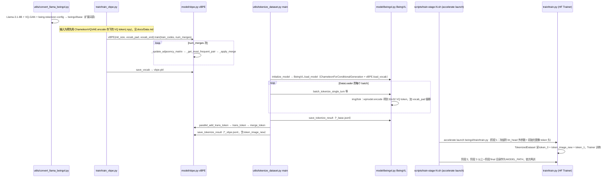

# Being-VL-0.5

## 一句话定义

**Being-VL-0.5** 是 [智在无界](https://github.com/BeingBeyond) 公开的 **世界模型** 开源项目：世界模型/预测模型：按条件生成未来状态，服务训练与评测

## 英文缩写速查

| 缩写 | 英文全称 | 简要说明 |
|------|----------|----------|
| SDK | Software Development Kit | 真机控制与状态读取接口 |
| RL | Reinforcement Learning | 强化学习训练与策略优化 |
| VLA | Vision-Language-Action | 视觉–语言–动作统一策略 |
| Sim2Real | Simulation to Real | 仿真策略迁移真机 |
| URDF | Unified Robot Description Format | 机器人描述与仿真资产 |

## 为什么重要

- 收录于 [国内具身智能开源全景（76 家 · 424 项）](../overview/china-domestic-embodied-opensource-76-companies-technology-map.md) 的 **第二层** 分组。
- 与 [Humanoid Motion Intelligence](../entities/humanoid-motion-intelligence.md) 同源策展；本页为 **独立详情节点**，便于从公司清单跳到机制与入口说明。

## 核心原理

| 字段 | 内容 |
|------|------|
| 机构 | 智在无界 |
| 类别 | 世界模型 |
| 官方组织 | https://github.com/BeingBeyond |

## 工程实践

1. 从官方 GitHub/Gitee 组织检索 `Being-VL-0.5` 仓库并核对 README 许可与依赖。
2. 对照本库 [424 项覆盖索引](../queries/china-domestic-opensource-424-coverage.md) 查看同公司其它入口是否共用训练/部署链路。
3. 若与既有方法页（如 RL 框架、VLA、SDK）主题相同，优先读关联页中的「开源入口」小节，避免重复维护平行叙事。

## 局限与风险

- 公众号清单为 **策展快照**（2026-09-06）；仓库更名、归档或许可证变化须回官方组织页核实。
- **开源状态**：以仓库 README 与 release 为准（入库日按文章描述归纳，未逐仓 clone 验证）。

## 源码运行时序图

入口（数据与训练链路，按 README / `docs/Data.md` 顺序）：`python beingvl/utils/convert_llama_beingvl.py` → `python beingvl/train/train_vbpe.py` → `python beingvl/utils/tokenize_dataset.py --mode pt|sft` → `bash beingvl/scripts/train-stage-{1,2,3}.sh 0`

推理入口：Python 中 `BeingVL(model_path, vbpe_path).load_model()`，然后调用 `generate_vq(prompts, images)`（VQ + vBPE 压缩 token 作为输入后 `model.generate`）。

图依据：BeingBeyond/Being-VL-0.5@e92ce36，读过 `README.md`、`pyproject.toml`、`docs/Data.md`、`docs/Inference.md`、`beingvl/scripts/train-stage-1.sh`（stage-2 的参数头部）、`beingvl/train/train.py`、`beingvl/train/train_vbpe.py`（仅函数列表）、`beingvl/model/beingvl.py`、`beingvl/model/vbpe.py`、`beingvl/utils/tokenize_dataset.py`（process_dataset 等）。`convert_llama_beingvl.py` 只读了函数结构（copy_model_files、load_and_convert_model、save_converted_model 等），未逐行读；仓库内置的修改版 `transformers/` 未读。

## 关联页面

- [国内具身开源全景技术地图](../overview/china-domestic-embodied-opensource-76-companies-technology-map.md)
- [HMI 开源项目主表导读](../queries/hmi-opensource-projects-coverage.md)
- [Humanoid Motion Intelligence](../entities/humanoid-motion-intelligence.md)

## 参考来源

- [Being-VL-0.5 源码归档](../../sources/repos/being-vl-0_5.md)（<https://github.com/BeingBeyond/Being-VL-0.5>）

- [国内具身智能开源全景（微信公众号）](../../sources/blogs/wechat_embodied_station_domestic_opensource_panorama_2026-09-06.md)
- 源码核对（2026-11-02）：BeingBeyond/Being-VL-0.5@e92ce36，读过 README.md、pyproject.toml、docs/Data.md、docs/Inference.md、beingvl/scripts/train-stage-1.sh 与 train-stage-2.sh（头部）、beingvl/train/train.py、beingvl/model/beingvl.py、beingvl/model/vbpe.py、beingvl/utils/tokenize_dataset.py、beingvl/utils/convert_llama_beingvl.py（函数结构）；时序图依据以上文件，未运行代码。

## 推荐继续阅读

- [智在无界 官方组织](https://github.com/BeingBeyond)
