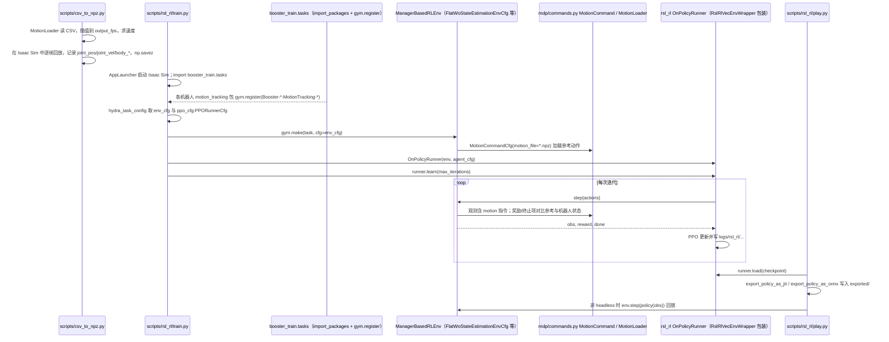

# booster_train

## 一句话定义

**booster_train** 是 [加速进化](https://github.com/BoosterRobotics) 公开的 **运动RL/技能训练** 开源项目：并行 RL 运动训练框架（含仿真任务与策略导出链路）

## 英文缩写速查

| 缩写 | 英文全称 | 简要说明 |
|------|----------|----------|
| SDK | Software Development Kit | 真机控制与状态读取接口 |
| RL | Reinforcement Learning | 强化学习训练与策略优化 |
| VLA | Vision-Language-Action | 视觉–语言–动作统一策略 |
| Sim2Real | Simulation to Real | 仿真策略迁移真机 |
| URDF | Unified Robot Description Format | 机器人描述与仿真资产 |

## 为什么重要

- 收录于 [国内具身智能开源全景（76 家 · 424 项）](../overview/china-domestic-embodied-opensource-76-companies-technology-map.md) 的 **第一层** 分组。
- 与 [Humanoid Motion Intelligence](../entities/humanoid-motion-intelligence.md) 同源策展；本页为 **独立详情节点**，便于从公司清单跳到机制与入口说明。

## 核心原理

| 字段 | 内容 |
|------|------|
| 机构 | 加速进化 |
| 类别 | 运动RL/技能训练 |
| 官方组织 | https://github.com/BoosterRobotics |

## 工程实践

1. 从官方 GitHub/Gitee 组织检索 `booster_train` 仓库并核对 README 许可与依赖。
2. 对照本库 [424 项覆盖索引](../queries/china-domestic-opensource-424-coverage.md) 查看同公司其它入口是否共用训练/部署链路。
3. 若与既有方法页（如 RL 框架、VLA、SDK）主题相同，优先读关联页中的「开源入口」小节，避免重复维护平行叙事。

## 局限与风险

- 公众号清单为 **策展快照**（2026-09-06）；仓库更名、归档或许可证变化须回官方组织页核实。
- **开源状态**：以仓库 README 与 release 为准（入库日按文章描述归纳，未逐仓 clone 验证）。

## 源码运行时序图

入口：先 `python scripts/csv_to_npz.py --headless --input_file=<CSV> --input_fps=<FPS> --output_file=<NPZ>` 生成动作 npz；再 `python scripts/rsl_rl/train.py --task=<TASK_NAME> --headless --device cuda:N` 训练；最后 `python scripts/rsl_rl/play.py --task=<TASK_NAME> --checkpoint=<CKPT>` 回放并导出。均需在装有 Isaac Lab 的 Python 中运行。

图依据：BoosterRobotics/booster_train@83037fd，读过 `README.md`、`scripts/rsl_rl/{train,play}.py`、`scripts/csv_to_npz.py`、`source/booster_train/booster_train/tasks/__init__.py`、`tasks/manager_based/beyond_mimic/robots/t2/motion_tracking/{__init__,env_cfg,tracking_env_cfg}.py`、`tasks/manager_based/beyond_mimic/mdp/commands.py`。训练步内部的奖励、事件与课程细节（`mdp/rewards.py`、`events.py`、`terminations.py`、执行器 `assets/robots/actuator.py`）未逐行读，仅按 `OnPolicyRunner` 通用流程概括；T1/K1 任务注册文件未读，仅以 T2 为例。

## 关联页面

- [国内具身开源全景技术地图](../overview/china-domestic-embodied-opensource-76-companies-technology-map.md)
- [HMI 开源项目主表导读](../queries/hmi-opensource-projects-coverage.md)
- [Humanoid Motion Intelligence](../entities/humanoid-motion-intelligence.md)

## 参考来源

- [booster_train 源码归档](../../sources/repos/booster_train.md)（<https://github.com/BoosterRobotics/booster_train>）

- [国内具身智能开源全景（微信公众号）](../../sources/blogs/wechat_embodied_station_domestic_opensource_panorama_2026-09-06.md)
- 源码核对（2026-11-02）：BoosterRobotics/booster_train@83037fd，读过 README.md、scripts/rsl_rl/{train,play}.py、scripts/csv_to_npz.py、source/booster_train/booster_train/tasks/__init__.py、tasks/manager_based/beyond_mimic/robots/t2/motion_tracking/{__init__,env_cfg,tracking_env_cfg}.py、tasks/manager_based/beyond_mimic/mdp/commands.py；时序图依据以上文件，未运行代码。

## 推荐继续阅读

- [加速进化 官方组织](https://github.com/BoosterRobotics)
