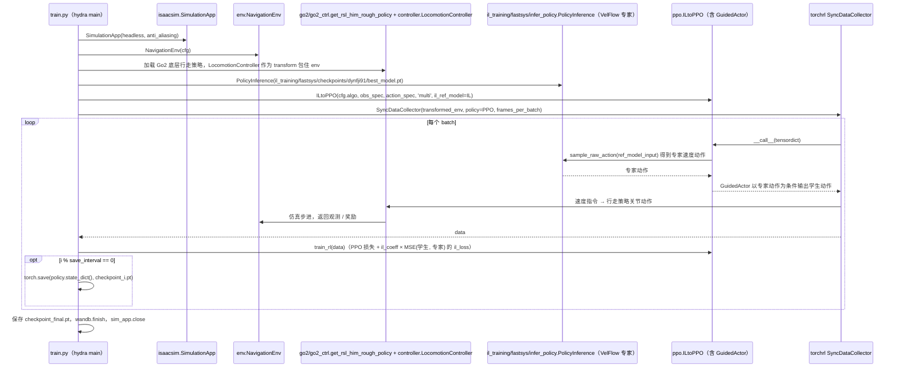

# CE-Nav

## 一句话定义

**CE-Nav** 是 [阿里巴巴](https://github.com/amap-cvlab) 公开的 **感知/导航** 开源项目：流引导强化细化的跨本体局部导航

## 英文缩写速查

| 缩写 | 英文全称 | 简要说明 |
|------|----------|----------|
| SDK | Software Development Kit | 真机控制与状态读取接口 |
| RL | Reinforcement Learning | 强化学习训练与策略优化 |
| VLA | Vision-Language-Action | 视觉–语言–动作统一策略 |
| Sim2Real | Simulation to Real | 仿真策略迁移真机 |
| URDF | Unified Robot Description Format | 机器人描述与仿真资产 |

## 为什么重要

- 收录于 [国内具身智能开源全景（76 家 · 424 项）](../overview/china-domestic-embodied-opensource-76-companies-technology-map.md) 的 **第四层** 分组。
- 与 [Humanoid Motion Intelligence](../entities/humanoid-motion-intelligence.md) 同源策展；本页为 **独立详情节点**，便于从公司清单跳到机制与入口说明。

## 核心原理

| 字段 | 内容 |
|------|------|
| 机构 | 阿里巴巴 |
| 类别 | 感知/导航 |
| 官方组织 | https://github.com/amap-cvlab、https://github.com/alibaba-damo-academy |

## 工程实践

1. 从官方 GitHub/Gitee 组织检索 `CE-Nav` 仓库并核对 README 许可与依赖。
2. 对照本库 [424 项覆盖索引](../queries/china-domestic-opensource-424-coverage.md) 查看同公司其它入口是否共用训练/部署链路。
3. 若与既有方法页（如 RL 框架、VLA、SDK）主题相同，优先读关联页中的「开源入口」小节，避免重复维护平行叙事。

## 局限与风险

- 公众号清单为 **策展快照**（2026-09-06）；仓库更名、归档或许可证变化须回官方组织页核实。
- **开源状态**：以仓库 README 与 release 为准（入库日按文章描述归纳，未逐仓 clone 验证）。

## 关联页面

- [国内具身开源全景技术地图](../overview/china-domestic-embodied-opensource-76-companies-technology-map.md)
- [HMI 开源项目主表导读](../queries/hmi-opensource-projects-coverage.md)
- [Humanoid Motion Intelligence](../entities/humanoid-motion-intelligence.md)

## 源码运行时序图

入口：`cd isaac-training/training/scripts && python train.py`（第二阶段 RL 精调；配置 `cfg/train.yaml`，hydra 装载）。评测入口为同目录 `python eval.py`（`cfg/eval.yaml` 的 `evaluation.mode`）；第一阶段模仿学习入口为 `cd il_training/fastsys && python train_navrl_il.py`，本图只画 `train.py`。

图依据：amap-cvlab/CE-Nav@8eaac06，读过 README.md、isaac-training/training/scripts/train.py、isaac-training/training/scripts/ppo.py（类/函数与 il_loss 相关行）、il_training/fastsys/infer_policy.py（函数列表）、isaac-training/training/scripts/eval.py 与 il_training/fastsys/train_navrl_il.py（仅浏览结构）。`ILtoPPO.__call__` 中 GuidedActor 的具体前向细节未逐行读，上图为据 `ppo.py` 行 189-221 的函数名与调用关系的概括。

## 参考来源

- [CE-Nav 源码归档](../../sources/repos/ce-nav.md)（<https://github.com/amap-cvlab/CE-Nav>）

- [国内具身智能开源全景（微信公众号）](../../sources/blogs/wechat_embodied_station_domestic_opensource_panorama_2026-09-06.md)
- 源码核对（2026-11-02）：amap-cvlab/CE-Nav@8eaac06，读过 README.md、isaac-training/training/scripts/{train.py,ppo.py,eval.py}、il_training/fastsys/{infer_policy.py,train_navrl_il.py}（后两者仅浏览结构）；时序图依据以上文件，未运行代码。

## 推荐继续阅读

- [阿里巴巴 官方组织](https://github.com/amap-cvlab)
