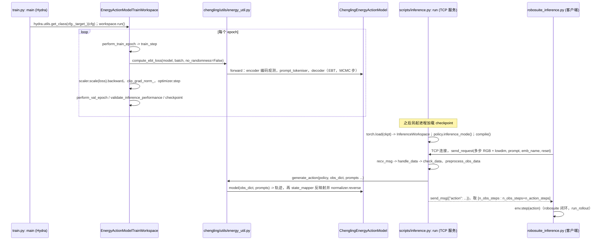

# Chengling-PWM

## 一句话定义

**Chengling-PWM** 是 [智澄AI](https://github.com/ZhiChengAIR) 公开的 **世界模型** 开源项目：机器人原生 JEPA 物理世界模型：从机器人示范学习物理动力学并预测动作轨迹（配套 TR5 Pro 人形机器人）

## 英文缩写速查

| 缩写 | 英文全称 | 简要说明 |
|------|----------|----------|
| SDK | Software Development Kit | 真机控制与状态读取接口 |
| RL | Reinforcement Learning | 强化学习训练与策略优化 |
| VLA | Vision-Language-Action | 视觉–语言–动作统一策略 |
| Sim2Real | Simulation to Real | 仿真策略迁移真机 |
| URDF | Unified Robot Description Format | 机器人描述与仿真资产 |

## 为什么重要

- 收录于 [国内具身智能开源全景（76 家 · 424 项）](../overview/china-domestic-embodied-opensource-76-companies-technology-map.md) 的 **第二层** 分组。
- 与 [Humanoid Motion Intelligence](../entities/humanoid-motion-intelligence.md) 同源策展；本页为 **独立详情节点**，便于从公司清单跳到机制与入口说明。

## 核心原理

| 字段 | 内容 |
|------|------|
| 机构 | 智澄AI |
| 类别 | 世界模型 |
| 官方组织 | https://github.com/ZhiChengAIR |

## 工程实践

1. 从官方 GitHub/Gitee 组织检索 `Chengling-PWM` 仓库并核对 README 许可与依赖。
2. 对照本库 [424 项覆盖索引](../queries/china-domestic-opensource-424-coverage.md) 查看同公司其它入口是否共用训练/部署链路。
3. 若与既有方法页（如 RL 框架、VLA、SDK）主题相同，优先读关联页中的「开源入口」小节，避免重复维护平行叙事。

## 局限与风险

- 公众号清单为 **策展快照**（2026-09-06）；仓库更名、归档或许可证变化须回官方组织页核实。
- **开源状态**：以仓库 README 与 release 为准（入库日按文章描述归纳，未逐仓 clone 验证）。

## 源码运行时序图

入口：训练 `python train.py --config-name=train_energy_config dataset.dataset_path=<数据>`（多卡用 `torchrun train.py`）；推理服务 `python scripts/inference.py --ckpt_path=<ckpt>`；仿真客户端 `python robosuite_inference.py`（默认连 `localhost:65432`）。

图依据：ZhiChengAIR/Chengling-PWM@abb89d0，读过 `README.md`、`train.py`、`config/train_energy_config.yaml`（`_target_` 行）、`workspace/energy_action_model_train_workspace.py`（train_step、run）、`scripts/inference.py`、`robosuite_inference.py`（接口部分）、`chengling/model/chengling.py`、`chengling/utils/energy_util.py`（`generate_action`）、`chengling/model/decoder.py`（参数说明部分）。`chengling/modules/ebt.py` 内部、数据集转换脚本 `prepare_robomimic_hdf5.py`、Docker 路线未读，未画；Langevin MCMC 的具体循环位于 decoder 中，未读，故图中只写“MCMC 步”。

## 关联页面

- [国内具身开源全景技术地图](../overview/china-domestic-embodied-opensource-76-companies-technology-map.md)
- [HMI 开源项目主表导读](../queries/hmi-opensource-projects-coverage.md)
- [Humanoid Motion Intelligence](../entities/humanoid-motion-intelligence.md)

## 参考来源

- [Chengling-PWM 源码归档](../../sources/repos/chengling-pwm.md)（<https://github.com/ZhiChengAIR/Chengling-PWM>）

- [国内具身智能开源全景（微信公众号）](../../sources/blogs/wechat_embodied_station_domestic_opensource_panorama_2026-09-06.md)
- 源码核对（2026-11-02）：ZhiChengAIR/Chengling-PWM@abb89d0，读过 README.md、train.py、config/train_energy_config.yaml（片段）、workspace/energy_action_model_train_workspace.py、scripts/inference.py、robosuite_inference.py（片段）、chengling/model/chengling.py、chengling/utils/energy_util.py、chengling/model/decoder.py（片段）；时序图依据以上文件，未运行代码。

## 推荐继续阅读

- [智澄AI 官方组织](https://github.com/ZhiChengAIR)
