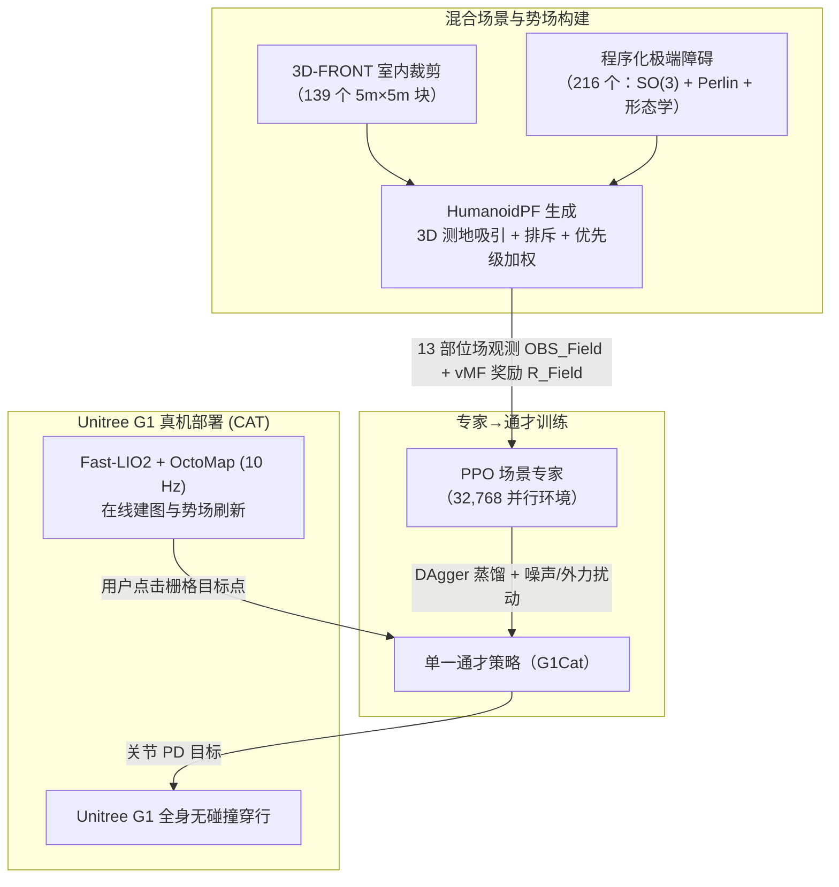
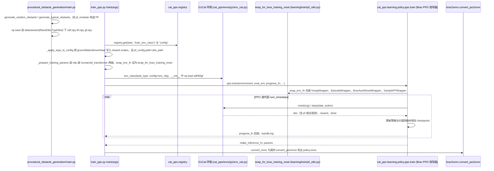

# Click-and-Traverse

## 一句话定义

**Click-and-Traverse** 是 [银河通用](https://github.com/GalaxyGeneralRobotics) 公开的 **运动RL/技能训练** 开源项目：用户在视觉画面中指定目标点，感知与导航模块形成局部移动目标，再由全身运动策略跨越障碍并到达目标；项目连接视觉指令、地形感知和运动基座。

## 英文缩写速查

| 缩写 | 英文全称 | 简要说明 |
|------|----------|----------|
| HumanoidPF | Humanoid Potential Field | 面向多关节人形的 3D 连续势场（测地吸引 + 排斥） |
| APF | Artificial Potential Field | 经典人工势场避障规划方法 |
| vMF | von Mises–Fisher distribution | 单位球面方向分布，用于把势场转为密集奖励 |
| DAgger | Dataset Aggregation | 将场景专家蒸馏为单一通才策略的在线模仿学习 |
| SLAM | Simultaneous Localization and Mapping | 真机端 Fast-LIO2 + OctoMap 实时建图定位 |

## 为什么重要

- 突破已有感知运动策略仅处理地面（$g$）或单一方向简单块状障碍的局限，统一应对**地面、侧向、头顶三向并发约束**与**复杂不规则室内几何**（跨越、俯身、侧挤、绕行）。
- 用 **HumanoidPF** 同时解决“观测易受传感器几何噪声干扰”与“碰撞惩罚稀疏难探索”两大瓶颈：连续势场本身起到感知低通滤波作用，并诱导出免调参的 vMF 方向先验奖励。
- 完整开源了从势场离线生成、专家/DAgger 训练、Generalist v1 权重到 `Fast-LIO2 + OctoMap` 真机部署的全套链路。

## 核心原理

| 字段 | 内容 |
|------|------|
| 机构 | 清华大学 · 同济大学 · 银河通用（Galbot）· 上海期智等 |
| 论文 / 项目页 | [arXiv:2601.16035](https://arxiv.org/abs/2601.16035) · <https://axian12138.github.io/CAT/> |
| 开源仓库 | <https://github.com/GalaxyGeneralRobotics/Click-and-Traverse> |

CAT 将全身无碰撞穿行拆为**势场表征（HumanoidPF）**、**混合场景生成与蒸馏**与**SLAM 闭环部署**三环：

1. **HumanoidPF 构造：** 吸引势 $U_{att}(x)=\eta \|x-g\|_{geo}$ 使用绕障 **3D 测地距离**（而非欧氏距离），排斥势 $U_{rep}(x)$ 在安全距离 $d_0$ 内按反比平方增长；对总势 $U$ 取负梯度 $F=-\nabla U$ 后，施加根节点（骨盆 $1.0$ vs 其他 $0.5$）静态优先权重 $w_0$ 及基于有符号距离与靠近速度的动态紧迫权重 $w_1(p_k)$，消除身体左右对称势场相互抵消导致的局部极小震荡。
2. **观测与 vMF 奖励：** 在 $K=13$ 个身体关键部位采样 $OBS_{Field}=\{F^H(x_k)\}$ 作为紧凑观测（兼作低通滤波缩小 Sim2Real 差距）；同时以 $F^H(x_k)$ 定义单位球面 vMF 分布，对各部位实际运动方向 $\hat{v}_k$ 计算对数似然奖励 $R_{Field}$，提供前瞻密集监督。
3. **混合场景与两阶段训练：** 将 139 个 **3D-FRONT** 真实室内裁剪块（$5\,\text{m}\times 5\,\text{m}$）与 216 个**程序化极端约束场景**（随机 $SO(3)$ 旋转 + Perlin 噪声 + 体素形态学处理）组合，用 PPO 训多场景专家再通过 **DAgger** 蒸馏成单一通才策略；真机用 10 Hz **Fast-LIO2 + OctoMap** 实时建图并经正运动学查询 HumanoidPF。

### 流程总览

图依据：arXiv:2601.16035v2 §III-A–C、Fig. 2。

## 实验与评测

- **仿真 8 类杂乱场景（Table II）：** 在 Hurdle-Crouch（93.9%）、Side-Hurdle-Crouch（86.6%）、Side-Crouch（96.9%）、Side-Pass（97.3%）等 8 类场景 SR 均在 **86.6%–97.5%**，显著超过 ASTraversal（0.5%–82.1%）与 Humanoid Parkour（0.4%–88.7%）；去 $OBS_{Field}$ 在 Side-Hurdle-Crouch 跌至 53.7%，去 $R_{Field}$ 跌至 0.0%。
- **30 个未见室内场景零样本泛化（Table III）：** 仅 3D-FRONT（Base）Easy/Hard SR 为 62.0% / 1.2%；加入全量高难度程序化场景（Base+Syn-Full-Hard）后升至 **95.2% / 66.7%**。
- **Unitree G1 真机对比（Table IV，4 场景 × 5 次）：** HumanoidPF 成功率达 CrouchPass **4/5**、HurdlePass **5/5**、SidePass **5/5**、CrouchHurdle **4/5**，全面高于体素网格（1–3/5）与多层高程图（1–3/5）。

## 工程实践

1. **环境与资产初始化：** 推荐 CUDA 12.5 + `uv sync -i https://pypi.org/simple`，配置 `.env` 后运行 `python -m cat_ppo.utils.mj_playground_init`；预训练模型与场景数据可从 Hugging Face（`Axian12138/Click-and-Traverse`）、Google Drive 或清华云盘拉取至 `data/`。
2. **离线势场生成与训练：** 通过 `procedural_obstacle_generation/main.py` 生成典型/随机障碍及 `sdf.npy`/`bf.npy`/`gf.npy`；用 `train_ppo.py`（任务 `G1Cat` 或特权 `G1CatPri`，支持 `mlp`/`humanoid_transformer`）训练专家，再跑 `train_ppo_dagger.py` 蒸馏并导出 ONNX。
3. **仿真评测与真机 SLAM 部署：** 用 `python -m cat_ppo.eval.mj_onnx_play` 交互可视化，或 `mj_onnx_test` 批量导出成功率 JSON；真机部署进入 `deploy/Click-and-Traverse-SLAM` 对接 Fast-LIO2 + OctoMap 10 Hz 势场刷新。
4. **开源核查（2026-11-21）：** `GalaxyGeneralRobotics/Click-and-Traverse@866ba39` 已完整开源势场生成、PPO 专家、DAgger 蒸馏、Generalist v1 权重（42 随机场景）与真机部署代码；仅扩展场景集待后续补充。

## 局限与风险

- **无接触支撑利用：** 原文 §V 明确指出当前框架仅做无碰撞躲避，尚未利用接触丰富交互（如扶墙、倚靠障碍物或踏上高处支撑面）。
- **极端未知非结构化场景边界：** 在高度非结构化或极端杂乱场景下的零样本泛化（如 Table III Hard 子集 66.7%）仍有进一步提升空间。
- **真机强依赖 LiDAR SLAM 与体素势场更新：** 实机 10 Hz 闭环依赖 Fast-LIO2 + OctoMap 实时几何重建质量，透明/极细/高速动态障碍物在点云缺失时会导致势场失真。

## 源码运行时序图

入口：`python -m train_ppo --task G1Cat --obs_path data/assets/TypiObs/<scene> ...`（README 的单实验训练命令；批量用 `python train_batch.py`）。障碍场景与 HumanoidPF 的离线生成入口为 `procedural_obstacle_generation/main.py`，输出 `sdf.npy/bf.npy/gf.npy`，训练时被环境读入。

图依据：GalaxyGeneralRobotics/Click-and-Traverse@866ba39，读过 README.md、train_ppo.py、cat_ppo/__init__.py、cat_ppo/envs/g1/env_cat.py（构造函数与注册）、cat_ppo/learning/train/pf_utils.py（wrap_for_brax_training_reset）、procedural_obstacle_generation/main.py（np.save 部分）。cat_ppo/learning/policy/ppo/train.py 只核对了 train 入口、reset_fn、training_epoch、checkpoint.save、progress_fn 的位置，未逐行读 PPO 损失细节。

## 关联页面

- [Locomotion](../tasks/locomotion.md)
- [DAgger](../methods/dagger.md)
- [国内具身开源全景技术地图](../overview/china-domestic-embodied-opensource-76-companies-technology-map.md)
- [HMI 开源项目主表导读](../queries/hmi-opensource-projects-coverage.md)
- [Humanoid Motion Intelligence](../entities/humanoid-motion-intelligence.md)

## 参考来源

- [Click-and-Traverse 论文原文归档（arXiv:2601.16035）](../../sources/papers/click_and_traverse_arxiv_2601_16035.md)
- [Click-and-Traverse 源码归档](../../sources/repos/click-and-traverse.md)（<https://github.com/GalaxyGeneralRobotics/Click-and-Traverse>，commit `866ba39`）
- [国内具身智能开源全景（微信公众号）](../../sources/blogs/wechat_embodied_station_domestic_opensource_panorama_2026-09-06.md)

## 推荐继续阅读

- [Click-and-Traverse 论文（arXiv:2601.16035）](https://arxiv.org/abs/2601.16035)
- [Click-and-Traverse 项目页](https://axian12138.github.io/CAT/)
- [Click-and-Traverse 官方仓库](https://github.com/GalaxyGeneralRobotics/Click-and-Traverse)
