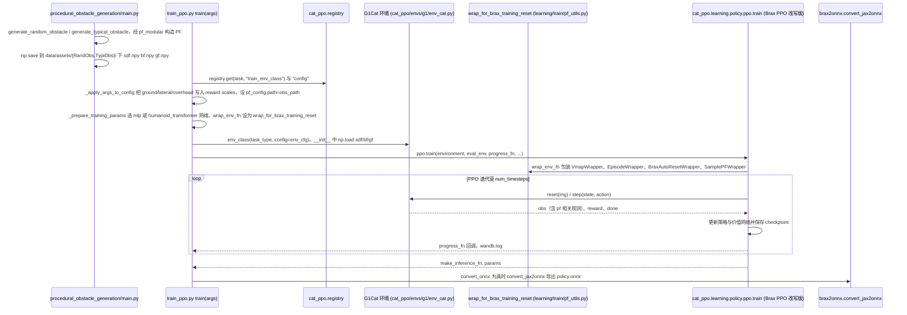

# Click-and-Traverse

## 一句话定义

**Click-and-Traverse** 是 [银河通用](https://github.com/GalaxyGeneralRobotics) 公开的 **运动RL/技能训练** 开源项目：用户在视觉画面中指定目标点，感知与导航模块形成局部移动目标，再由全身运动策略跨越障碍并到达目标；项目连接视觉指令、地形感知和运动基座。

## 英文缩写速查

| 缩写 | 英文全称 | 简要说明 |
|------|----------|----------|
| SDK | Software Development Kit | 真机控制与状态读取接口 |
| RL | Reinforcement Learning | 强化学习训练与策略优化 |
| VLA | Vision-Language-Action | 视觉–语言–动作统一策略 |
| Sim2Real | Simulation to Real | 仿真策略迁移真机 |
| URDF | Unified Robot Description Format | 机器人描述与仿真资产 |

## 为什么重要

- 收录于 [国内具身智能开源全景（76 家 · 424 项）](../overview/china-domestic-embodied-opensource-76-companies-technology-map.md) 的 **第二层** 分组。
- 与 [Humanoid Motion Intelligence](../entities/humanoid-motion-intelligence.md) 同源策展；本页为 **独立详情节点**，便于从公司清单跳到机制与入口说明。

## 核心原理

| 字段 | 内容 |
|------|------|
| 机构 | 银河通用 |
| 类别 | 运动RL/技能训练 |
| 官方组织 | https://github.com/GalaxyGeneralRobotics、https://github.com/PKU-EPIC |

## 工程实践

1. 从官方 GitHub/Gitee 组织检索 `Click-and-Traverse` 仓库并核对 README 许可与依赖。
2. 对照本库 [424 项覆盖索引](../queries/china-domestic-opensource-424-coverage.md) 查看同公司其它入口是否共用训练/部署链路。
3. 若与既有方法页（如 RL 框架、VLA、SDK）主题相同，优先读关联页中的「开源入口」小节，避免重复维护平行叙事。

## 局限与风险

- 公众号清单为 **策展快照**（2026-09-06）；仓库更名、归档或许可证变化须回官方组织页核实。
- **开源状态**：以仓库 README 与 release 为准（入库日按文章描述归纳，未逐仓 clone 验证）。

## 源码运行时序图

入口：`python -m train_ppo --task G1Cat --obs_path data/assets/TypiObs/<scene> ...`（README 的单实验训练命令；批量用 `python train_batch.py`）。障碍场景与 HumanoidPF 的离线生成入口为 `procedural_obstacle_generation/main.py`，输出 `sdf.npy/bf.npy/gf.npy`，训练时被环境读入。

图依据：GalaxyGeneralRobotics/Click-and-Traverse@866ba39，读过 README.md、train_ppo.py、cat_ppo/__init__.py、cat_ppo/envs/g1/env_cat.py（构造函数与注册）、cat_ppo/learning/train/pf_utils.py（wrap_for_brax_training_reset）、procedural_obstacle_generation/main.py（np.save 部分）。cat_ppo/learning/policy/ppo/train.py 只核对了 train 入口、reset_fn、training_epoch、checkpoint.save、progress_fn 的位置，未逐行读 PPO 损失细节。

## 关联页面

- [国内具身开源全景技术地图](../overview/china-domestic-embodied-opensource-76-companies-technology-map.md)
- [HMI 开源项目主表导读](../queries/hmi-opensource-projects-coverage.md)
- [Humanoid Motion Intelligence](../entities/humanoid-motion-intelligence.md)

## 参考来源

- [Click-and-Traverse 源码归档](../../sources/repos/click-and-traverse.md)（<https://github.com/GalaxyGeneralRobotics/Click-and-Traverse>）

- [国内具身智能开源全景（微信公众号）](../../sources/blogs/wechat_embodied_station_domestic_opensource_panorama_2026-09-06.md)
- 源码核对（2026-11-02）：GalaxyGeneralRobotics/Click-and-Traverse@866ba39，读过 README.md、train_ppo.py、cat_ppo/__init__.py、cat_ppo/envs/g1/env_cat.py（构造函数与注册部分）、cat_ppo/learning/train/pf_utils.py、procedural_obstacle_generation/main.py（保存部分）；learning/policy/ppo/train.py 仅核对 train 入口与 training_epoch/checkpoint.save/progress_fn 位置；时序图依据以上文件，未运行代码。

## 推荐继续阅读

- [银河通用 官方组织](https://github.com/GalaxyGeneralRobotics)
