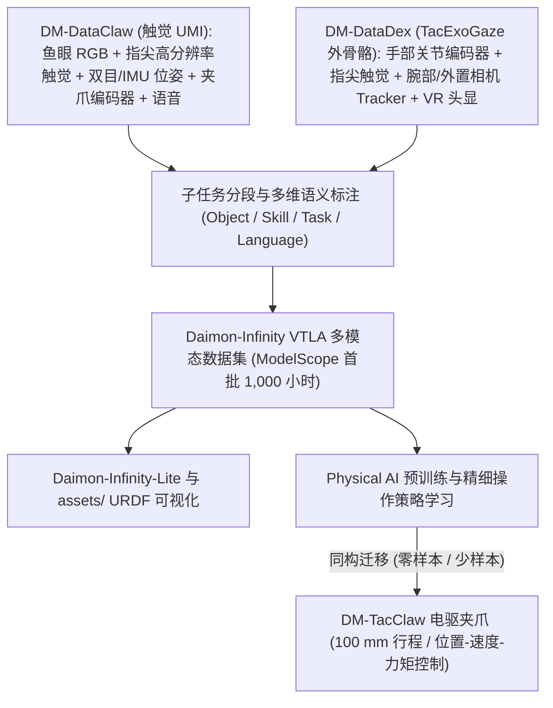

# Daimon-Infinity

## 一句话定义

**Daimon-Infinity** 是 [戴盟机器人](https://github.com/dmrobot-admin) 公开的 **数据集/Benchmark** 开源项目：公开包含高分辨率触觉在内的全模态机器人数据集入口，用于Physical AI的数据预训练与操作研究。

## 英文缩写速查

| 缩写 | 英文全称 | 简要说明 |
|------|----------|----------|
| SDK | Software Development Kit | 真机控制与状态读取接口 |
| RL | Reinforcement Learning | 强化学习训练与策略优化 |
| VLA | Vision-Language-Action | 视觉–语言–动作统一策略 |
| Sim2Real | Simulation to Real | 仿真策略迁移真机 |
| URDF | Unified Robot Description Format | 机器人描述与仿真资产 |

## 为什么重要

- 收录于 [国内具身智能开源全景（76 家 · 424 项）](../overview/china-domestic-embodied-opensource-76-companies-technology-map.md) 的 **第二层** 分组。
- 与 [Humanoid Motion Intelligence](../entities/humanoid-motion-intelligence.md) 同源策展；本页为 **独立详情节点**，便于从公司清单跳到机制与入口说明。

## 核心原理

| 字段 | 内容 |
|------|------|
| 机构 | 戴盟机器人 |
| 类别 | 数据集/Benchmark |
| 官方组织 | https://github.com/dmrobot-admin |

### 架构流程图

依据 [dmrobot-admin/Daimon-Infinity](https://github.com/dmrobot-admin/Daimon-Infinity) 仓库 README 描述的硬件采集平台、多模态标注与部署闭环：

## 源码运行时序图

**不适用。** 经核查 [dmrobot-admin/Daimon-Infinity](https://github.com/dmrobot-admin/Daimon-Infinity)（`main` 分支，共 25 个文件），仓库仅包含 `LICENSE`、`README.md`、`README_CN.md` 与 `assets/images/` 下的 22 张说明配图，用于介绍数据集结构（Parquet/MP4/MOV/JSON）、114 维观测与 111 维动作字段及硬件平台；`README.md` 中的 `## 🛠️ Tool Repo` 指向 ModelScope 的 `daimonrobotics/Daimon-Infinity-Lite`（样例数据与可视化资源），本仓库自身未包含可运行的数据加载、策略训练或部署脚本，无法绘制源码运行时序图。

## 工程实践

1. 从官方 GitHub/Gitee 组织检索 `Daimon-Infinity` 仓库并核对 README 许可与依赖。
2. 对照本库 [424 项覆盖索引](../queries/china-domestic-opensource-424-coverage.md) 查看同公司其它入口是否共用训练/部署链路。
3. 若与既有方法页（如 RL 框架、VLA、SDK）主题相同，优先读关联页中的「开源入口」小节，避免重复维护平行叙事。

## 局限与风险

- 公众号清单为 **策展快照**（2026-09-06）；仓库更名、归档或许可证变化须回官方组织页核实。
- **开源状态**：以仓库 README 与 release 为准（入库日按文章描述归纳，未逐仓 clone 验证）。

## 关联页面

- [国内具身开源全景技术地图](../overview/china-domestic-embodied-opensource-76-companies-technology-map.md)
- [HMI 开源项目主表导读](../queries/hmi-opensource-projects-coverage.md)
- [Humanoid Motion Intelligence](../entities/humanoid-motion-intelligence.md)

- [具身智能体评测方法](../methods/embodied-agent-benchmarking.md)：对照任务设置、接口与评估指标。
- [机器人学习数据管线](../methods/robot-learning-data-pipelines.md)：了解采集、同步与数据质量检查。

## 参考来源

- [Daimon-Infinity 源码归档](../../sources/repos/daimon-infinity.md)（<https://github.com/dmrobot-admin/Daimon-Infinity>）

- [国内具身智能开源全景（微信公众号）](../../sources/blogs/wechat_embodied_station_domestic_opensource_panorama_2026-09-06.md)

## 推荐继续阅读

- [戴盟机器人 官方组织](https://github.com/dmrobot-admin)
