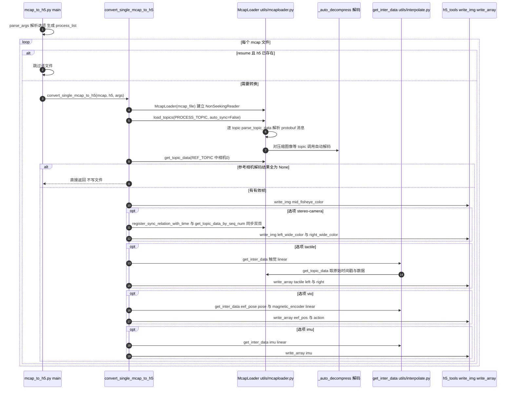

# das-datakit

## 一句话定义

**das-datakit** 是 [简智机器人](https://github.com/genrobot-ai) 公开的 **数据集/Benchmark** 开源项目：读取MCAP中的相机、深度、触觉和设备状态数据，提供解析、可视化及MCAP到H5转换入口，把RealOmni等采集数据接到后续清洗和训练管线。

## 英文缩写速查

| 缩写 | 英文全称 | 简要说明 |
|------|----------|----------|
| SDK | Software Development Kit | 真机控制与状态读取接口 |
| RL | Reinforcement Learning | 强化学习训练与策略优化 |
| VLA | Vision-Language-Action | 视觉–语言–动作统一策略 |
| Sim2Real | Simulation to Real | 仿真策略迁移真机 |
| URDF | Unified Robot Description Format | 机器人描述与仿真资产 |

## 为什么重要

- 收录于 [国内具身智能开源全景（76 家 · 424 项）](../overview/china-domestic-embodied-opensource-76-companies-technology-map.md) 的 **第二层** 分组。
- 与 [Humanoid Motion Intelligence](../entities/humanoid-motion-intelligence.md) 同源策展；本页为 **独立详情节点**，便于从公司清单跳到机制与入口说明。

## 核心原理

| 字段 | 内容 |
|------|------|
| 机构 | 简智机器人 |
| 类别 | 数据集/Benchmark |
| 官方组织 | https://github.com/genrobot-ai |

## 工程实践

1. 从官方 GitHub/Gitee 组织检索 `das-datakit` 仓库并核对 README 许可与依赖。
2. 对照本库 [424 项覆盖索引](../queries/china-domestic-opensource-424-coverage.md) 查看同公司其它入口是否共用训练/部署链路。
3. 若与既有方法页（如 RL 框架、VLA、SDK）主题相同，优先读关联页中的「开源入口」小节，避免重复维护平行叙事。

## 局限与风险

- 公众号清单为 **策展快照**（2026-09-06）；仓库更名、归档或许可证变化须回官方组织页核实。
- **开源状态**：以仓库 README 与 release 为准（入库日按文章描述归纳，未逐仓 clone 验证）。

## 关联页面

- [Gen-HumanEgo 开放人类 ego 数据集](../entities/gen-human-ego-dataset.md) — RealOmni-Open 人类 MCAP 子集；**推荐** 与本 kit 配套消费
- [国内具身开源全景技术地图](../overview/china-domestic-embodied-opensource-76-companies-technology-map.md)
- [HMI 开源项目主表导读](../queries/hmi-opensource-projects-coverage.md)
- [Humanoid Motion Intelligence](../entities/humanoid-motion-intelligence.md)

## 源码运行时序图

入口：`python mcap_to_h5.py --mcap-file <x.mcap> --out-path <dir>`，可加 `--stereo-camera`、`--tactile`、`--vio`、`--imu`、`--resume`；也可用 `--task-dir` 读取 `vio_result.json` 中的 `success_mcap_files` 批量处理。

图依据：genrobot-ai/das-datakit@df2d8a2，读过 `README.md`（前 80 行，数据格式部分）、`mcap_to_h5.py`（全文）、`utils/mcaploader.py`（`parse_topic_data`、`load_topics`、`_auto_decompress`、`__init__` 段）、`utils/interpolate.py`（`get_inter_data` 段）；`mcap_decoder.py` 仅 grep 了 import 与函数定义。时序图依据以上文件，未运行代码。

## 参考来源

- [das-datakit 源码归档](../../sources/repos/das-datakit.md)（<https://github.com/genrobot-ai/das-datakit>）

- [国内具身智能开源全景（微信公众号）](../../sources/blogs/wechat_embodied_station_domestic_opensource_panorama_2026-09-06.md)

- 源码核对（2026-11-02）：genrobot-ai/das-datakit@df2d8a2，读过 `README.md`（前 80 行）、`mcap_to_h5.py`、`utils/mcaploader.py`（部分）、`utils/interpolate.py`（部分）、`mcap_decoder.py`（仅 grep）；时序图依据以上文件，未运行代码。

## 推荐继续阅读

- [简智机器人 官方组织](https://github.com/genrobot-ai)
