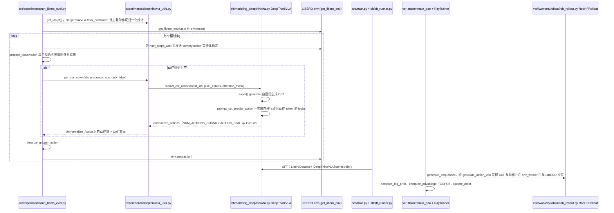

# DeepThinkVLA

## 一句话定义

**DeepThinkVLA** 是 [面壁智能](https://github.com/OpenBMB) 公开的 **VLA/操作模型** 开源项目：模型在视觉与语言输入到动作输出之间加入与任务执行相关的推理过程，使复杂操作中的目标、状态和动作序列能够显式关联。

## 英文缩写速查

| 缩写 | 英文全称 | 简要说明 |
|------|----------|----------|
| SDK | Software Development Kit | 真机控制与状态读取接口 |
| RL | Reinforcement Learning | 强化学习训练与策略优化 |
| VLA | Vision-Language-Action | 视觉–语言–动作统一策略 |
| Sim2Real | Simulation to Real | 仿真策略迁移真机 |
| URDF | Unified Robot Description Format | 机器人描述与仿真资产 |

## 为什么重要

- 收录于 [国内具身智能开源全景（76 家 · 424 项）](../overview/china-domestic-embodied-opensource-76-companies-technology-map.md) 的 **第二层** 分组。
- 与 [Humanoid Motion Intelligence](../entities/humanoid-motion-intelligence.md) 同源策展；本页为 **独立详情节点**，便于从公司清单跳到机制与入口说明。

## 核心原理

| 字段 | 内容 |
|------|------|
| 机构 | 面壁智能 |
| 类别 | VLA/操作模型 |
| 官方组织 | https://github.com/OpenBMB |

## 工程实践

1. 从官方 GitHub/Gitee 组织检索 `DeepThinkVLA` 仓库并核对 README 许可与依赖。
2. 对照本库 [424 项覆盖索引](../queries/china-domestic-opensource-424-coverage.md) 查看同公司其它入口是否共用训练/部署链路。
3. 若与既有方法页（如 RL 框架、VLA、SDK）主题相同，优先读关联页中的「开源入口」小节，避免重复维护平行叙事。

## 局限与风险

- 公众号清单为 **策展快照**（2026-09-06）；仓库更名、归档或许可证变化须回官方组织页核实。
- **开源状态**：以仓库 README 与 release 为准（入库日按文章描述归纳，未逐仓 clone 验证）。

## 源码运行时序图

入口：评估 `bash scripts/eval.sh`（实际执行 `python -m experiments.run_libero_eval --pretrained_checkpoint ... --task_suite_name libero_10`）。SFT 入口为 `scripts/finetune.sh`（`deepspeed src/train.py`），RL 入口为 `scripts/run_deepthinkvla_rl.sh`（`python -m verl.trainer.main_ppo`），图中以评估推理链路为主，后两者在末尾简要画出。

图依据：OpenBMB/DeepThinkVLA@ff271e7，读过 `README.md`、`scripts/eval.sh`、`scripts/finetune.sh`、`scripts/run_deepthinkvla_rl.sh`、`src/experiments/run_libero_eval.py`、`src/experiments/deepthinkvla_utils.py`、`src/sft/modeling_deepthinkvla.py`、`src/sft/sft_runner.py`、`src/train.py`、`src/verl/trainer/main_ppo.py`、`src/verl/trainer/ppo/ray_trainer.py`、`src/verl/workers/rollout/rob_rollout.py`；SFT 与 RL 部分只读了入口与调用骨架，未逐行核对内部实现。

## 关联页面

- [国内具身开源全景技术地图](../overview/china-domestic-embodied-opensource-76-companies-technology-map.md)
- [HMI 开源项目主表导读](../queries/hmi-opensource-projects-coverage.md)
- [Humanoid Motion Intelligence](../entities/humanoid-motion-intelligence.md)

## 参考来源

- [DeepThinkVLA 源码归档](../../sources/repos/deepthinkvla.md)（<https://github.com/OpenBMB/DeepThinkVLA>）

- [国内具身智能开源全景（微信公众号）](../../sources/blogs/wechat_embodied_station_domestic_opensource_panorama_2026-09-06.md)
- 源码核对（2026-11-02）：OpenBMB/DeepThinkVLA@ff271e7，读过 README.md、scripts/eval.sh、scripts/finetune.sh、scripts/run_deepthinkvla_rl.sh、src/experiments/run_libero_eval.py、src/experiments/deepthinkvla_utils.py、src/sft/modeling_deepthinkvla.py、src/sft/sft_runner.py、src/train.py、src/verl/trainer/main_ppo.py、src/verl/trainer/ppo/ray_trainer.py、src/verl/workers/rollout/rob_rollout.py；时序图依据以上文件，未运行代码。

## 推荐继续阅读

- [面壁智能 官方组织](https://github.com/OpenBMB)
