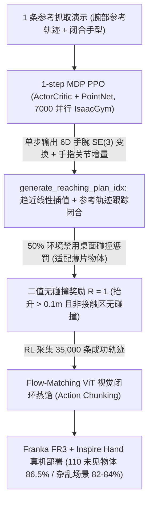
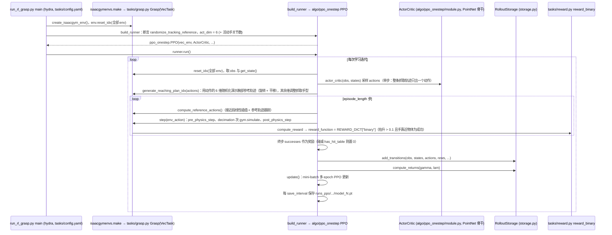

# DemoGrasp：从单条演示通过单步 MDP 泛化至通用灵巧抓取

## 一句话定义

**DemoGrasp**（`arXiv:2509.22149`，ICLR 2026）是智在无界（BeingBeyond）开源的极低演示门槛灵巧抓取框架：只需 **1 条人工抓取演示**作为参考模板，将抓取形态自适应重塑为 **单步马尔可夫决策过程（1-step MDP PPO）**，在海量仿真采样出 35K 成功抓取轨迹后蒸馏为视觉闭环 **Flow-Matching** 策略直接迁移真机。

## 英文缩写速查

| 缩写 | 英文全称 | 简要说明 |
|------|----------|----------|
| 1-step MDP | One-Step Markov Decision Process | 整条抓握生成过程只做一次动作决策，随后由确定性轨迹插值与闭合回放执行 |
| SE(3) | Special Euclidean Group in 3D | 用于对单条演示参考手腕末端的 3D 旋转与平移进行自适应残差编辑的空间变换 |
| PPO | Proximal Policy Optimization | 本作在 7,000 个 IsaacGym 并行环境下优化手腕位姿与手型增量的 RL 算法 |
| ViT | Vision Transformer | 下游闭环蒸馏策略用于从多视角图像预测动作块的视觉编码骨干 |

## 为什么重要

1. **绕开多手指接触稀疏奖励与海量遥操作成本**：高自由度五指灵巧手抓取面临极高的探索空间与密集接触奖励调参灾难；DemoGrasp 证明只要有 1 条标准抓握参考，RL 只需在单步内微调 $T^{ee}$ 与手指增量 $\Delta q^G$，极大缩小搜索空间并天然产出拟人抓取手型。
2. **闭环 Flow-Matching 视觉蒸馏桥接 Sim2Real 位姿失真**：仿真内特权状态轨迹经统一筛选收集 35K 条，再蒸馏为不依赖精准物体 CAD 与 6D 追踪的图像流匹配动作块策略，实现杂乱桌面零样本抓取迁移。

## 核心原理

1. **单步 MDP 问题重构**：给定物体初始观测，策略在 `t=0` 单步预测相对物体中心的手腕 `SE(3)` 位姿变换 $T^{ee}$ 与抓取手型关节增量 $\Delta q^G$；此后 `compute_reference_actions()` 按分段线性插值趋近 + 参考合拢轨迹执行完整 `episode_length` 物理回放，大幅缩短信用分配链条。
2. **极简二值碰撞惩罚奖励**：`REWARD_DICT["binary"]` 当且仅当物体被稳定抬高且非预设抓握部位不碰桌/碰物时给 `1`；专门设计 **50% 并行环境关闭桌面自碰撞** 的混合调度，使模型学会抓起硬币、卡片或平板等需轻擦桌面切入的薄小物件。
3. **35K 轨迹向视觉 Flow-Matching 蒸馏**：筛选出约 **35,000 条** 成功物理轨迹后，训练仅依靠图像观测预测动作块的闭环 **Flow-Matching ViT** 策略以抵抗真实视觉遮挡与标定偏移。

## 工程实践

- **基准与真机表现**：
  - **DexGraspNet（Shadow Hand 全集）**：状态策略达 **95.2%（train）/ 95.5%（seen）/ 94.4%（unseen）**；蒸馏后的视觉策略达 **92.2% / 92.3% / 90.1%**；
  - **真机评测（Franka FR3 + Inspire Hand，110 种未见日常物体）**：整体成功率 **86.5%**（常规尺寸物体 **95.3%**、小/薄难抓物体 **71.1%**），杂乱多物体堆叠场景亦维持 **82%–84%** 成功率。
- **训练与回放实操入口（`BeingBeyond/DemoGrasp @ 1255dc5`）**：使用 Hydra 配置通过 `run_rl_grasp.py task=grasp train=PPOOneStep hand=fr3_inspire_tac num_envs=7000` 即可一键并行开启千级 IsaacGym 环境强化探索，支持 `test=True checkpoint=...` 验证回放与演示回放模式。

## 结论

**DemoGrasp 将灵巧手抓取泛化的范式简化为「1 条人工模版 + 1 步强化残差编辑 + 大规模无碰撞轨迹视觉蒸馏」，兼顾高拟人手型、极低收集代价与 86.5% 真机未见物体通用性。**
- 1-step MDP + 50% 免桌面碰撞环境消除了五指接触奖励脆弱性与扁平物体难起抓痛点；
- 状态 RL 生成海量多形态轨迹再蒸馏给视觉 Flow-Matching 避免了高维图像端到端 RL 收敛难问题；
- RL 阶段依赖单次开环轨迹重放，面对强动态或须多阶段预调整（pre-grasp）的物体仍需外接前序规划或多次尝试机制。

## 局限与风险

1. **RL 探索阶段的开环重放假设**：一旦开始合并手指即沿既定轨迹执行，遇到实时滑动或倾倒物体需靠后续蒸馏出的闭环视觉策略多次微调，不支持如功用部位抓取（functional grasping）般复杂的多指指面滚动操作。
2. **薄/微小物体精度仍有差距**：真机上 71.1% 相比常规物体 95.3% 低 24 个百分点，对深度噪声与指尖物理几何公差较敏感。

## 源码运行时序图

训练入口：`python -u run_rl_grasp.py task=grasp train=PPOOneStep hand=fr3_inspire_tac num_envs=7000 ...`（完整参数见 `train.sh`）；回放 / 评测入口：同一脚本加 `test=True checkpoint='ckpt/inspire.pt'`（见 `play_policy.sh`）；演示回放：`+debug=test_demo_replay`

图依据：BeingBeyond/DemoGrasp@1255dc5，读过 `README.md`、`train.sh`（头部）、`run_rl_grasp.py`、`algo/ppo_onestep/ppo.py`（run / update 开头）、`algo/ppo_onestep/module.py`（类列表）、`tasks/grasp.py`（generate_reaching_plan_idx、compute_reference_actions、step、pre_physics_step）、`tasks/reward.py`。IsaacGymEnvs 本身、`compute_observations` / `reset_idx` 细节、`data/dataset_utils.py` 与点云编码细节未读。

## 关联页面

- 所属机构实体：[智在无界（BeingBeyond）](beingbeyond.md)
- 同公司人形单演示数据引擎：[DemoHLM：单演示可泛化人形移动操作](paper-loco-manip-161-136-demohlm.md)
- 同公司触觉与灵巧手控制：[UniTacHand](cn-os-unitachand.md) 与 [TTP](cn-os-ttp.md)
- [国内具身开源全景技术地图](../overview/china-domestic-embodied-opensource-76-companies-technology-map.md)
- [HMI 开源项目主表导读](../queries/hmi-opensource-projects-coverage.md)
- [Humanoid Motion Intelligence](../entities/humanoid-motion-intelligence.md)

## 参考来源

- 一手论文：`arXiv:2509.22149v1`（ICLR 2026）全文归档（[demograsp_arxiv_2509_22149.md](../../sources/papers/demograsp_arxiv_2509_22149.md)）
- 源码核对（2026-11-02）：`BeingBeyond/DemoGrasp@1255dc5`，读过 README.md、train.sh（头部）、run_rl_grasp.py、algo/ppo_onestep/ppo.py、algo/ppo_onestep/module.py（类列表）、algo/ppo_onestep/storage.py（类名）、tasks/grasp.py（generate_reaching_plan_idx、compute_reference_actions、step、pre_physics_step、compute_reward）、tasks/reward.py、tasks/train（log_dir），归档于 [demograsp.md](../../sources/repos/demograsp.md)；时序图依据以上文件，未运行代码。
- [国内具身智能开源全景（微信公众号）](../../sources/blogs/wechat_embodied_station_domestic_opensource_panorama_2026-09-06.md)

## 推荐继续阅读

- [arXiv:2509.22149 论文页面](https://arxiv.org/abs/2509.22149)
- [DemoGrasp 官方项目主页](https://beingbeyond.github.io/DemoGrasp/)
- [BeingBeyond/DemoGrasp GitHub 仓库](https://github.com/BeingBeyond/DemoGrasp)
