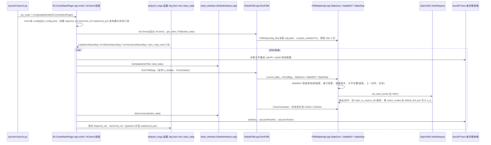

# Deploy_Tienkung

## 一句话定义

**Deploy_Tienkung** 是 [北京人形机器人创新中心](https://github.com/Open-X-Humanoid) 公开的 **仿真环境** 开源项目：ROS 2控制主库接收导出的强化学习策略，通过有限状态机、标准机器人接口和控制SDK驱动天工系列机器人；配套xSIM_MUJOCO提供相同消息链路的关节、IMU、地形和位置/力矩仿真，xhumanoid_sdk补充天工3.0关节与传感器示例。

## 英文缩写速查

| 缩写 | 英文全称 | 简要说明 |
|------|----------|----------|
| SDK | Software Development Kit | 真机控制与状态读取接口 |
| RL | Reinforcement Learning | 强化学习训练与策略优化 |
| VLA | Vision-Language-Action | 视觉–语言–动作统一策略 |
| Sim2Real | Simulation to Real | 仿真策略迁移真机 |
| URDF | Unified Robot Description Format | 机器人描述与仿真资产 |

## 为什么重要

- 收录于 [国内具身智能开源全景（76 家 · 424 项）](../overview/china-domestic-embodied-opensource-76-companies-technology-map.md) 的 **第一层** 分组。
- 与 [Humanoid Motion Intelligence](../entities/humanoid-motion-intelligence.md) 同源策展；本页为 **独立详情节点**，便于从公司清单跳到机制与入口说明。

## 核心原理

| 字段 | 内容 |
|------|------|
| 机构 | 北京人形机器人创新中心 |
| 类别 | 仿真环境 |
| 官方组织 | https://github.com/Open-X-Humanoid |

## 工程实践

1. 从官方 GitHub/Gitee 组织检索 `Deploy_Tienkung` 仓库并核对 README 许可与依赖。
2. 对照本库 [424 项覆盖索引](../queries/china-domestic-opensource-424-coverage.md) 查看同公司其它入口是否共用训练/部署链路。
3. 若与既有方法页（如 RL 框架、VLA、SDK）主题相同，优先读关联页中的「开源入口」小节，避免重复维护平行叙事。

## 局限与风险

- 公众号清单为 **策展快照**（2026-09-06）；仓库更名、归档或许可证变化须回官方组织页核实。
- **开源状态**：以仓库 README 与 release 为准（入库日按文章描述归纳，未逐仓 clone 验证）。

## 源码运行时序图

入口：`ros2 launch rl_control_new rl.launch.py`（启动 `joy_node` 与装载 `rl_control_new::RLControlNewPlugin` 的 `component_container`；README 要求 ROS2 Humble + `colcon build --packages-select rl_control_new x_humanoid_rl_sdk`）。策略用 OpenVINO 在 CPU 推理（`config/policy/*.xml/.bin`，可由 `python_scripts/torch2ov.py` 转换）。注意 `rl_control_new/src/plugins/x_humanoid_rl_sdk/lib/libx_humanoid_rl_sdk.so` 是预编译库，下图 FSM 部分依据顶层 `x_humanoid_rl_sdk/` 源码，假定两者同源（未核对二进制）。

图依据：Open-X-Humanoid/Deploy_Tienkung@1f2b8b8，读过 README.md、rl_control_new/README.md、rl_control_new/launch/rl.launch.py、rl_control_new/rlctrlnew_plugin.xml、rl_control_new/src/plugins/rl_control_new/src/RLControlNewPlugin.cpp（onInit、rlControl 主循环的发布/FSM/SP 转换调用位置，其余用 grep 定位）、x_humanoid_rl_sdk/src/robot_FSM/{RobotFSM,FSMStateImpl}.cpp（FSMInit、StateMLP::Run 后半、CheckTransition、RunFSM 开头）、python_scripts/torch2ov.py（开头）；StateZero/StateStop 内部、RobotInterface.cpp、BasicFunction.cpp、Joystick 插件、libfuncSPTrans.so 与预编译 SDK 二进制未读；SetCommand 在 FSM 之后的先后依据 grep 行号（92/119/124）推断。

## 关联页面

- [国内具身开源全景技术地图](../overview/china-domestic-embodied-opensource-76-companies-technology-map.md)
- [HMI 开源项目主表导读](../queries/hmi-opensource-projects-coverage.md)
- [Humanoid Motion Intelligence](../entities/humanoid-motion-intelligence.md)

## 参考来源

- [Deploy_Tienkung 源码归档](../../sources/repos/deploy_tienkung.md)（<https://github.com/Open-X-Humanoid/Deploy_Tienkung>）

- [国内具身智能开源全景（微信公众号）](../../sources/blogs/wechat_embodied_station_domestic_opensource_panorama_2026-09-06.md)
- 源码核对（2026-11-02）：Open-X-Humanoid/Deploy_Tienkung@1f2b8b8，读过 README.md、rl_control_new/README.md、rl_control_new/launch/rl.launch.py、rl_control_new/src/plugins/rl_control_new/src/RLControlNewPlugin.cpp、x_humanoid_rl_sdk/src/robot_FSM/RobotFSM.cpp、x_humanoid_rl_sdk/src/robot_FSM/FSMStateImpl.cpp、python_scripts/torch2ov.py；时序图依据以上文件，未运行代码；预编译 .so 未读。

## 推荐继续阅读

- [北京人形机器人创新中心 官方组织](https://github.com/Open-X-Humanoid)
