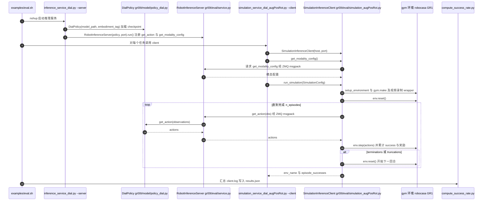

# DIAL

## 一句话定义

**DIAL** 是 [小鹏机器人](https://github.com/xpeng-robotics) 公开的 **VLA/操作模型** 开源项目：小鹏机器人官方公开的机器人学习研究项目，具体数据、模型与动作接口以仓库和论文材料为准。

## 英文缩写速查

| 缩写 | 英文全称 | 简要说明 |
|------|----------|----------|
| SDK | Software Development Kit | 真机控制与状态读取接口 |
| RL | Reinforcement Learning | 强化学习训练与策略优化 |
| VLA | Vision-Language-Action | 视觉–语言–动作统一策略 |
| Sim2Real | Simulation to Real | 仿真策略迁移真机 |
| URDF | Unified Robot Description Format | 机器人描述与仿真资产 |

## 为什么重要

- 收录于 [国内具身智能开源全景（76 家 · 424 项）](../overview/china-domestic-embodied-opensource-76-companies-technology-map.md) 的 **第一层** 分组。
- 与 [Humanoid Motion Intelligence](../entities/humanoid-motion-intelligence.md) 同源策展；本页为 **独立详情节点**，便于从公司清单跳到机制与入口说明。

## 核心原理

| 字段 | 内容 |
|------|------|
| 机构 | 小鹏机器人 |
| 类别 | VLA/操作模型 |
| 官方组织 | https://github.com/xpeng-robotics |

## 工程实践

1. 从官方 GitHub/Gitee 组织检索 `DIAL` 仓库并核对 README 许可与依赖。
2. 对照本库 [424 项覆盖索引](../queries/china-domestic-opensource-424-coverage.md) 查看同公司其它入口是否共用训练/部署链路。
3. 若与既有方法页（如 RL 框架、VLA、SDK）主题相同，优先读关联页中的「开源入口」小节，避免重复维护平行叙事。

## 局限与风险

- 公众号清单为 **策展快照**（2026-09-06）；仓库更名、归档或许可证变化须回官方组织页核实。
- **开源状态**：以仓库 README 与 release 为准（入库日按文章描述归纳，未逐仓 clone 验证）。

## 关联页面

- [国内具身开源全景技术地图](../overview/china-domestic-embodied-opensource-76-companies-technology-map.md)
- [HMI 开源项目主表导读](../queries/hmi-opensource-projects-coverage.md)
- [Humanoid Motion Intelligence](../entities/humanoid-motion-intelligence.md)

## 源码运行时序图

入口：`bash examples/eval.sh <model_path> <eval_type>`（仿真在线评测）。脚本先以后台方式运行 `python scripts/inference_service_dial.py --server --embodiment_tag gr1 --model_path ... --port ...`，再对每个 GR1 任务调用 `python scripts/simulation_service_dial_augPosRot.py --client --env_name ...`（失败最多重试 5 次）。

图依据：xpeng-robotics/DIAL@b611fed，读过 `README.md`（前 120 行）、`examples/eval.sh`（开头与任务循环、末尾段）、`examples/train.sh`、`scripts/inference_service_dial.py`（`main` 段与 grep）、`scripts/simulation_service_dial_augPosRot.py`（`--server` / `--client` 分支）、`gr00t/eval/service.py`（传输与 server 结构 grep）、`gr00t/eval/robot.py`、`gr00t/eval/simulation_augPosRot.py`（`run_simulation` 与 `_get_actions_from_server` 段）、`gr00t/model/policy_dial.py`（类与方法签名 grep）。`scripts/dual_system_train.py` 训练链路未画、未读。时序图依据以上文件，未运行代码。

## 参考来源

- [DIAL 源码归档](../../sources/repos/dial.md)（<https://github.com/xpeng-robotics/DIAL>）

- [国内具身智能开源全景（微信公众号）](../../sources/blogs/wechat_embodied_station_domestic_opensource_panorama_2026-09-06.md)

- 源码核对（2026-11-02）：xpeng-robotics/DIAL@b611fed，读过 `README.md`（前 120 行）、`examples/eval.sh`、`examples/train.sh`、`scripts/inference_service_dial.py`、`scripts/simulation_service_dial_augPosRot.py`、`gr00t/eval/service.py`、`gr00t/eval/robot.py`、`gr00t/eval/simulation_augPosRot.py`（部分）、`gr00t/model/policy_dial.py`（grep）；时序图依据以上文件，未运行代码。

## 推荐继续阅读

- [小鹏机器人 官方组织](https://github.com/xpeng-robotics)
