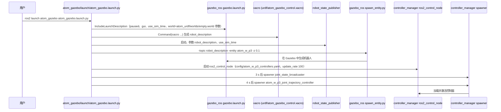
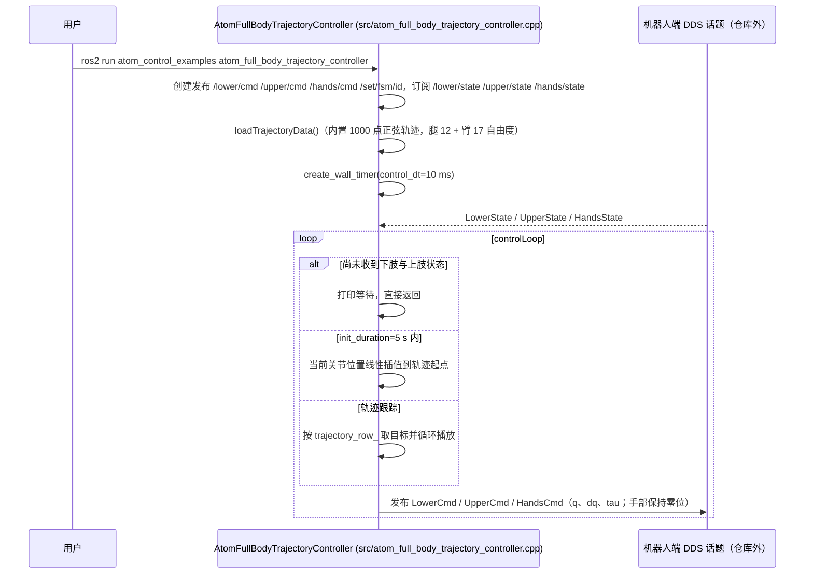

# dobot_atom_ros2

## 一句话定义

**dobot_atom_ros2** 是 [越疆科技](https://github.com/embodied-dobot) 公开的 **工程与工具** 开源项目：为ATOM机器人提供ROS2接口，使状态、传感器与执行器进入上层控制和开发工具链。

## 英文缩写速查

| 缩写 | 英文全称 | 简要说明 |
|------|----------|----------|
| SDK | Software Development Kit | 真机控制与状态读取接口 |
| RL | Reinforcement Learning | 强化学习训练与策略优化 |
| VLA | Vision-Language-Action | 视觉–语言–动作统一策略 |
| Sim2Real | Simulation to Real | 仿真策略迁移真机 |
| URDF | Unified Robot Description Format | 机器人描述与仿真资产 |

## 为什么重要

- 收录于 [国内具身智能开源全景（76 家 · 424 项）](../overview/china-domestic-embodied-opensource-76-companies-technology-map.md) 的 **第一层** 分组。
- 与 [Humanoid Motion Intelligence](../entities/humanoid-motion-intelligence.md) 同源策展；本页为 **独立详情节点**，便于从公司清单跳到机制与入口说明。

## 核心原理

| 字段 | 内容 |
|------|------|
| 机构 | 越疆科技 |
| 类别 | 工程与工具 |
| 官方组织 | https://github.com/embodied-dobot、https://github.com/Dobot-Arm |

## 工程实践

1. 从官方 GitHub/Gitee 组织检索 `dobot_atom_ros2` 仓库并核对 README 许可与依赖。
2. 对照本库 [424 项覆盖索引](../queries/china-domestic-opensource-424-coverage.md) 查看同公司其它入口是否共用训练/部署链路。
3. 若与既有方法页（如 RL 框架、VLA、SDK）主题相同，优先读关联页中的「开源入口」小节，避免重复维护平行叙事。

## 局限与风险

- 公众号清单为 **策展快照**（2026-09-06）；仓库更名、归档或许可证变化须回官方组织页核实。
- **开源状态**：以仓库 README 与 release 为准（入库日按文章描述归纳，未逐仓 clone 验证）。

## 源码运行时序图

本仓库是 ROS 2 colcon 工作区，没有单一主程序；运行入口分两类：仿真走 launch 文件，真机走 `atom_control_examples` 的示例节点。

### 仿真：Atom W-P3 Gazebo

入口：`ros2 launch atom_gazebo atom_gazebo.launch.py`（P2 腿式版本为 `atom_p2_gazebo` 包的 `atom_p2_gazebo.launch.py`，本次未读其内容）

### 真机：全身轨迹控制示例

入口：`ros2 run atom_control_examples atom_full_body_trajectory_controller`（可执行文件在 `atom_control_examples/CMakeLists.txt` 中声明；README 列出同包的 `lower_state_reader`、`upper_state_reader`、`atom_dexterous_hands_controller` 等入口）。真机侧经 CycloneDDS（`setup.sh` 中配置网卡）收发话题，机器人端程序不在本仓库。

图依据：Dobot-Arm/dobot_atom_ros2@695c8da，读过 README.md、atom_gazebo/launch/atom_gazebo.launch.py、atom_gazebo/config/atom_w_p3_controllers.yaml（开头）、atom_control_examples/README.md、atom_control_examples/CMakeLists.txt、atom_control_examples/src/atom_full_body_trajectory_controller.cpp（构造函数与 controlLoop；末段发布与 FSM 逻辑未逐行读）。

## 关联页面

- [国内具身开源全景技术地图](../overview/china-domestic-embodied-opensource-76-companies-technology-map.md)
- [HMI 开源项目主表导读](../queries/hmi-opensource-projects-coverage.md)
- [Humanoid Motion Intelligence](../entities/humanoid-motion-intelligence.md)

## 参考来源

- [dobot_atom_ros2 源码归档](../../sources/repos/dobot_atom_ros2.md)（<https://github.com/Dobot-Arm/dobot_atom_ros2>）

- [国内具身智能开源全景（微信公众号）](../../sources/blogs/wechat_embodied_station_domestic_opensource_panorama_2026-09-06.md)
- 源码核对（2026-11-02）：Dobot-Arm/dobot_atom_ros2@695c8da，读过 README.md、atom_gazebo/launch/atom_gazebo.launch.py、atom_gazebo/config/atom_w_p3_controllers.yaml、atom_control_examples/README.md、CMakeLists.txt、src/atom_full_body_trajectory_controller.cpp（部分）；时序图依据以上文件，未运行代码。

## 推荐继续阅读

- [越疆科技 官方组织](https://github.com/embodied-dobot)
