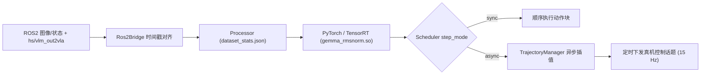
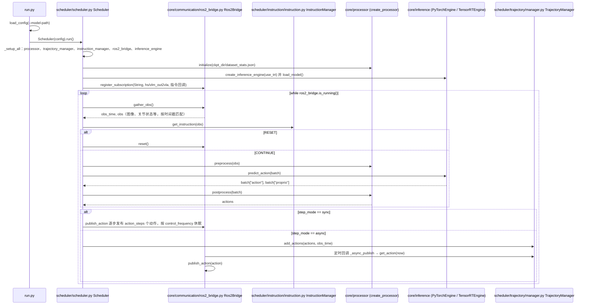

# EFMNode

## 一句话定义

**EFMNode** 是 [星海图](https://github.com/OpenGalaxea) 公开的 **部署运行时** 开源项目：策略部署运行时：加载训练策略、下发关节命令

## 英文缩写速查

| 缩写 | 英文全称 | 简要说明 |
|------|----------|----------|
| SDK | Software Development Kit | 真机控制与状态读取接口 |
| RL | Reinforcement Learning | 强化学习训练与策略优化 |
| VLA | Vision-Language-Action | 视觉–语言–动作统一策略 |
| Sim2Real | Simulation to Real | 仿真策略迁移真机 |
| URDF | Unified Robot Description Format | 机器人描述与仿真资产 |

## 为什么重要

- 收录于 [国内具身智能开源全景（76 家 · 424 项）](../overview/china-domestic-embodied-opensource-76-companies-technology-map.md) 的 **第一层** 分组。
- 与 [Humanoid Motion Intelligence](../entities/humanoid-motion-intelligence.md) 同源策展；本页为 **独立详情节点**，便于从公司清单跳到机制与入口说明。

## 核心原理

`EFMNode` 是星海图面向真实机器人平台（如 `R1_LITE`、`R1_PRO`）的 **ROS2 Humble** 策略部署与调度节点，将上游 `GalaxeaFM` 模型与机器人底层通信解耦：

- **配置与资产加载**：`run.py` 优先加载模型目录下的 `efmnode.toml`（或默认 `config.toml`），随后 `Scheduler` 初始化 `dataset_stats.json` 归一化统计与 `config.yaml` 模型配置，构建传感器预/后处理器 `Processor` 与推理引擎。
- **双推理后端与 WebSocket 扩展**：`core/inference/factory.py` 支持 **PyTorch** 原生推理与 **TensorRT** 加速（使用自定义算子 `gemma_rmsnorm.so`）；同时支持 `scripts/launch_server.sh` 启动远程 `policy_server.py` WebSocket 服务。
- **同步 / 异步控制调度**：在 `sync` 模式下顺序执行「采集多路观测 → 预处理 → `predict_action` → 发布整段动作步数」；在 `async` 模式下借助 `TrajectoryManager` 按观测时间戳插值对齐动作队列，并以定时回调按设定频率（默认 **15 Hz**）平滑下发至真机控制话题。

> 图依据：[`OpenGalaxea/EFMNode@154b69c`](https://github.com/OpenGalaxea/EFMNode) `README.md`、`run.py`、`scheduler/scheduler.py`。

## 工程实践

1. **Docker / `glx` CLI 优先**：官方提供打包好 ROS2 Humble 与 TensorRT 算子的 Docker 镜像及 `glx` CLI，避免本机 TensorRT 与 CUDA ABI 错配；源码启动可直接执行 `./scripts/run.sh --model-path <ckpt_dir>`。
2. **异步时序平滑与数据回采**：当模型推理耗时波动或大于控制周期时优先启用 `async` 模式并核查 `control_frequency`；排障或采集真机部署数据时可使用仓库自带 `scripts/record.sh` 录制完整 ROS2 话题包。
3. **跨仓库衔接**：策略训练与仿真闭环验证可先参考 [GalaxeaManipSim](./cn-os-galaxeamanipsim.md) 与 [GalaxeaDP](./cn-os-galaxeadp.md)，切入真机推理再挂载 `GalaxeaFM` 权重运行本节点。

## 局限与风险

- 仓库仅包含 **推理运行时与 ROS2 调度框架**，核心网络实现与预训练权重需单独安装 `GalaxeaFM`（`galaxea_fm`）包并获取对应 checkpoint（`dataset_stats.json`、`config.yaml`）。
- 仓库根目录未单独提供 `LICENSE` 文件，商业或跨硬件复用前需向 [OpenGalaxea](https://github.com/OpenGalaxea) 确认授权边界。
- 强绑定 ROS2 Humble、特定平台话题命名（如 `hs/vlm_out2vla`）及 `R1_LITE`/`R1_PRO` 控制接口，迁移到异构机器人需重写 `Ros2Bridge` 与处理器配置；本次核对未接通真机验证。

## 源码运行时序图

入口：`./scripts/run.sh`（设置环境变量后执行 `python3 run.py [--model-path <ckpt_dir>]`；`run.py` 读取 `config.toml` 或 `<model_path>/efmnode.toml`）。模型网络结构由 `GalaxeaFM`（`galaxea_fm`）包提供，本仓库只负责 ROS2 收发、预处理/后处理与调度。

图依据：OpenGalaxea/EFMNode@154b69c，读过 `README.md`、`run.py`、`scripts/run.sh`、`scripts/launch_server.sh`、`config.toml`、`scheduler/scheduler.py`、`core/inference/factory.py`、`core/inference/pytorch_engine.py`（函数骨架）、`core/communication/ros2_bridge.py`（函数骨架）、`serving/policy_server.py`（函数骨架）；`processor`、`trajectory/manager.py`、`instruction.py` 内部未逐行读。`serving/policy_server.py` 的 WebSocket 服务路径（`scripts/launch_server.sh`）未画入图中。

## 关联页面

- [国内具身开源全景技术地图](../overview/china-domestic-embodied-opensource-76-companies-technology-map.md)
- [HMI 开源项目主表导读](../queries/hmi-opensource-projects-coverage.md)
- [Humanoid Motion Intelligence](../entities/humanoid-motion-intelligence.md)

## 参考来源

- [EFMNode 源码归档](../../sources/repos/efmnode.md)（<https://github.com/OpenGalaxea/EFMNode>）

- [国内具身智能开源全景（微信公众号）](../../sources/blogs/wechat_embodied_station_domestic_opensource_panorama_2026-09-06.md)
- 源码核对（2026-11-02）：OpenGalaxea/EFMNode@154b69c，读过 README.md、run.py、scripts/run.sh、scripts/launch_server.sh、config.toml、scheduler/scheduler.py、core/inference/factory.py、core/inference/pytorch_engine.py、core/communication/ros2_bridge.py、serving/policy_server.py；时序图依据以上文件，未运行代码。

## 推荐继续阅读

- [星海图 官方组织](https://github.com/OpenGalaxea)
