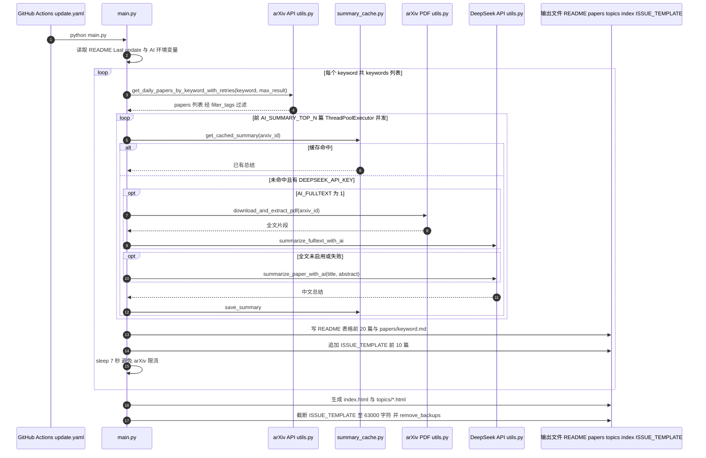

# Embodied-AI-Daily

**Embodied-AI-Daily**（[GitHub 仓库](https://github.com/luohongk/Embodied-AI-Daily)）是具身智能社区 **论文/issue 策展仓库**，被 [机器人研发工程师 · 前沿算法盘点](../../sources/blogs/wechat_robot_engineer_embodied_frontier_algorithms_2026-09-23.md) 列为持续追踪入口。

## 一句话定义

**具身智能每日顶会/arXiv 论文速递 issue 仓库；公众号盘点常作索引入口。**

## 英文缩写速查

| 缩写 | 英文全称 | 简要说明 |
|------|----------|----------|
| Daily | Daily Paper Digest | 每日论文速递 |
| arXiv | arXiv.org | 预印本论文库 |
| Repo | Repository | 代码/策展仓库 |

## 为什么重要

- 公众号盘点类 ingest 的 **时效索引**，不是单篇方法论文。
- 与 [Awesome Physical AI](./awesome-physical-ai-natnew.md) 等静态清单互补。

## 工程实践

| 项 | 内容 |
|----|------|
| **链接** | https://github.com/luohongk/Embodied-AI-Daily |
| **开源** | **已开源** |
| **用途** | 跟踪 VLA/WAM/足式/操作新预印本与开源仓 |

## 局限与风险

- Issue 质量取决于维护者策展，不等同 peer-review。
- 链接与 arXiv 编号需二次核对（本仓库 ingest 已校正部分错误编号）。

## 关联页面

- [embodied-frontier-algorithms-technology-map](../overview/embodied-frontier-algorithms-technology-map.md)
- [vla](../methods/vla.md)

## 源码运行时序图

入口：`python main.py`（由 `.github/workflows/update.yaml` 每日 cron `30 16 * * *` 触发，即北京时间 00:30）。可选环境变量 `DEEPSEEK_API_KEY`、`AI_SUMMARY_TOP_N`、`AI_FULLTEXT` 等控制 AI 总结；未设置密钥时只复用 `summaries/` 缓存。

图依据：luohongk/Embodied-AI-Daily@81a0eff，读过 `README.md`（前 30 行）、`main.py`（导入与配置段 1-120 行、README 与 keyword 循环段 176-190 与 258-367 行，`process_paper_summary` 段 grep）、`.github/workflows/update.yaml`（grep）、`utils.py`、`summary_cache.py`（grep 函数定义与 API 调用）。`verify_math_render.py` 未读。时序图依据以上文件，未运行代码。

## 参考来源

- [embodied_ai_daily.md](../../sources/repos/embodied_ai_daily.md)
- [wechat_robot_engineer_embodied_frontier_algorithms_2026-09-23.md](../../sources/blogs/wechat_robot_engineer_embodied_frontier_algorithms_2026-09-23.md)
- 源码核对（2026-11-02）：luohongk/Embodied-AI-Daily@81a0eff，读过 `README.md`（前 30 行）、`main.py`（部分）、`.github/workflows/update.yaml`（grep）、`utils.py` 与 `summary_cache.py`（grep）；时序图依据以上文件，未运行代码。

## 推荐继续阅读

- [Embodied-AI-Daily 仓库](https://github.com/luohongk/Embodied-AI-Daily)
