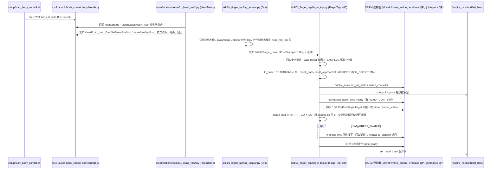

# embodied-skill-kit

## 一句话定义

**embodied-skill-kit** 是 [北京人形机器人创新中心](https://github.com/Open-X-Humanoid) 公开的 **具身Agent/规划** 开源项目：具身 Agent：任务规划与技能调度

## 英文缩写速查

| 缩写 | 英文全称 | 简要说明 |
|------|----------|----------|
| SDK | Software Development Kit | 真机控制与状态读取接口 |
| RL | Reinforcement Learning | 强化学习训练与策略优化 |
| VLA | Vision-Language-Action | 视觉–语言–动作统一策略 |
| Sim2Real | Simulation to Real | 仿真策略迁移真机 |
| URDF | Unified Robot Description Format | 机器人描述与仿真资产 |

## 为什么重要

- 收录于 [国内具身智能开源全景（76 家 · 424 项）](../overview/china-domestic-embodied-opensource-76-companies-technology-map.md) 的 **第一层** 分组。
- 与 [Humanoid Motion Intelligence](../entities/humanoid-motion-intelligence.md) 同源策展；本页为 **独立详情节点**，便于从公司清单跳到机制与入口说明。

## 核心原理

| 字段 | 内容 |
|------|------|
| 机构 | 北京人形机器人创新中心 |
| 类别 | 具身Agent/规划 |
| 官方组织 | https://github.com/Open-X-Humanoid |

## 工程实践

1. 从官方 GitHub/Gitee 组织检索 `embodied-skill-kit` 仓库并核对 README 许可与依赖。
2. 对照本库 [424 项覆盖索引](../queries/china-domestic-opensource-424-coverage.md) 查看同公司其它入口是否共用训练/部署链路。
3. 若与既有方法页（如 RL 框架、VLA、SDK）主题相同，优先读关联页中的「开源入口」小节，避免重复维护平行叙事。

## 局限与风险

- 公众号清单为 **策展快照**（2026-09-06）；仓库更名、归档或许可证变化须回官方组织页核实。
- **开源状态**：以仓库 README 与 release 为准（入库日按文章描述归纳，未逐仓 clone 验证）。

## 源码运行时序图

入口（均需真机，ROS2 + `bodyctrl_msgs` 等，开发机只能静态阅读）：`./setup/start_body_control.sh`；原子示例 `python3 atom/motion/motion01_head_ros2.py`；技能示例 Orin 上 `tag_locator.py`、x86 上 `python3 skill/skill01_finger_tap/finger_tap.py`（文件头注释给出的运行顺序，另需 `bash setup/start_xarm.sh real`）。下图画 `motion01` 与 `skill01_finger_tap` 两条链，skill02 瓶子抓取未读。

图依据：Open-X-Humanoid/embodied-skill-kit@6850f4c，读过 `README.md`、`setup/start_body_control.sh`、`atom/motion/motion01_head_ros2.py`、`skill/skill01_finger_tap/finger_tap.py`（文件头注释与 `main()`，部分方法只看了名称与调用处）、`skill/skill01_finger_tap/tag_locator.py`（`_on_image` 及类/函数清单）。`setup/start_xarm.sh`、`config.py`、`pose_math.py`、其余 motion/perception/interaction 原子、skill02 均未读。

## 关联页面

- [国内具身开源全景技术地图](../overview/china-domestic-embodied-opensource-76-companies-technology-map.md)
- [HMI 开源项目主表导读](../queries/hmi-opensource-projects-coverage.md)
- [Humanoid Motion Intelligence](../entities/humanoid-motion-intelligence.md)

## 参考来源

- [embodied-skill-kit 源码归档](../../sources/repos/embodied-skill-kit.md)（<https://github.com/Open-X-Humanoid/embodied-skill-kit>）

- [国内具身智能开源全景（微信公众号）](../../sources/blogs/wechat_embodied_station_domestic_opensource_panorama_2026-09-06.md)
- 源码核对（2026-11-02）：Open-X-Humanoid/embodied-skill-kit@6850f4c，读过 README.md、setup/start_body_control.sh、atom/motion/motion01_head_ros2.py、skill/skill01_finger_tap/finger_tap.py、tag_locator.py；时序图依据以上文件，未运行代码。

## 推荐继续阅读

- [北京人形机器人创新中心 官方组织](https://github.com/Open-X-Humanoid)
