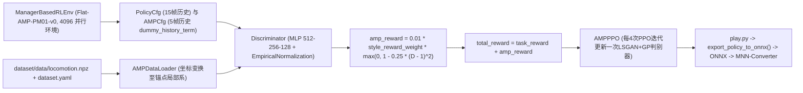
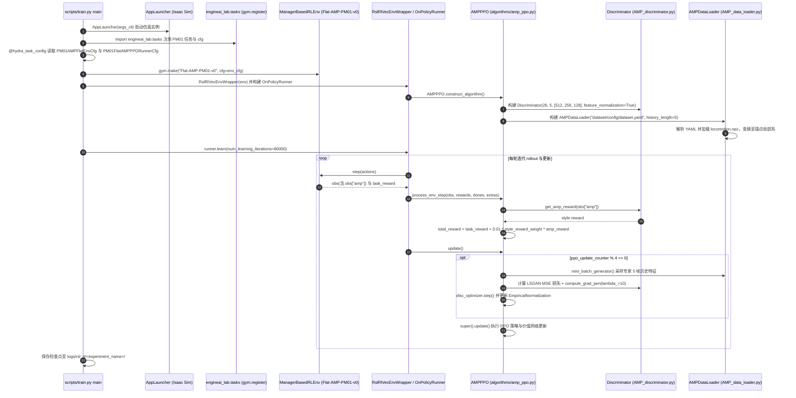

# engineai_amp

## 一句话定义

**engineai_amp**（包名 **EngineAI-Lab**）是众擎机器人面向 **PM01** 人形机器人开源的 **Isaac Lab + RSL-RL** 并行强化学习训练仓库，实现了纯平地行走（`Flat-PM01-v0`）与基于 **AMP（Adversarial Motion Priors）** 的自然步态风格模仿（`Flat-AMP-PM01-v0`），并提供从 PyTorch 检查点导出 **ONNX** 再转 **MNN** 的部署链路。

## 英文缩写速查

| 缩写 | 英文全称 | 简要说明 |
|------|----------|----------|
| AMP | Adversarial Motion Priors | 对抗运动先验，用判别器替代手工步态追踪目标 |
| PPO | Proximal Policy Optimization | 近端策略优化，本仓库通过 RSL-RL `PPO` 基类实现 |
| LSGAN | Least Squares Generative Adversarial Network | AMP 判别器采用的最小二乘 GAN 目标函数 |
| RSL-RL | Robotic Systems Lab Reinforcement Learning | 提供 `OnPolicyRunner`、`PPO` 与 `EmpiricalNormalization` 的高速 GPU RL 库 |
| ONNX | Open Neural Network Exchange | `scripts/play.py` 自动导出的标准神经网络推理格式 |
| MNN | Mobile Neural Network | 众擎在部署说明中推荐由 ONNX 进一步转换的真机推理格式 |

## 为什么重要

- **众擎 PM01 官方运动控制参考栈**：与 [engineai_rl_lab](./engineai-rl-lab.md)（仿真强化学习训练）、[engineai_native_sdk](./engineai-native-sdk.md)（真机 SDK 部署）及上游动捕重定向工具 [engineai_gmr](./cn-os-engineai-gmr.md) 共同构成众擎开源控制工具链。
- **工程化 AMP 落地方案**：仓库基于 Peng et al.（arXiv:2104.02180v2）的标准 LSGAN + 梯度惩罚设计，但在 `RslRlVecEnvWrapper`、`AMPDataLoader` 与多帧历史拼接上给出了可直接套用到 Isaac Lab 5.0 的轻量级 `AMPPPO` 子类实现。
- **轻量化判别特征设计**：通过单帧 26 维观测与 5 帧历史滑窗在 PM01 上融合任务速度追踪奖励与专家 `locomotion.npz` 风格先验，降低长序列参考回放索引的耦合。

## 核心原理

方法理论与仓库模块对齐关系如下（对照 Peng et al., arXiv:2104.02180v2）：

| 机制维度 | 论文理论（Peng et al. 2021） | `engineai_amp@83ba64b` 实现细节 |
|----------|-------------------------------|--------------------------------|
| 判别损失与正则 | LSGAN 目标（专家标 `+1`、策略标 `-1`）+ 专家样本流形梯度惩罚 `w_gp` | `AMPPPO.update()` 使用 `0.5 * (MSE(expert, +1) + MSE(policy, -1))` 加 `Discriminator.compute_grad_pen(..., lambda_=10)` |
| 风格奖励计算 | `r^S = max(0, 1 - 0.25 (D - 1)^2)`，总奖励 `w_G r^G + w_S r^S` | `get_amp_reward()` 计算截断平方差后，在 `process_env_step()` 乘以 `0.01 * style_reward_weight`（默认 `2.0`）叠加到任务奖励 |
| 判别输入构造 | `Φ(s_t)` 局部系状态转移特征 | `AMPCfg` / `AMPDataLoader` 按 `frame_length = 5`、`frame_dim = 26` 拼接归零腰部 yaw 后的关节位置（`* 9`）与局部线速度（`* 7`） |
| 策略与环境封装 | 任意无模型 Actor-Critic | 继承 `rsl_rl.algorithms.PPO`（`actor`/`critic` 接收 15 帧历史的 `PolicyCfg`/`CriticCfg` 观测），默认 `max_iterations = 80_000` |

## 源码运行时序图

入口：`python scripts/train.py --task=Flat-AMP-PM01-v0 --num_envs 4096 --headless --run_name <name>`（训练）；评估与导出：`python scripts/play.py --task=Flat-AMP-PM01-v0 --num_envs 128 --load_run <name>`。

## 工程实践

1. **环境搭建与依赖对齐**
   - 按 `README.md` 创建 `Python 3.11` 环境并先完成 Isaac Sim >= 5.0 的 pip 依赖安装；克隆 `IsaacLab` 时建议检出推荐基线提交 `4df6560e` 并执行 `./isaaclab -i rsl_rl`（`rsl-rl-lib >= 5.0`），最后在本仓库根目录执行 `pip install -e .`。
2. **基线 PPO 与 AMP 训练对比**
   - 建议先跑通纯任务奖励基线 `python scripts/train.py --task=Flat-PM01-v0 --num_envs 4096 --headless --run_name pm01_base`，再切换 `--task=Flat-AMP-PM01-v0` 验证步态自然度提升与 `Step_Reward/style_reward` 日志曲线是否稳定收敛。
3. **推理验证与 ONNX/MNN 部署转换**
   - 运行 `python scripts/play.py --task=Flat-AMP-PM01-v0 --num_envs 128 --load_run <name>` 会从 `logs/rsl_rl/` 加载对应权重并自动执行 `ppo_runner.export_policy_to_onnx()`，产物落在检查点同级的 `exported/` 目录。
   - 若部署到众擎 PM01 实体控制端，需额外编译 `alibaba/mnn` 的 `MNN-Converter` 将导出的 `.onnx` 转为 `.mnn`；本仓库内不含实机控制 C++ 运行时，实机通讯请配合 [engineai_native_sdk](./engineai-native-sdk.md)。

## 常见误区与局限

- **观测与专家特征缩放的硬编码耦合**：`flat_amp_env_cfg.py` 中的 `dummy_history_term` 与 `AMP_data_loader.py` 的 `gather_frame_features` 均显式置零 `.*WAIST_YAW.*` 关节并将关节角乘 `9`、基座线速度乘 `7`，同时 `amp_ppo_cfg.py` 固定 `frame_dim = 26`。更换非 PM01 自由度机器人或新增观测维度时必须同步修改这两处特征定义，否则会触发维度断言失败。
- **历史帧顺序待核对注释与更新节拍小细节**：`flat_amp_env_cfg.py` 第 122 行保留了 `TODO: is the history from old to new or new to old?`，而 `AMPDataLoader` 明确按 `old -> new` 拼接；此外 `amp_ppo.py` 第 186 行在判别器更新块末尾写了未初始化变量风格的属性 `self.policy_update_counter = 0`（实际节拍由 `self.ppo_update_counter % 4 == 0` 控制，对运行无阻断但二次开发需留意）。
- **内置动作集规模有限**：本地检出 `dataset/data/` 下仅附带单一动作文件 `locomotion.npz`，多技能或复杂地形迁移仍需借助 [engineai_gmr](./cn-os-engineai-gmr.md) 或参考 [engineai_rl_lab](./engineai-rl-lab.md) 扩展数据与地形课程。

## 关联页面

- AMP 方法原理总页：[Adversarial Motion Priors（AMP）风格奖励](../methods/amp-reward.md)
- 众擎同系列开源项目：[engineai_gmr（动捕重定向）](./cn-os-engineai-gmr.md)、[engineai_rl_lab（RL 扩展框架）](./engineai-rl-lab.md)、[engineai_native_sdk（真机通信 SDK）](./engineai-native-sdk.md)
- 国内具身开源图谱：[国内具身智能开源全景（76 家 · 424 项）](../overview/china-domestic-embodied-opensource-76-companies-technology-map.md)、[HMI 开源项目主表导读](../queries/hmi-opensource-projects-coverage.md)、[Humanoid Motion Intelligence](./humanoid-motion-intelligence.md)

## 参考来源

- [engineai_amp.md](../../sources/repos/engineai_amp.md)（`engineai-robotics/engineai_amp@83ba64b` 源码与 Peng et al. AMP 原文对照精读归档）
- [wechat_embodied_station_domestic_opensource_panorama_2026-09-06.md](../../sources/blogs/wechat_embodied_station_domestic_opensource_panorama_2026-09-06.md)

## 推荐继续阅读

- [engineai-robotics/engineai_amp GitHub 仓库](https://github.com/engineai-robotics/engineai_amp)
- [AMP 原论文（arXiv:2104.02180）](https://arxiv.org/abs/2104.02180)
- [众擎机器人官方 GitHub 组织](https://github.com/engineai-robotics)
