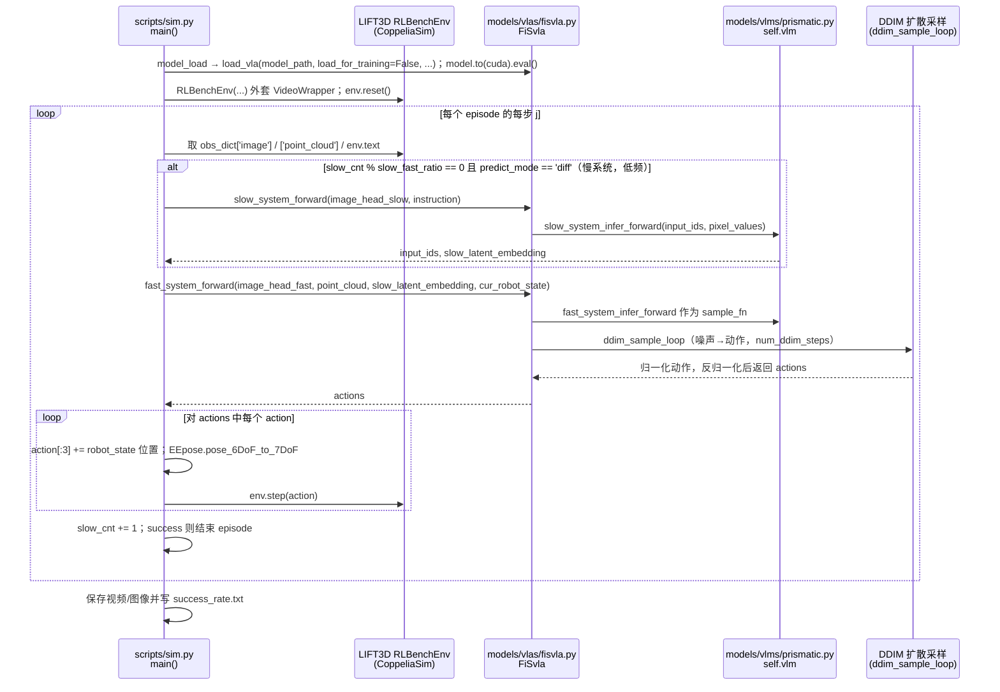

# Fast-in-Slow

## 一句话定义

**Fast-in-Slow** 是 [智平方](https://github.com/CHEN-H01) 公开的 **具身Agent/规划** 开源项目：以慢速推理系统组织任务并由快速策略执行操作，研究长时决策与实时动作之间的双系统接口。

## 英文缩写速查

| 缩写 | 英文全称 | 简要说明 |
|------|----------|----------|
| SDK | Software Development Kit | 真机控制与状态读取接口 |
| RL | Reinforcement Learning | 强化学习训练与策略优化 |
| VLA | Vision-Language-Action | 视觉–语言–动作统一策略 |
| Sim2Real | Simulation to Real | 仿真策略迁移真机 |
| URDF | Unified Robot Description Format | 机器人描述与仿真资产 |

## 为什么重要

- 收录于 [国内具身智能开源全景（76 家 · 424 项）](../overview/china-domestic-embodied-opensource-76-companies-technology-map.md) 的 **第二层** 分组。
- 与 [Humanoid Motion Intelligence](../entities/humanoid-motion-intelligence.md) 同源策展；本页为 **独立详情节点**，便于从公司清单跳到机制与入口说明。

## 核心原理

| 字段 | 内容 |
|------|------|
| 机构 | 智平方 |
| 类别 | 具身Agent/规划 |
| 官方组织 | https://github.com/CHEN-H01 |

## 工程实践

1. 从官方 GitHub/Gitee 组织检索 `Fast-in-Slow` 仓库并核对 README 许可与依赖。
2. 对照本库 [424 项覆盖索引](../queries/china-domestic-opensource-424-coverage.md) 查看同公司其它入口是否共用训练/部署链路。
3. 若与既有方法页（如 RL 框架、VLA、SDK）主题相同，优先读关联页中的「开源入口」小节，避免重复维护平行叙事。

## 局限与风险

- 公众号清单为 **策展快照**（2026-09-06）；仓库更名、归档或许可证变化须回官方组织页核实。
- **开源状态**：以仓库 README 与 release 为准（入库日按文章描述归纳，未逐仓 clone 验证）。

## 源码运行时序图

入口：评测 `bash test_rlbench.sh`（起 Xvfb 后循环调 `python scripts/sim.py --replay-or-predict predict --training_mode async --slow-fast-ratio 4 ...`）；训练 `bash train.sh`（`torchrun ... scripts/train.py --vla.type prism-dinosiglip-224px+oxe+diffusion ...`）。

图依据：CHEN-H01/Fast-in-Slow@14f73b3，读过 README.md、train.sh、test_rlbench.sh、scripts/sim.py、scripts/train.py（训练只读到 train() 的模型/数据/策略装配，未读 training/strategies 的训练循环内部）、models/vlas/fisvla.py 中 slow_system_forward / fast_system_forward 的片段；上图为评测路径，训练路径未画；fisvla 内部与 prismatic.py 的更细调用未读。

## 关联页面

- [国内具身开源全景技术地图](../overview/china-domestic-embodied-opensource-76-companies-technology-map.md)
- [HMI 开源项目主表导读](../queries/hmi-opensource-projects-coverage.md)
- [Humanoid Motion Intelligence](../entities/humanoid-motion-intelligence.md)

## 参考来源

- [Fast-in-Slow 源码归档](../../sources/repos/fast-in-slow.md)（<https://github.com/CHEN-H01/Fast-in-Slow>）

- [国内具身智能开源全景（微信公众号）](../../sources/blogs/wechat_embodied_station_domestic_opensource_panorama_2026-09-06.md)
- 源码核对（2026-11-02）：CHEN-H01/Fast-in-Slow@14f73b3，读过 README.md、train.sh、test_rlbench.sh、scripts/sim.py、scripts/train.py、models/vlas/fisvla.py（slow_system_forward / fast_system_forward 部分）；时序图依据以上文件，未运行代码。

## 推荐继续阅读

- [智平方 官方组织](https://github.com/CHEN-H01)
