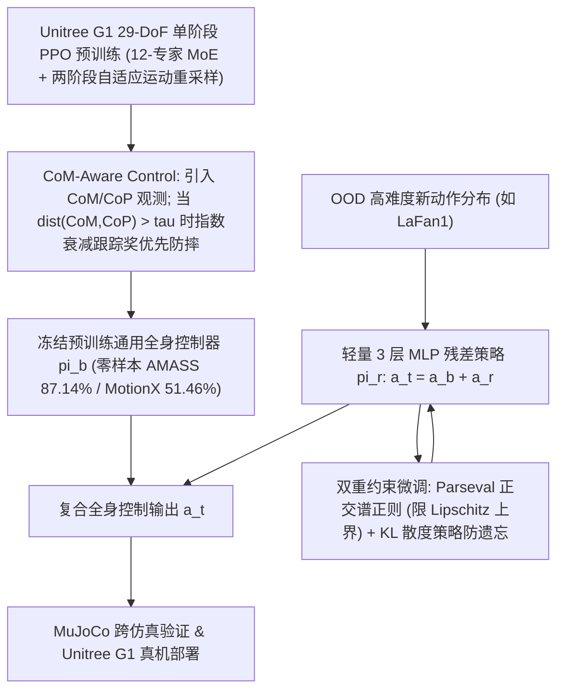

# FAST：基于预训练与快速自适应的通用人形全身控制

## 一句话定义

**FAST**（Fast Adaptation and Stable Motion Tracking，`arXiv:2602.11929`，CoRL 2026）是智在无界（BeingBeyond）提出的通用人形机器人全身控制框架：以单阶段 **12 专家 MoE** 结合 **CoM-Aware 物理平衡约束**免蒸馏预训练通用底座，并提出 **Parseval 引导残差策略自适应**以在不遗忘旧技能的前提下快速攻克未见高动态新动作。

## 英文缩写速查

| 缩写 | 英文全称 | 简要说明 |
|------|----------|----------|
| FAST | Fast Adaptation and Stable Motion Tracking | 本文提出的「预训练底座 + 残差快速自适应」人形全身控制框架 |
| MoE | Mixture of Experts | 单策略内部由门控路由动态组合 12 个子专家的神经网络结构 |
| CoM / CoP | Center of Mass / Center of Pressure | 质心与足底压力中心，二者的水平投影距离直接反映人形动态平衡稳定裕度 |
| Parseval Loss | Parseval Orthogonality Regularization | $\|W^\top W - sI\|_F^2$ 正交谱约束，用于限定残差网的 Lipschitz 上界防止特征发散 |

## 为什么重要

1. **淘汰「分簇专家 + 蒸馏」的繁复多阶段流水线**：前序工作 [BumbleBee](paper-notebook-from-experts-to-a-generalist.md) 需经历聚类、分簇专家训练与 DAgger 蒸馏四步；FAST 证明只需 **单阶段 12-专家 MoE PPO + 两阶段自适应采样 + CoM-Aware 奖励** 即可一步训成强健通用人形底座，零样本大幅超越 GMT 与 TWIST2。
2. **给出对抗人形增量学习灾难性遗忘的解析工具**：常规微调冻结底座只训残差容易引发动作过冲或破坏原有动力学增益，Parseval 正交谱约束配合 KL 漂移惩罚让新动作学习（LaFan1 `90.60%`）与旧动作记忆保持（AMASS 保留率 `96.92%`）兼得。

## 核心原理

1. **单阶段 MoE + CoM-Aware 通用预训练**：
   - 免除教师-学生蒸馏环节，直接在 29-DoF Unitree G1 上端到端训练 **12-专家混合策略（MoE）**，利用两阶段自适应参考裁剪与难例动作采样覆盖广域运动谱；
   - **Center-of-Mass-Aware Control**：在状态观测与奖励结构显式引入质心（CoM）与足底压力中心（CoP）距离指标；当两者偏差超过安全阈值 $\tau$ 时动态衰减运动跟踪精确性权重、提高平衡塑形奖励占比，从机理上减少高动态大动作中的倾倒率。
2. **Parseval-Guided Residual Policy Adaptation**：
   - 面临分布外新动作集（如高难度风格化步态 LaFan1）时，完全冻结基座 $\pi_b$，并联训练一个轻量 3 层 MLP 残差支路 $\pi_r$ 输出动作修正 $a_t = a_t^b + a_t^r$；
   - 引入 **Parseval 正则** $\mathcal{L}_{\text{Parseval}} = \sum \|W^\top W - sI\|_F^2$ 约束残差网络各层奇异值有界（控住 Lipschitz 常数，防止高频震荡或放大噪声），并结合 **$\mathcal{L}_{\text{KL}}$** 散度约束抑制灾难性遗忘。

## 工程实践

- **基准评测定量表现**：
  - **MuJoCo 跨引擎零样本跟踪（AMASS / MotionX 成功率）**：FAST 分别取得 **87.14% / 51.46%**，显着超越同时期强基线 GMT（`77.55% / 38.91%`）与 TWIST2（`72.61% / 31.82%`）；
  - **OOD 快速残差微调与抗遗忘（LaFan1）**：残差适配后在未见 LaFan1 集上取得 **90.60%** 成功率，同时对预训练 AMASS 动作的保持率高达 **96.92%**；并完成 Unitree G1 真实硬件部署。
- **开源状态核查**：**源码运行时序图：不适用**（截至 2026-11-21，官方仓库 [BeingBeyond/FAST](https://github.com/BeingBeyond/FAST) commit `20c8537` 仅含 `README.md` 与 `docs/` 静态项目页资产，暂无 IsaacGym/MuJoCo MoE-PPO 与残差微调代码；已据此修正早期全景自动归档中的“已开源”误标）。

## 结论

**FAST 用「单阶段 CoM-Aware MoE 预训练 + Parseval 约束轻量残差微调」重构了通用人形全身控制范式，既省去了繁复的多簇蒸馏步骤，又解决了真机增量学新动作时易破坏原有平衡能力的问题。**
- CoM/CoP 软门控奖励机制有效缓解参考动作物理不可行时「硬追轨迹必摔」的通病；
- 轻量 3 层 Parseval 残差网在几乎零算力增量下实现 90.60% OOD 适配且保留 96.92% 原能力；
- 目前复现瓶颈在于尚未发布开源训练脚本。

## 局限与风险

1. **CoP 准确感知依赖**：物理硬件上真实压力中心需通过足底力传感器或运动学-动力学估计，如果机身外部扰动突变导致状态估计偏斜，残差修正裕度会收缩。
2. **代码尚未释出**：GitHub `20c8537` 仅有展示页面与论文链接，尚无法直接运行调参。

## 关联页面

- 所属机构实体：[智在无界（BeingBeyond）](beingbeyond.md)
- 前代全身控制基线：[BumbleBee：从专家到通才人形控制](paper-notebook-from-experts-to-a-generalist.md)
- 上游运动大模型结合：[RLPF](paper-notebook-rl-from-physical-feedback-aligning-large-motion.md) 与 [DemoHLM](paper-loco-manip-161-136-demohlm.md)

## 参考来源

- 一手论文：`arXiv:2602.11929v1`（CoRL 2026）全文归档（[fast_arxiv_2602_11929.md](../../sources/papers/fast_arxiv_2602_11929.md)）
- 代码仓库核查：[fast.md](../../sources/repos/fast.md)（`BeingBeyond/FAST @ 20c8537`）
- 行业全景索引：[wechat_embodied_station_domestic_opensource_panorama_2026-09-06.md](../../sources/blogs/wechat_embodied_station_domestic_opensource_panorama_2026-09-06.md)

## 继续阅读

- [arXiv:2602.11929 论文页面](https://arxiv.org/abs/2602.11929)
- [FAST 官方博客页](https://research.beingbeyond.com/fast) 与 [项目主页](https://beingbeyond.github.io/FAST/)
- [BeingBeyond/FAST GitHub 仓库](https://github.com/BeingBeyond/FAST)
