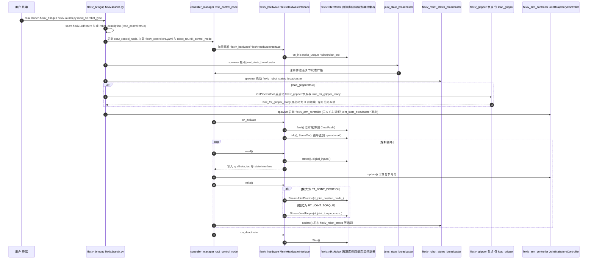

# flexiv_ros2

## 一句话定义

**flexiv_ros2** 是 [非夕科技](https://github.com/flexivrobotics) 公开的 **工程与工具** 开源项目：把Flexiv RDK接入ROS2，为感知、规划和控制应用提供标准中间件接口。

## 英文缩写速查

| 缩写 | 英文全称 | 简要说明 |
|------|----------|----------|
| SDK | Software Development Kit | 真机控制与状态读取接口 |
| RL | Reinforcement Learning | 强化学习训练与策略优化 |
| VLA | Vision-Language-Action | 视觉–语言–动作统一策略 |
| Sim2Real | Simulation to Real | 仿真策略迁移真机 |
| URDF | Unified Robot Description Format | 机器人描述与仿真资产 |

## 为什么重要

- 收录于 [国内具身智能开源全景（76 家 · 424 项）](../overview/china-domestic-embodied-opensource-76-companies-technology-map.md) 的 **第五层** 分组。
- 与 [Humanoid Motion Intelligence](../entities/humanoid-motion-intelligence.md) 同源策展；本页为 **独立详情节点**，便于从公司清单跳到机制与入口说明。

## 核心原理

| 字段 | 内容 |
|------|------|
| 机构 | 非夕科技 |
| 类别 | 工程与工具 |
| 官方组织 | https://github.com/flexivrobotics |

## 工程实践

1. 从官方 GitHub/Gitee 组织检索 `flexiv_ros2` 仓库并核对 README 许可与依赖。
2. 对照本库 [424 项覆盖索引](../queries/china-domestic-opensource-424-coverage.md) 查看同公司其它入口是否共用训练/部署链路。
3. 若与既有方法页（如 RL 框架、VLA、SDK）主题相同，优先读关联页中的「开源入口」小节，避免重复维护平行叙事。

## 局限与风险

- 公众号清单为 **策展快照**（2026-09-06）；仓库更名、归档或许可证变化须回官方组织页核实。
- **开源状态**：以仓库 README 与 release 为准（入库日按文章描述归纳，未逐仓 clone 验证）。

## 源码运行时序图

入口：`ros2 launch flexiv_bringup flexiv.launch.py robot_sn:=Enlight-L-123456 robot_type:=Enlight-L`（使用 `use_fake_hardware:=true` 时改由 FakeSystem 替代真机硬件）

图依据：flexivrobotics/flexiv_ros2@a165e88，README.md、flexiv_bringup/launch/flexiv.launch.py、flexiv_bringup/config/flexiv_controllers.yaml（节选）、flexiv_hardware/src/flexiv_hardware_interface.cpp（节选）。RDK 内部闭源，ros2_control 的 read/write 调度为框架行为，未运行代码。

## 关联页面

- [国内具身开源全景技术地图](../overview/china-domestic-embodied-opensource-76-companies-technology-map.md)
- [HMI 开源项目主表导读](../queries/hmi-opensource-projects-coverage.md)
- [Humanoid Motion Intelligence](../entities/humanoid-motion-intelligence.md)

## 参考来源

- [flexiv_ros2 源码归档](../../sources/repos/flexiv_ros2.md)（<https://github.com/flexivrobotics/flexiv_ros2>）

- 源码核对（2026-11-02）：flexivrobotics/flexiv_ros2@a165e88，读过 README.md、flexiv_bringup/launch/flexiv.launch.py、flexiv_bringup/config/flexiv_controllers.yaml（节选）、flexiv_hardware/src/flexiv_hardware_interface.cpp（节选）；时序图依据以上文件，未运行代码。

- [国内具身智能开源全景（微信公众号）](../../sources/blogs/wechat_embodied_station_domestic_opensource_panorama_2026-09-06.md)

## 推荐继续阅读

- [非夕科技 官方组织](https://github.com/flexivrobotics)
