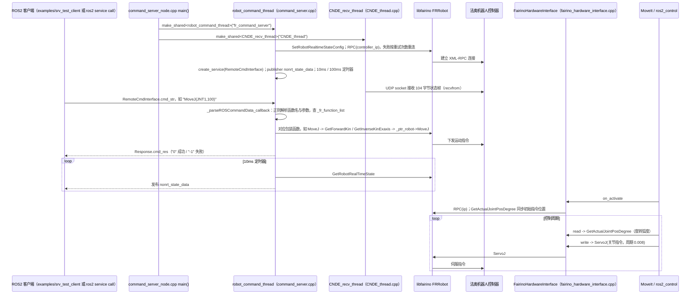

# frcobot_ros2

## 一句话定义

**frcobot_ros2** 是 [法奥意威](https://github.com/FAIR-INNOVATION) 公开的 **工程与工具** 开源项目：为法奥意威协作机器人提供ROS2驱动、机器人描述、控制与MoveIt集成入口。

## 英文缩写速查

| 缩写 | 英文全称 | 简要说明 |
|------|----------|----------|
| SDK | Software Development Kit | 真机控制与状态读取接口 |
| RL | Reinforcement Learning | 强化学习训练与策略优化 |
| VLA | Vision-Language-Action | 视觉–语言–动作统一策略 |
| Sim2Real | Simulation to Real | 仿真策略迁移真机 |
| URDF | Unified Robot Description Format | 机器人描述与仿真资产 |

## 为什么重要

- 收录于 [国内具身智能开源全景（76 家 · 424 项）](../overview/china-domestic-embodied-opensource-76-companies-technology-map.md) 的 **第五层** 分组。
- 与 [Humanoid Motion Intelligence](../entities/humanoid-motion-intelligence.md) 同源策展；本页为 **独立详情节点**，便于从公司清单跳到机制与入口说明。

## 核心原理

| 字段 | 内容 |
|------|------|
| 机构 | 法奥意威 |
| 类别 | 工程与工具 |
| 官方组织 | https://github.com/FAIR-INNOVATION |

## 工程实践

1. 从官方 GitHub/Gitee 组织检索 `frcobot_ros2` 仓库并核对 README 许可与依赖。
2. 对照本库 [424 项覆盖索引](../queries/china-domestic-opensource-424-coverage.md) 查看同公司其它入口是否共用训练/部署链路。
3. 若与既有方法页（如 RL 框架、VLA、SDK）主题相同，优先读关联页中的「开源入口」小节，避免重复维护平行叙事。

## 局限与风险

- 公众号清单为 **策展快照**（2026-09-06）；仓库更名、归档或许可证变化须回官方组织页核实。
- **开源状态**：以仓库 README 与 release 为准（入库日按文章描述归纳，未逐仓 clone 验证）。

## 关联页面

- [国内具身开源全景技术地图](../overview/china-domestic-embodied-opensource-76-companies-technology-map.md)
- [HMI 开源项目主表导读](../queries/hmi-opensource-projects-coverage.md)
- [Humanoid Motion Intelligence](../entities/humanoid-motion-intelligence.md)

## 源码运行时序图

入口：`ros2 run fairino_hardware ros2_cmd_server`（`CMakeLists.txt` 中 `add_executable(ros2_cmd_server ...)`，`src/command_server_node.cpp`）；ros2_control 路径则由 MoveIt/控制器管理器加载插件 `fairino_hardware/FairinoHardwareInterface`（`fairino_hardware.xml`）。下图以 `fairino_hardware_v4_0_1` 为例，各 `fairino_hardware_v*` 目录对应不同机器人软件版本。

图依据：FAIR-INNOVATION/frcobot_ros2@eb6d7ce，读过 `README.md`、`fairino_msgs/srv/RemoteCmdInterface.srv`、`fairino_hardware_master/CMakeLists.txt`、`fairino_hardware_master/src/command_server_node.cpp`、`fairino_hardware_master/src/fairino_hardware_interface.cpp`、`fairino_hardware_master/src/CNDE_thread.cpp`（接收部分）、`fairino_hardware_v4_0_1/src/command_server.cpp`（构造函数、`_parseROSCommandData_callback`、`MoveJ` 片段、状态回调片段）、`fairino_hardware_v4_0_1/src/fairino_hardware_interface.cpp`（grep 到的 RPC/ServoJ/GetActualJointPosDegree 调用）。`libfairino.so` 为预编译二进制，内部未读；`fairino_*_moveit2_config` 的 `ros2_control.xacro` 默认使用 `mock_components/GenericSystem`，接入真机插件需自行替换（仅读了 fairino10 一份配置）。

## 参考来源

- [frcobot_ros2 源码归档](../../sources/repos/frcobot_ros2.md)（<https://github.com/FAIR-INNOVATION/frcobot_ros2>）

- [国内具身智能开源全景（微信公众号）](../../sources/blogs/wechat_embodied_station_domestic_opensource_panorama_2026-09-06.md)
- 源码核对（2026-11-02）：FAIR-INNOVATION/frcobot_ros2@eb6d7ce，读过 README.md、fairino_msgs/srv/RemoteCmdInterface.srv、fairino_hardware_master 与 fairino_hardware_v4_0_1 的 CMakeLists.txt / command_server.cpp（部分）/ command_server_node.cpp / fairino_hardware_interface.cpp / CNDE_thread.cpp（部分）、fairino10_v6_moveit2_config 的 ros2_control.xacro 与 demo.launch.py；时序图依据以上文件，未运行代码。

## 推荐继续阅读

- [法奥意威 官方组织](https://github.com/FAIR-INNOVATION)
