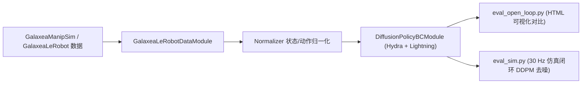
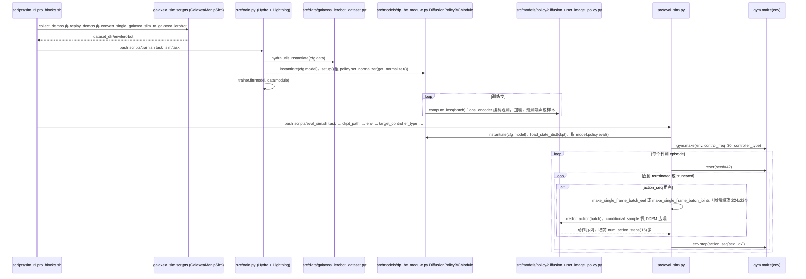

# GalaxeaDP

## 一句话定义

**GalaxeaDP** 是 [星海图](https://github.com/OpenGalaxea) 公开的 **VLA/操作模型** 开源项目：把相机观测、机器人状态和任务条件映射为连续动作块，用扩散策略完成双臂或移动操作；项目适合作为GalaxeaVLA之外的模仿学习基线。

## 英文缩写速查

| 缩写 | 英文全称 | 简要说明 |
|------|----------|----------|
| SDK | Software Development Kit | 真机控制与状态读取接口 |
| RL | Reinforcement Learning | 强化学习训练与策略优化 |
| VLA | Vision-Language-Action | 视觉–语言–动作统一策略 |
| Sim2Real | Simulation to Real | 仿真策略迁移真机 |
| URDF | Unified Robot Description Format | 机器人描述与仿真资产 |

## 为什么重要

- 收录于 [国内具身智能开源全景（76 家 · 424 项）](../overview/china-domestic-embodied-opensource-76-companies-technology-map.md) 的 **第一层** 分组。
- 与 [Humanoid Motion Intelligence](../entities/humanoid-motion-intelligence.md) 同源策展；本页为 **独立详情节点**，便于从公司清单跳到机制与入口说明。

## 核心原理

`GalaxeaDP` 是面向双臂/移动操作任务的模块化 Diffusion Policy（DP）训练与评测工程框架（MIT License），基于 **Hydra** 管理配置、**PyTorch Lightning** 驱动训练循环，并与 [GalaxeaManipSim](./cn-os-galaxeamanipsim.md) 及 GalaxeaLeRobot 数据管线直接对接：

- **观测—动作映射与策略核心**：通过 `DiffusionPolicyBCModule` 封装 `DiffusionUnetImagePolicy`，在训练前基于数据集统计初始化归一化器（`set_normalizer`），并在 DDPM 条件去噪采样（`conditional_sample`）中输出多步连续动作块（默认按 `num_action_steps=16` 执行）。
- **双控制接口支持**：同时支持关节空间（`make_single_frame_batch_joints`）与末端位姿控制（`make_single_frame_batch_eef`），图像输入统一缩放到 `224x224`。
- **端到端实验脚手架**：`scripts/sim_r1pro_blocks.sh` 串起仿真演示采集、重放、格式转换、`src/train.py` 训练、开环 HTML 可视化评估（`eval_open_loop.py`）与仿真闭环评估（`eval_sim.py`）。

> 图依据：[`OpenGalaxea/GalaxeaDP@21abf51`](https://github.com/OpenGalaxea/GalaxeaDP) `README.md`、`scripts/sim_r1pro_blocks.sh`、`src/train.py`。

## 工程实践

1. **一体化仿真基线复现**：在配置好 [GalaxeaManipSim](./cn-os-galaxeamanipsim.md) 环境后，直接运行 `bash scripts/sim_r1pro_blocks.sh` 即可跑通从采集到闭环评测的全链路；或单独调用 `bash scripts/train.sh task=sim/<task>` 覆盖 Hydra 配置。
2. **开环与闭环两级诊断**：部署进仿真前先跑 `scripts/eval_open_loop.sh` 生成预测轨迹与真值对比 HTML，定位归一化或相机视角错位后再跑 `scripts/eval_sim.sh`。
3. **与真机部署衔接**：如需真机运行更大规模 VLA/具身基座模型，可对照 [EFMNode](./cn-os-efmnode.md) 的 ROS2 节点与频率调度模式。

## 局限与风险

- 定位为模仿学习 / Diffusion Policy **实验基线仓库**，不包含多模态大语言模型推理或全身动力学规划模块。
- `README.md` 明确标注面向真实机器人 **MCAP 数据的转换与训练管线仍处于 Coming soon**，开箱即用流水线主要覆盖仿真数据与 LeRobot 格式。
- 策略泛化高度受限于演示覆盖面与动作表征选择（关节 vs 末端），跨机器人构型需重新采集与对齐传感器频率；本次核对未实际启动 GPU 训练。

## 源码运行时序图

入口：一键流程 `bash scripts/sim_r1pro_blocks.sh`，依次执行 GalaxeaManipSim 的数据采集/回放/转换脚本，然后 `bash scripts/train.sh task=sim/<task> ...`（内部 `python src/train.py`）、`bash scripts/eval_open_loop.sh`（`src/eval_open_loop.py`）、`bash scripts/eval_sim.sh`（`src/eval_sim.py`）。

图依据：OpenGalaxea/GalaxeaDP@21abf51，读过 `README.md`、`scripts/sim_r1pro_blocks.sh`、`scripts/train.sh`、`scripts/eval_sim.sh`、`src/train.py`、`src/eval_sim.py`、`src/models/dp_bc_module.py`、`src/models/policy/diffusion_unet_image_policy.py`（类/方法骨架）、`src/data/galaxea_lerobot_dataset.py`（方法骨架）；`src/eval_open_loop.py`、obs_encoder 与 UNet 内部未读，`compute_loss` 内部细节按方法名与调用行推断。

## 关联页面

- [双臂操作](../tasks/bimanual-manipulation.md) — 延伸阅读，理解双臂协调。
- [扩散策略](../methods/diffusion-policy.md) — 延伸阅读，生成条件动作。
- [国内具身开源全景技术地图](../overview/china-domestic-embodied-opensource-76-companies-technology-map.md)
- [HMI 开源项目主表导读](../queries/hmi-opensource-projects-coverage.md)
- [Humanoid Motion Intelligence](../entities/humanoid-motion-intelligence.md)

## 参考来源

- [GalaxeaDP 源码归档](../../sources/repos/galaxeadp.md)（<https://github.com/OpenGalaxea/GalaxeaDP>）

- [国内具身智能开源全景（微信公众号）](../../sources/blogs/wechat_embodied_station_domestic_opensource_panorama_2026-09-06.md)
- 源码核对（2026-11-02）：OpenGalaxea/GalaxeaDP@21abf51，读过 README.md、scripts/sim_r1pro_blocks.sh、scripts/train.sh、scripts/eval_sim.sh、src/train.py、src/eval_sim.py、src/models/dp_bc_module.py、src/models/policy/diffusion_unet_image_policy.py、src/data/galaxea_lerobot_dataset.py；时序图依据以上文件，未运行代码。

## 推荐继续阅读

- [星海图 官方组织](https://github.com/OpenGalaxea)
