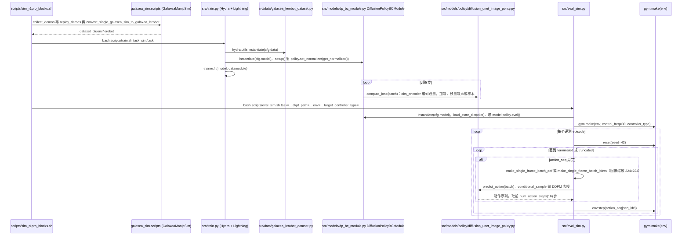

# GalaxeaDP

## 一句话定义

**GalaxeaDP** 是 [星海图](https://github.com/OpenGalaxea) 公开的 **VLA/操作模型** 开源项目：把相机观测、机器人状态和任务条件映射为连续动作块，用扩散策略完成双臂或移动操作；项目适合作为GalaxeaVLA之外的模仿学习基线。

## 英文缩写速查

| 缩写 | 英文全称 | 简要说明 |
|------|----------|----------|
| SDK | Software Development Kit | 真机控制与状态读取接口 |
| RL | Reinforcement Learning | 强化学习训练与策略优化 |
| VLA | Vision-Language-Action | 视觉–语言–动作统一策略 |
| Sim2Real | Simulation to Real | 仿真策略迁移真机 |
| URDF | Unified Robot Description Format | 机器人描述与仿真资产 |

## 为什么重要

- 收录于 [国内具身智能开源全景（76 家 · 424 项）](../overview/china-domestic-embodied-opensource-76-companies-technology-map.md) 的 **第一层** 分组。
- 与 [Humanoid Motion Intelligence](../entities/humanoid-motion-intelligence.md) 同源策展；本页为 **独立详情节点**，便于从公司清单跳到机制与入口说明。

## 核心原理

| 字段 | 内容 |
|------|------|
| 机构 | 星海图 |
| 类别 | VLA/操作模型 |
| 官方组织 | https://github.com/OpenGalaxea |

## 工程实践

1. 从官方 GitHub/Gitee 组织检索 `GalaxeaDP` 仓库并核对 README 许可与依赖。
2. 对照本库 [424 项覆盖索引](../queries/china-domestic-opensource-424-coverage.md) 查看同公司其它入口是否共用训练/部署链路。
3. 若与既有方法页（如 RL 框架、VLA、SDK）主题相同，优先读关联页中的「开源入口」小节，避免重复维护平行叙事。

## 局限与风险

- 公众号清单为 **策展快照**（2026-09-06）；仓库更名、归档或许可证变化须回官方组织页核实。
- **开源状态**：以仓库 README 与 release 为准（入库日按文章描述归纳，未逐仓 clone 验证）。

## 源码运行时序图

入口：一键流程 `bash scripts/sim_r1pro_blocks.sh`，依次执行 GalaxeaManipSim 的数据采集/回放/转换脚本，然后 `bash scripts/train.sh task=sim/<task> ...`（内部 `python src/train.py`）、`bash scripts/eval_open_loop.sh`（`src/eval_open_loop.py`）、`bash scripts/eval_sim.sh`（`src/eval_sim.py`）。

图依据：OpenGalaxea/GalaxeaDP@21abf51，读过 `README.md`、`scripts/sim_r1pro_blocks.sh`、`scripts/train.sh`、`scripts/eval_sim.sh`、`src/train.py`、`src/eval_sim.py`、`src/models/dp_bc_module.py`、`src/models/policy/diffusion_unet_image_policy.py`（类/方法骨架）、`src/data/galaxea_lerobot_dataset.py`（方法骨架）；`src/eval_open_loop.py`、obs_encoder 与 UNet 内部未读，`compute_loss` 内部细节按方法名与调用行推断。

## 关联页面

- [国内具身开源全景技术地图](../overview/china-domestic-embodied-opensource-76-companies-technology-map.md)
- [HMI 开源项目主表导读](../queries/hmi-opensource-projects-coverage.md)
- [Humanoid Motion Intelligence](../entities/humanoid-motion-intelligence.md)

## 参考来源

- [GalaxeaDP 源码归档](../../sources/repos/galaxeadp.md)（<https://github.com/OpenGalaxea/GalaxeaDP>）

- [国内具身智能开源全景（微信公众号）](../../sources/blogs/wechat_embodied_station_domestic_opensource_panorama_2026-09-06.md)
- 源码核对（2026-11-02）：OpenGalaxea/GalaxeaDP@21abf51，读过 README.md、scripts/sim_r1pro_blocks.sh、scripts/train.sh、scripts/eval_sim.sh、src/train.py、src/eval_sim.py、src/models/dp_bc_module.py、src/models/policy/diffusion_unet_image_policy.py、src/data/galaxea_lerobot_dataset.py；时序图依据以上文件，未运行代码。

## 推荐继续阅读

- [星海图 官方组织](https://github.com/OpenGalaxea)
