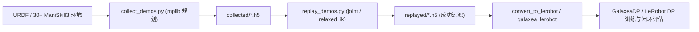
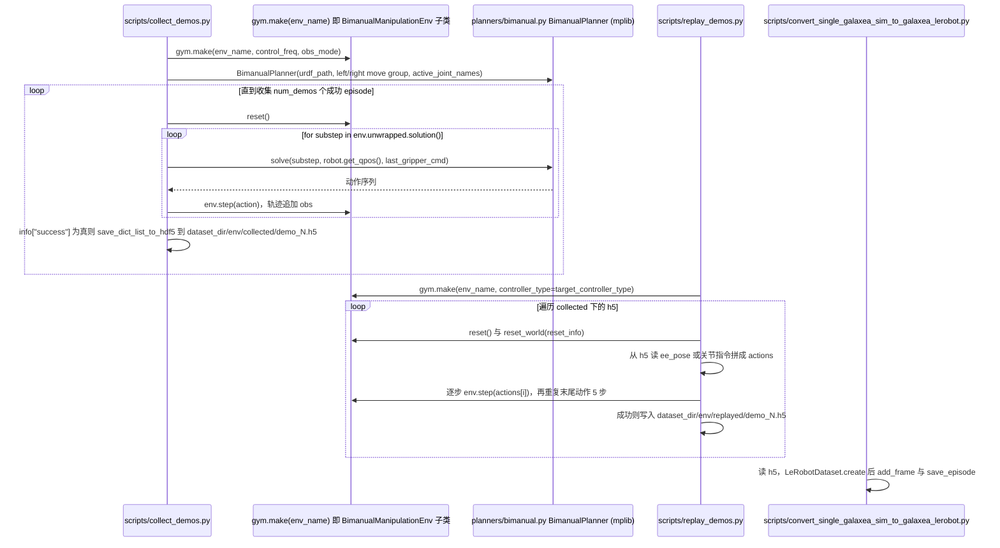

# GalaxeaManipSim

## 一句话定义

**GalaxeaManipSim** 是 [星海图](https://github.com/OpenGalaxea) 公开的 **仿真环境** 开源项目：官方仿真环境与模型接入：联调、策略回放与 Sim2Sim 验证

## 英文缩写速查

| 缩写 | 英文全称 | 简要说明 |
|------|----------|----------|
| SDK | Software Development Kit | 真机控制与状态读取接口 |
| RL | Reinforcement Learning | 强化学习训练与策略优化 |
| VLA | Vision-Language-Action | 视觉–语言–动作统一策略 |
| Sim2Real | Simulation to Real | 仿真策略迁移真机 |
| URDF | Unified Robot Description Format | 机器人描述与仿真资产 |

## 为什么重要

- 收录于 [国内具身智能开源全景（76 家 · 424 项）](../overview/china-domestic-embodied-opensource-76-companies-technology-map.md) 的 **第一层** 分组。
- 与 [Humanoid Motion Intelligence](../entities/humanoid-motion-intelligence.md) 同源策展；本页为 **独立详情节点**，便于从公司清单跳到机制与入口说明。

## 核心原理

`GalaxeaManipSim` 基于 ManiSkill3 架构向 [星海图](./cn-os-galaxeadp.md)（Galaxea）双臂机器人提供标准化桌面操作仿真与自动化数据管线：

- **支持本体与环境规模**：内置 `Galaxea R1`、`R1 Pro` 与 `R1 Lite` 三款双臂构型，覆盖 **30+ 个仿真环境 / 17 类操作任务**（如 `Dual Bottles Pick`、`Blocks Stack` 等）。
- **双模式控制抽象**：提供关节空间控制器 `bimanual_joint_position` 与基于 **Relaxed IK** 的末端位姿控制器 `bimanual_relaxed_ik`，便于将采集轨迹在不同控制接口间重映射。
- **规划采集 → 回放 → 策略导出闭环**：利用 `mplib` 运动规划器按任务预定义 `solution()` 阶段自动生成演示 HDF5，再经目标控制器重放与成功过滤，最后转换为标准 LeRobot 或 Galaxea LeRobot 数据格式供 [GalaxeaDP](./cn-os-galaxeadp.md) 训练评估。

> 图依据：[`OpenGalaxea/GalaxeaManipSim@abe7f51`](https://github.com/OpenGalaxea/GalaxeaManipSim) `README.md` 及 `galaxea_sim/scripts/collect_demos.py`。

| 维度 | 说明 |
|------|------|
| **开源许可** | MIT License（<https://github.com/OpenGalaxea/GalaxeaManipSim>） |
| **支持本体** | Galaxea R1 / R1 Pro / R1 Lite |
| **基线表现（README 表）** | R1 `Dual Bottles Pick Easy` 98%；R1 Pro `Blocks Stack Easy` OpenDP 68% / LeRobot 64%；R1 Lite `Blocks Stack Easy` OpenDP 51% / LeRobot 42% |

## 工程实践

1. **快速采集与重采样流程**：先运行 `python -m galaxea_sim.scripts.collect_demos --env-name R1ProBlocksStackEasy --num-demos 100` 生成关节轨迹，再通过 `replay_demos.py --target_controller_type bimanual_relaxed_ik` 重映射至末端空间并过滤失败样本。
2. **格式转换与基线对照**：转换脚本同时支持标准 LeRobot (`convert_single_galaxea_sim_to_lerobot`) 与 Galaxea LeRobot (`convert_single_galaxea_sim_to_galaxea_lerobot`) 两条分支，可分别对接 `lerobot` DP 与 [GalaxeaDP](./cn-os-galaxeadp.md)。
3. **版本与依赖检查**：克隆后核对 `README.md` 中的 SAPIEN / ManiSkill / mplib / LeRobot 版本约束，避免直接套用下游真机控制器的关节限位配置。

## 局限与风险

- 当前主要面向桌面操作仿真与离线策略基线（OpenDP / LeRobot DP），并非高保真全身动力学或移动底盘导航仿真器。
- README 报告的成功率（如 R1 98%、R1 Pro 68%、R1 Lite 51%）对应特定简单任务与给定采集规模，不代表未见场景或真机泛化表现。
- Sim-to-Real 仍依赖相机外参标定、真机控制延迟匹配与 [EFMNode](./cn-os-efmnode.md) 侧安全限幅；本地核对未实际运行仿真器。

## 源码运行时序图

入口：`python -m galaxea_sim.scripts.collect_demos --env-name R1ProBlocksStackEasy --num-demos 100`，随后 `python -m galaxea_sim.scripts.replay_demos --env-name ... --target_controller_type bimanual_relaxed_ik`，再 `python -m galaxea_sim.scripts.convert_single_galaxea_sim_to_galaxea_lerobot --task ... --tag replayed --robot r1_pro --use_eef`（README 另给出 `convert_single_galaxea_sim_to_lerobot`、`train_lerobot_dp_policy`、`eval_lerobot_dp_policy` 入口，未画入图中）。

图依据：OpenGalaxea/GalaxeaManipSim@abe7f51，读过 `README.md`、`galaxea_sim/scripts/collect_demos.py`、`replay_demos.py`、`convert_single_galaxea_sim_to_galaxea_lerobot.py`（仅函数骨架）、`galaxea_sim/envs/base/bimanual_manipulation.py`（骨架）、`galaxea_sim/planners/bimanual.py`（骨架）、`envs/robotwin/blocks_stack_easy.py`（骨架）；`solution()` 内部、控制器与 `train/eval_lerobot_dp_policy.py` 未读。

## 关联页面

- [国内具身开源全景技术地图](../overview/china-domestic-embodied-opensource-76-companies-technology-map.md)
- [HMI 开源项目主表导读](../queries/hmi-opensource-projects-coverage.md)
- [Humanoid Motion Intelligence](../entities/humanoid-motion-intelligence.md)

- [双臂操作](../tasks/bimanual-manipulation.md)：了解双臂协调任务。
- [具身智能体评测方法](../methods/embodied-agent-benchmarking.md)：对照任务设置、接口与评估指标。

## 参考来源

- [GalaxeaManipSim 源码归档](../../sources/repos/galaxeamanipsim.md)（<https://github.com/OpenGalaxea/GalaxeaManipSim>）

- [国内具身智能开源全景（微信公众号）](../../sources/blogs/wechat_embodied_station_domestic_opensource_panorama_2026-09-06.md)
- 源码核对（2026-11-02）：OpenGalaxea/GalaxeaManipSim@abe7f51，读过 README.md、galaxea_sim/scripts/collect_demos.py、replay_demos.py、convert_single_galaxea_sim_to_galaxea_lerobot.py、galaxea_sim/envs/base/bimanual_manipulation.py、galaxea_sim/planners/bimanual.py、galaxea_sim/envs/robotwin/blocks_stack_easy.py；时序图依据以上文件，未运行代码。

## 推荐继续阅读

- [星海图 官方组织](https://github.com/OpenGalaxea)
