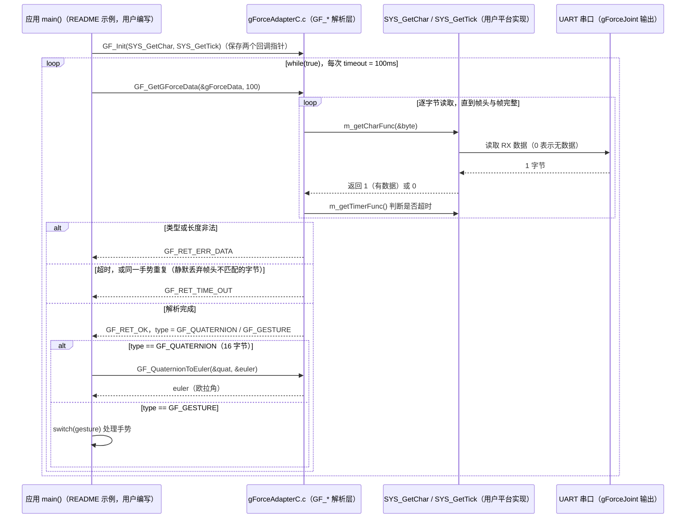

# gForceSDKEmbedded

## 一句话定义

**gForceSDKEmbedded** 是 [傲意科技](https://github.com/oymotion) 公开的 **SDK/驱动** 开源项目：gForce 肌电臂环 C/C++ 嵌入式 SDK

## 英文缩写速查

| 缩写 | 英文全称 | 简要说明 |
|------|----------|----------|
| SDK | Software Development Kit | 真机控制与状态读取接口 |
| RL | Reinforcement Learning | 强化学习训练与策略优化 |
| VLA | Vision-Language-Action | 视觉–语言–动作统一策略 |
| Sim2Real | Simulation to Real | 仿真策略迁移真机 |
| URDF | Unified Robot Description Format | 机器人描述与仿真资产 |

## 为什么重要

- 收录于 [国内具身智能开源全景（76 家 · 424 项）](../overview/china-domestic-embodied-opensource-76-companies-technology-map.md) 的 **第三层** 分组。
- 与 [Humanoid Motion Intelligence](../entities/humanoid-motion-intelligence.md) 同源策展；本页为 **独立详情节点**，便于从公司清单跳到机制与入口说明。

## 核心原理

| 字段 | 内容 |
|------|------|
| 机构 | 傲意科技 |
| 类别 | SDK/驱动 |
| 官方组织 | https://github.com/oymotion |

## 工程实践

1. 从官方 GitHub/Gitee 组织检索 `gForceSDKEmbedded` 仓库并核对 README 许可与依赖。
2. 对照本库 [424 项覆盖索引](../queries/china-domestic-opensource-424-coverage.md) 查看同公司其它入口是否共用训练/部署链路。
3. 若与既有方法页（如 RL 框架、VLA、SDK）主题相同，优先读关联页中的「开源入口」小节，避免重复维护平行叙事。

## 局限与风险

- 公众号清单为 **策展快照**（2026-09-06）；仓库更名、归档或许可证变化须回官方组织页核实。
- **开源状态**：以仓库 README 与 release 为准（入库日按文章描述归纳，未逐仓 clone 验证）。

## 源码运行时序图

入口：仓库不含可执行 `main()`。应用程序（嵌入式 MCU 的 `main()`）按 README 示例调用 `GF_Init(SYS_GetChar, SYS_GetTick)` 后循环调用 `GF_GetGForceData()`；`SYS_GetChar` / `SYS_GetTick` 由用户按平台自行实现。`gForceAdapterC.c` 为可直接编入工程的 C 适配层。

注：`GF_GotGesture(gesture, timeout)` 是对 `GF_GetGForceData` 的手势判定封装（README 所述 C++ 等价用法见 `gForceAdaptor`，本仓库未包含）；`GF_EMGRAW` 类型在头文件中定义，但 README 示例循环未处理。

图依据：gForceSDKEmbedded@74aeeda，读过 README.md、gForceAdapterC.c（GF_Init、GF_GotGesture、GF_GetGForceData 的解析与超时逻辑）、gForceDataTypes.h（事件类型常量，grep 读取）；未运行代码。

## 关联页面

- [国内具身开源全景技术地图](../overview/china-domestic-embodied-opensource-76-companies-technology-map.md)
- [HMI 开源项目主表导读](../queries/hmi-opensource-projects-coverage.md)
- [Humanoid Motion Intelligence](../entities/humanoid-motion-intelligence.md)

## 参考来源

- [gForceSDKEmbedded 源码归档](../../sources/repos/gforcesdkembedded.md)（<https://github.com/oymotion/gForceSDKEmbedded>）

- [国内具身智能开源全景（微信公众号）](../../sources/blogs/wechat_embodied_station_domestic_opensource_panorama_2026-09-06.md)

- 源码核对（2026-11-02）：oymotion/gForceSDKEmbedded@74aeeda，读过 README.md、gForceAdapterC.c、gForceDataTypes.h（grep）；时序图依据以上文件，未运行代码。

## 推荐继续阅读

- [傲意科技 官方组织](https://github.com/oymotion)
