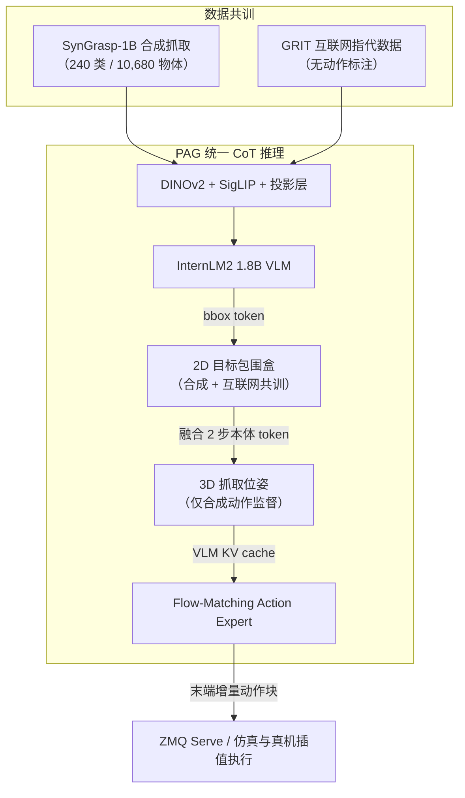
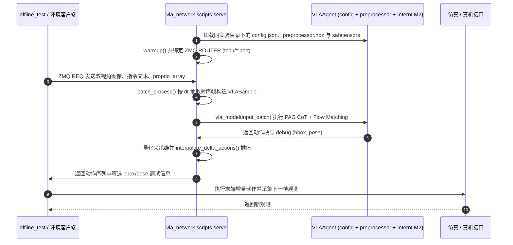

# GraspVLA：十亿级合成数据预训练的抓取基座

## 一句话定义

GraspVLA 在 SynGrasp-1B 合成动作数据上预训练，以自回归感知与 flow-matching 动作生成联合支持开放词汇抓取和零样本 Sim2Real。

## 英文缩写速查

| 缩写 | 英文全称 | 简要说明 |
| --- | --- | --- |
| VLA | Vision-Language-Action | 视觉和语言条件下生成动作 |
| CoT | Chain of Thought | 串联感知与动作生成的思维链 |
| HF | Hugging Face | 官方模型与数据分发平台 |

## 为什么重要

- 展示大规模仿真数据能否预训练可真机迁移的抓取策略。
- 已有模型服务、训练数据和仿真/真机接口，可从原先的公司清单入口转为复现入口。

## 核心原理

**SynGrasp-1B** 是十亿帧合成抓取数据，覆盖 **240 类、10,680 个 Objaverse 物体实例**（CuRobo 单步规划 + MuJoCo 抬起校验 + Isaac Sim 光追渲染与域随机化）。模型采用 **Progressive Action Generation（PAG）**：视觉编码器融合冻结的 **DINOv2 + SigLIP** 并投影到 **InternLM2 1.8B** VLM 主干，将“目标 2D 包围盒预测 → 3D 抓取位姿预测（引入最近 2 步本体状态 token）→ 条件 Flow Matching Action Expert 生成末端增量动作块”串成统一思维链；联合训练时对 **GRIT** 互联网指代数据仅监督 2D bbox，对 SynGrasp-1B 监督全链（$L_{S2}+L_{S1}$），使合成动作技能迁移至开放词汇对象。

这里的“零样本”指论文设定下（Franka Panda + 前/侧双视角）的直接 Sim2Real 抓取迁移，不代表任意本体、任意相机和任意接触任务无需适配。

### 流程总览

图依据：arXiv:2505.03233v3 §3–§4、Fig. 2–3。

## 源码运行时序图

入口：服务端 `uv run --no-sync python -u -m vla_network.scripts.serve --port 6666 --path <checkpoint/model.safetensors>`；客户端自检 `vla_network.scripts.offline_test`。

图依据：`PKU-EPIC/GraspVLA@6acd035` 的 `README.md`、`vla_network/scripts/serve.py`、`vla_network/scripts/offline_test.py`；仅读未运行服务。

## 工程实践

1. 锁定官方 `PKU-EPIC/GraspVLA` 的版本，按 `uv sync --locked` 安装；准备 `internlm/internlm2-1_8b` 与 HF `vegebirrd/GraspVLA` 权重，确保 `config.json`、`preprocessor.npz` 与 `model.safetensors` 来自同一实验目录。
2. 启动 `vla_network.scripts.serve`（加 `--compile` 可在 L40s 上将单次推理从 ~500 ms 降至 ~200 ms，占用约 9 GB 显存），先用 `vla_network.scripts.offline_test` 验证请求/响应及预测框。
3. 仿真与真机接口分别位于独立配套仓 `MiYanDoris/GraspVLA-playground`（含 LIBERO 评测）与 `MiYanDoris/GraspVLA-real-world-controller`；从头训练使用 `torchrun --module vla_network.scripts.train_vla --pred cot_flow_matching` 对接 SynGrasp-1B。
4. **开源核查（2026-11-21）**：推理、分布式训练入口、权重与 SynGrasp-1B（2026-08-19）均已开源；真机与仿真环境接入独立配套仓库。

## 局限与风险

- 论文与模型主证据绑定 **Franka Panda + 前/侧双视角** 桌面刚体抓取，跨本体或单视角部署需另行采集数据与适配。
- 对模糊语义指令（如“pick up food”或方位词“最左物体”）较脆弱；力封闭合成标签未显式建模柔性体大变形。
- 经 Torch Compile 加速后推理延迟仍约 **200 ms**（5 Hz，慢于 AnyGrasp 的 37 Hz），在高速动态目标场景下反应受限。
- 配置/归一化不匹配会让服务输出错误动作，上线前须用 `offline_test` 回放校验；注意 `PKU-EPIC/GraspVLA` 许可证（CC BY-NC 4.0，非商用）与各外部权重许可差异。

## 关联页面

- [Manipulation](../tasks/manipulation.md) — 合成数据预训练的抓取迁移应按本体、相机与接触设置评估，不能泛化成所有操作任务零适配。
- [AstraBrain](./galbot-astrabrain.md)
- [VLA](../methods/vla.md)
- [Sim2Real](../concepts/sim2real.md)

## 参考来源

- [GraspVLA 论文原文归档（arXiv:2505.03233）](../../sources/papers/graspvla_arxiv_2505_03233.md)
- [官方 GraspVLA 代码与资产核查](../../sources/repos/graspvla.md)

## 推荐继续阅读

- [官方仓库](https://github.com/PKU-EPIC/GraspVLA)
- [原始论文](https://arxiv.org/abs/2505.03233)
