# hi_dynamic_control

## 一句话定义

**hi_dynamic_control** 是 [高擎机电](https://github.com/HighTorque-Robotics) 公开的 **部署运行时** 开源项目：策略部署运行时：加载训练策略、下发关节命令

## 英文缩写速查

| 缩写 | 英文全称 | 简要说明 |
|------|----------|----------|
| SDK | Software Development Kit | 真机控制与状态读取接口 |
| RL | Reinforcement Learning | 强化学习训练与策略优化 |
| VLA | Vision-Language-Action | 视觉–语言–动作统一策略 |
| Sim2Real | Simulation to Real | 仿真策略迁移真机 |
| URDF | Unified Robot Description Format | 机器人描述与仿真资产 |

## 为什么重要

- 收录于 [国内具身智能开源全景（76 家 · 424 项）](../overview/china-domestic-embodied-opensource-76-companies-technology-map.md) 的 **第一层** 分组。
- 与 [Humanoid Motion Intelligence](../entities/humanoid-motion-intelligence.md) 同源策展；本页为 **独立详情节点**，便于从公司清单跳到机制与入口说明。

## 核心原理

| 字段 | 内容 |
|------|------|
| 机构 | 高擎机电 |
| 类别 | 部署运行时 |
| 官方组织 | https://github.com/HighTorque-Robotics |

## 工程实践

1. 从官方 GitHub/Gitee 组织检索 `hi_dynamic_control` 仓库并核对 README 许可与依赖。
2. 对照本库 [424 项覆盖索引](../queries/china-domestic-opensource-424-coverage.md) 查看同公司其它入口是否共用训练/部署链路。
3. 若与既有方法页（如 RL 框架、VLA、SDK）主题相同，优先读关联页中的「开源入口」小节，避免重复维护平行叙事。

## 局限与风险

- 公众号清单为 **策展快照**（2026-09-06）；仓库更名、归档或许可证变化须回官方组织页核实。
- **开源状态**：以仓库 README 与 release 为准（入库日按文章描述归纳，未逐仓 clone 验证）。

## 源码运行时序图

入口：`roslaunch hi_controllers one_start_gazebo.launch`（仿真；真机为 `roslaunch hi_controllers one_start_real.launch`，经 `hi_bridge_hw` 接电机与 IMU）。下图画仿真路径，ROS 1 + OCS2 + ros_control。

```mermaid
sequenceDiagram
    participant GL as hi_controllers/launch/one_start_gazebo.launch
    participant GZ as hi_description empty_world.launch + hi_gazebo (hiHWSim 插件)
    participant TL as scripts/timedelay_launch.sh
    participant CM as controller_manager（load_controller_sim.launch 的 spawner）
    participant HC as hi_controllers/src/hiController.cpp
    participant MPC as OCS2 SqpMpc（独立线程）
    participant EST as hi_estimation KalmanFilterEstimate
    participant WBC as hi_wbc WeightedWbc
    participant TT as hi_target_trajectories_publisher
    GL->>GZ: include empty_world.launch，加载 hi.urdf，spawn_model 生成机器人
    GL->>TL: 延时 2 秒后 roslaunch hi_controllers load_controller_sim.launch
    TL->>CM: 加载 task_sim.info、reference_sim.info、gait.info、controllers.yaml；spawner 启动 controllers/hi_controller
    CM->>HC: init(robot_hw, nh)：setupLeggedInterface、setupMpc、setupMrt（起 MPC 线程）、取 HybridJointInterface 与 IMU 句柄、setupStateEstimate、建 WeightedWbc
    CM->>HC: starting()：设站立初始目标，订阅 /load_controller /set_walk /reset_estimation /emergency_stop
    loop 每个控制周期 update()
        HC->>GZ: 读关节 pos/vel/effort 与 IMU（readSim 提供的句柄）
        HC->>EST: updateJointStates / updateImu / update → measuredRbdState_
        HC->>HC: computeCentroidalStateFromRbdModel 得 currentObservation_
        HC->>MPC: setCurrentObservation；MPC 线程按 mpcDesiredFrequency 执行 advanceMpc（loadController 后 mpcRunning_）
        MPC-->>HC: updatePolicy、evaluatePolicy 得 optimizedState / optimizedInput / plannedMode
        HC->>WBC: wbc_->update(optimizedState, optimizedInput, measuredRbdState_, plannedMode, dt)
        WBC-->>HC: 关节加速度、接触力、力矩解 x
        HC->>GZ: hybridJointHandles_[j].setCommand(posDes, velDes, kp, kd, ff)，writeSim 按 kp·Δq + kd·Δv + ff 施加力矩
    end
    TT->>MPC: 订阅 /cmd_vel（joy_teleop 发布）与 legged_robot_mpc_observation，cmdVelToTargetTrajectories 生成目标轨迹并发布，由 RosReferenceManager 订阅后交给 MPC
```

另：`dynamic_reconfigure` 回调 `dynamicParamCallback` 更新 kp/kd；位置越限（超出关节限位 ±0.02）会置 `emergencyStopFlag_`，并把所有关节命令改为 `setCommand(0, 0, 0, 1, 0)`。

图依据：HighTorque-Robotics/Mini-Hi_Dynamic_Control@f94f23c，读过 README.md、hi_controllers/launch/（one_start_gazebo.launch、load_controller_sim.launch、joy_teleop.launch、one_start_real.launch）、hi_controllers/scripts/timedelay_launch.sh、hi_controllers/config/controllers.yaml、hi_controllers/src/hiController.cpp、hi_controllers/src/TargetTrajectoriesPublisher.cpp、hi_examples/hi_biped/hi_description/launch/empty_world.launch、hi_gazebo/src/hiHWSim.cpp、hi_gazebo/config/default.yaml。`controller_manager` 周期性调用 `update()` 是 ros_control 的标准机制，仓库内未见该调用代码，属推断；`hi_wbc`、`hi_estimation`、`hi_interface` 内部实现与真机桥接（`hi_bridge_hw`）未细读。

## 关联页面

- [国内具身开源全景技术地图](../overview/china-domestic-embodied-opensource-76-companies-technology-map.md)
- [HMI 开源项目主表导读](../queries/hmi-opensource-projects-coverage.md)
- [Humanoid Motion Intelligence](../entities/humanoid-motion-intelligence.md)

## 参考来源

- [hi_dynamic_control 源码归档](../../sources/repos/mini-hi_dynamic_control.md)（<https://github.com/HighTorque-Robotics/Mini-Hi_Dynamic_Control>）

- [国内具身智能开源全景（微信公众号）](../../sources/blogs/wechat_embodied_station_domestic_opensource_panorama_2026-09-06.md)
- 源码核对（2026-11-02）：HighTorque-Robotics/Mini-Hi_Dynamic_Control@f94f23c，读过 README.md、hi_controllers/launch/、hi_controllers/scripts/timedelay_launch.sh、hi_controllers/config/controllers.yaml、hi_controllers/src/hiController.cpp、hi_controllers/src/TargetTrajectoriesPublisher.cpp、hi_examples/hi_biped/hi_description/launch/empty_world.launch、hi_gazebo/src/hiHWSim.cpp、hi_gazebo/config/default.yaml；时序图依据以上文件，未运行代码。

## 推荐继续阅读

- [高擎机电 官方组织](https://github.com/HighTorque-Robotics)
