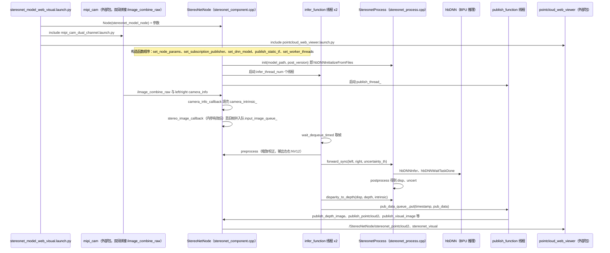

# hobot_stereonet

## 一句话定义

**hobot_stereonet** 是 [地瓜机器人](https://github.com/D-Robotics) 公开的 **工程与工具** 开源项目：从双目图像实时估计深度，为机器人三维感知、避障和操作提供环境几何输入。

## 英文缩写速查

| 缩写 | 英文全称 | 简要说明 |
|------|----------|----------|
| SDK | Software Development Kit | 真机控制与状态读取接口 |
| RL | Reinforcement Learning | 强化学习训练与策略优化 |
| VLA | Vision-Language-Action | 视觉–语言–动作统一策略 |
| Sim2Real | Simulation to Real | 仿真策略迁移真机 |
| URDF | Unified Robot Description Format | 机器人描述与仿真资产 |

## 为什么重要

- 收录于 [国内具身智能开源全景（76 家 · 424 项）](../overview/china-domestic-embodied-opensource-76-companies-technology-map.md) 的 **第四层** 分组。
- 与 [Humanoid Motion Intelligence](../entities/humanoid-motion-intelligence.md) 同源策展；本页为 **独立详情节点**，便于从公司清单跳到机制与入口说明。

## 核心原理

| 字段 | 内容 |
|------|------|
| 机构 | 地瓜机器人 |
| 类别 | 工程与工具 |
| 官方组织 | https://github.com/D-Robotics |

## 工程实践

1. 从官方 GitHub/Gitee 组织检索 `hobot_stereonet` 仓库并核对 README 许可与依赖。
2. 对照本库 [424 项覆盖索引](../queries/china-domestic-opensource-424-coverage.md) 查看同公司其它入口是否共用训练/部署链路。
3. 若与既有方法页（如 RL 框架、VLA、SDK）主题相同，优先读关联页中的「开源入口」小节，避免重复维护平行叙事。

## 局限与风险

- 公众号清单为 **策展快照**（2026-09-06）；仓库更名、归档或许可证变化须回官方组织页核实。
- **开源状态**：以仓库 README 与 release 为准（入库日按文章描述归纳，未逐仓 clone 验证）。

## 源码运行时序图

入口：`ros2 launch hobot_stereonet stereonet_model_web_visual.launch.py`（内部 include `launch/stereonet_model.launch.py`，启动可执行文件 `stereonet_model_node`，即 `CMakeLists.txt` 里 `rclcpp_components_register_node` 注册的 `stereonet::StereoNetNode`；下图为 `infer_thread_num=2` 默认值、`use_local_image_flag=False` 的在线路径）

图依据：D-Robotics/hobot_stereonet@f74a612，读过 `README.md`、`CMakeLists.txt`、`launch/stereonet_model_web_visual.launch.py`、`launch/stereonet_model.launch.py`、`src/stereonet_component.cpp`、`src/stereonet_process.cpp`（`init`/`forward`/`forward_sync`/`forward_async` 及其调用处）；`mipi_cam` 与 `pointcloud_web_viewer` 为外部包，仅按 launch 引用画出，内部未读。`infer_thread_num=1` 时走 `forward_async` 路径，图中未画。

## 关联页面

- [国内具身开源全景技术地图](../overview/china-domestic-embodied-opensource-76-companies-technology-map.md)
- [HMI 开源项目主表导读](../queries/hmi-opensource-projects-coverage.md)
- [Humanoid Motion Intelligence](../entities/humanoid-motion-intelligence.md)

## 参考来源

- [hobot_stereonet 源码归档](../../sources/repos/hobot_stereonet.md)（<https://github.com/D-Robotics/hobot_stereonet>）

- [国内具身智能开源全景（微信公众号）](../../sources/blogs/wechat_embodied_station_domestic_opensource_panorama_2026-09-06.md)
- 源码核对（2026-11-02）：D-Robotics/hobot_stereonet@f74a612，读过 README.md、CMakeLists.txt、launch/stereonet_model_web_visual.launch.py、launch/stereonet_model.launch.py、src/stereonet_component.cpp、src/stereonet_process.cpp；时序图依据以上文件，未运行代码。

## 推荐继续阅读

- [地瓜机器人 官方组织](https://github.com/D-Robotics)
