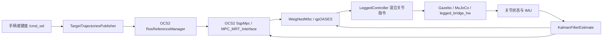
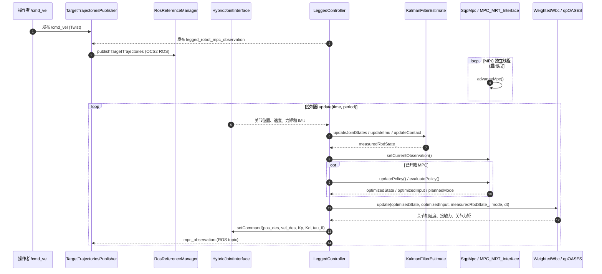

# hunter_bipedal_control｜双足 SQP-MPC + WBC 控制框架

## 一句话定义

**hunter_bipedal_control** 是桥介数物（BridgeDP Robotics）为 **EC-Hunter80-V01** 双足机器人发布的 ROS1 Noetic 运控框架，结合 **OCS2 的 SQP-MPC**、基于 IMU/关节的状态估计、**WeightedWbc** 二次规划与关节混合控制，支持 Gazebo、MuJoCo 和指定硬件。它是 **Model-based 运控项目**，不是 RL/VLA 策略训练框架。

## 英文缩写速查

| 缩写 | 英文全称 | 简要说明 |
|---|---|---|
| MPC | Model Predictive Control | 滚动求解预测时域内的状态与控制轨迹 |
| SQP | Sequential Quadratic Programming | 此项目在 OCS2 中使用的 MPC 优化方法 |
| WBC | Whole-Body Control | 把期望运动和接触约束转为全身关节控制 |
| QP | Quadratic Programming | WeightedWbc 通过 qpOASES 求解的优化问题 |
| IMU | Inertial Measurement Unit | 姿态、角速度与加速度测量 |
| LCM | Lightweight Communications and Marshalling | README 要求的 MuJoCo 通信依赖 |

## 为什么重要

- 提供可沿代码走通的 **状态估计 → MPC → WBC → 关节位置/速度与力矩前馈** 双足系统链路，而不只是算法概念。
- 同一个 ROS 控制器可通过 **Gazebo、MuJoCo 与 `legged_bridge_hw`** 替换底层接口，适合比较不同仿真/真机路径。
- 官方项目页描述目标 EC-Hunter80-V01 为无上肢的 **10 DoF** 轻量双足机器人；本页专注这个具体本体，不外推到所有人形配置。

## 核心原理

| 模块 | 源码位置 / 事实 |
|---|---|
| 目标轨迹 | `TargetTrajectoriesPublisher.h/.cpp` 订阅 `/cmd_vel`、`/move_base_simple/goal`，基于 `legged_robot_mpc_observation` 和速度限幅发布 OCS2 目标轨迹 |
| MPC | `LeggedController::setupMpc()` 构造 `SqpMpc`；`setupMrt()` 用独立线程调用 `MPC_MRT_Interface::advanceMpc()` |
| 状态估计 | `setupStateEstimate()` 构造 `KalmanFilterEstimate`；控制周期融合关节状态、IMU 和计划接触模式 |
| WBC | `WeightedWbc::update()` 组合浮动基动力学、力矩限制、摩擦锥约束及加权运动任务，交由 `qpOASES::QProblem` 求解 |
| 输出 | `LeggedController::update()` 使用 WBC 的关节加速度修正位置/速度参考，并通过 `HybridJointInterface::setCommand(pos, vel, kp, kd, tau_ff)` 下发 |

**关键区别：** MPC 计算期望未来轨迹，WBC 结合当前估计状态及接触约束求全身关节指令；`loadControllerFlag_`、`setWalkFlag_` 决定实际使用的控制分支，不能把流程理解为每次启动立即进入行走力矩控制。

## 流程总览

以下模块与流向对照官方项目页和 `LeggedController.cpp`、`TargetTrajectoriesPublisher.h`、`WeightedWbc.cpp`：



流程是**逻辑数据流**：真实执行中 MPC 在独立线程滚动求解，WBC 随控制器 `update()` 周期运行；参考轨迹通过 OCS2 ROS 发布与订阅传递。

## 源码运行时序图

启动入口分别为 `roslaunch legged_controllers one_start_gazebo.launch`、`one_start_mujoco.launch` 或 `one_start_real.launch`。三个入口会加载各自仿真/硬件接口，再经 `timedelay_launch.sh` 延迟启动 `one_start.launch`，启动 `controllers/legged_controller` 及目标轨迹发布节点。



源码参考：[`LeggedController.cpp`](https://github.com/bridgedp/hunter_bipedal_control/blob/main/legged_controllers/src/LeggedController.cpp)、[`TargetTrajectoriesPublisher.h`](https://github.com/bridgedp/hunter_bipedal_control/blob/main/legged_controllers/include/legged_controllers/TargetTrajectoriesPublisher.h)、[`WeightedWbc.cpp`](https://github.com/bridgedp/hunter_bipedal_control/blob/main/legged_wbc/src/WeightedWbc.cpp)；时序只概括已核对的调用链，未做运行时 tracing。

## 工程实践

**依赖**：官方 README 指定 [OCS2](https://leggedrobotics.github.io/ocs2/installation.html#prerequisites)、ROS1 Noetic；MuJoCo 仿真还需 LCM。核心编译/启动命令：

```bash
mkdir -p <catkin_ws>/src
cd <catkin_ws>/src
git clone https://github.com/bridgedp/hunter_bipedal_control.git
cd <catkin_ws>
catkin init
catkin config -DCMAKE_BUILD_TYPE=RelWithDebInfo
# 根据选择执行一种构建
catkin build legged_controllers legged_hunter_description legged_gazebo
catkin build legged_controllers legged_hunter_description legged_mujoco lcm_msg mujoco
# 运行相应入口
roslaunch legged_controllers one_start_gazebo.launch
roslaunch legged_controllers one_start_mujoco.launch
roslaunch legged_controllers one_start_real.launch
```

上述构建/运行命令摘自官方 README，**三种启动方式按环境择一执行**，不是要求一次执行全部。无手柄仿真路径在启动控制器前要持续发送 `/cmd_vel`（README 示例 10 Hz），依次调用 `/load_controller`、`/set_walk`；MuJoCo 重载后另有 `/reset_estimation` 步骤。参数与重置操作以官方 README 的对应仿真章节为准。

## 局限与风险

- 适配目标是特定 **10 DoF 双足** 与 ROS1 Noetic；真机还涉及 EtherCAT/CAN、IMU 和厂家硬件，不能仅凭源码可见就推断其他平台即插即用。
- README **明确提醒仿真初次启动可能跌倒**，需要调整 `kp_position`/`kd_position` 并重置；在真实机器人上修改增益或启动运动控制必须做好急停及限位保护。
- `WeightedWbc.cpp` 对 QP 未求解情形打印错误，若存在上次解则回退到上次解；应在部署评测中监控求解失败和 MPC/WBC 周期。
- **开源状态：已开源代码**（MIT）；截至本次核对，未做依赖安装、编译、Gazebo/MuJoCo 实测或真机测试，**不宣称复现成功**。

## 关联页面

- [传统模型控制纵深路线](../../roadmap/depth-classical-control.md)
- [OCS2](../entities/ocs2.md)
- [Model Predictive Control](../methods/model-predictive-control.md)
- [MPC-WBC 集成](../concepts/mpc-wbc-integration.md)
- [Humanoid Motion Intelligence](../entities/humanoid-motion-intelligence.md)
- [国内具身开源全景技术地图](../overview/china-domestic-embodied-opensource-76-companies-technology-map.md)

## 参考来源

- [官方仓库与源码核对归档](../../sources/repos/hunter_bipedal_control.md) — 官方 README + 关键控制器/WBC/launch 源码，`main@37310dde`，2026-11-18 通读，未运行。
- [官方项目页核对归档](../../sources/sites/hunter-bipedal-control.md) — 硬件、控制结构及 Code 入口，2026-11-18 通读。
- [国内具身智能开源全景（策展来源）](../../sources/blogs/wechat_embodied_station_domestic_opensource_panorama_2026-09-06.md)

## 推荐继续阅读

- [hunter_bipedal_control 原始代码](https://github.com/bridgedp/hunter_bipedal_control)
- [官方项目页](https://bridgedp.github.io/hunter_bipedal_control/)
- [OCS2 官方文档](https://leggedrobotics.github.io/ocs2/)
