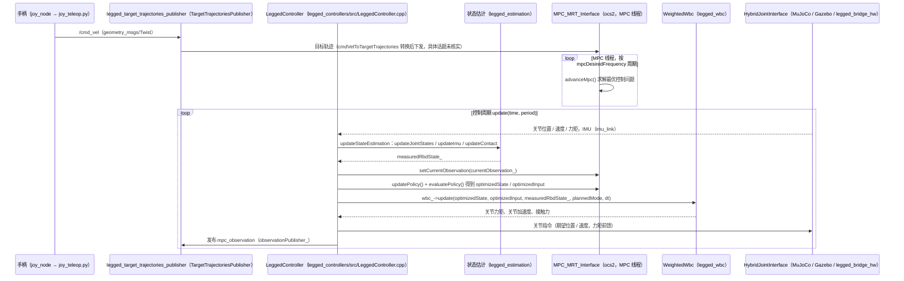

# hunter_bipedal_control

## 一句话定义

**hunter_bipedal_control** 是 [桥介数物](https://github.com/bridgedp) 公开的 **运动控制** 开源项目：开源双足运动控制框架：非线性 MPC + 全身控制（WBC），面向 EC-hunter80 双足机器人，配套 Gazebo/MuJoCo 仿真与真机部署

## 英文缩写速查

| 缩写 | 英文全称 | 简要说明 |
|------|----------|----------|
| SDK | Software Development Kit | 真机控制与状态读取接口 |
| RL | Reinforcement Learning | 强化学习训练与策略优化 |
| VLA | Vision-Language-Action | 视觉–语言–动作统一策略 |
| Sim2Real | Simulation to Real | 仿真策略迁移真机 |
| URDF | Unified Robot Description Format | 机器人描述与仿真资产 |

## 为什么重要

- 收录于 [国内具身智能开源全景（76 家 · 424 项）](../overview/china-domestic-embodied-opensource-76-companies-technology-map.md) 的 **第一层** 分组。
- 与 [Humanoid Motion Intelligence](../entities/humanoid-motion-intelligence.md) 同源策展；本页为 **独立详情节点**，便于从公司清单跳到机制与入口说明。

## 核心原理

| 字段 | 内容 |
|------|------|
| 机构 | 桥介数物 |
| 类别 | 运动控制 |
| 官方组织 | https://github.com/bridgedp |

## 工程实践

1. 从官方 GitHub/Gitee 组织检索 `hunter_bipedal_control` 仓库并核对 README 许可与依赖。
2. 对照本库 [424 项覆盖索引](../queries/china-domestic-opensource-424-coverage.md) 查看同公司其它入口是否共用训练/部署链路。
3. 若与既有方法页（如 RL 框架、VLA、SDK）主题相同，优先读关联页中的「开源入口」小节，避免重复维护平行叙事。

## 局限与风险

- 公众号清单为 **策展快照**（2026-09-06）；仓库更名、归档或许可证变化须回官方组织页核实。
- **开源状态**：以仓库 README 与 release 为准（入库日按文章描述归纳，未逐仓 clone 验证）。

## 源码运行时序图

入口（ROS1 Noetic，仿真或实机二选一）：
- MuJoCo 仿真：`roslaunch legged_controllers one_start_mujoco.launch`
- Gazebo 仿真：`roslaunch legged_controllers one_start_gazebo.launch`
- 实机：`roslaunch legged_controllers one_start_real.launch`（经 `legged_bridge_hw` 接入硬件）

三个入口都经 `timedelay_launch.sh` 延迟 2 秒后启动 `one_start.launch`，由它加载参数并拉起 `controllers/legged_controller` 与 `legged_target_trajectories_publisher`；手柄经 `joy_teleop.launch` 发布 `/cmd_vel`。

注：`starting()` 时写入初始目标轨迹；`/set_walk`、`/load_controller`、`/emergency_stop`、`/reset_estimation` 由 `LeggedController` 订阅，回调未在图中展开。状态估计器的具体实现由配置决定，本图未逐一核实。

图依据：hunter_bipedal_control@37310dd，读过 README.md、legged_controllers/launch/one_start.launch、one_start_mujoco.launch、one_start_real.launch、joy_teleop.launch（grep）、legged_controllers/src/LeggedController.cpp（init、starting、update、updateStateEstimation、setupMrt、订阅与发布）、legged_controllers/include/legged_controllers/TargetTrajectoriesPublisher.h（grep）、legged_controllers/src/TargetTrajectoriesPublisher.cpp（grep）；未运行代码。

## 关联页面

- [国内具身开源全景技术地图](../overview/china-domestic-embodied-opensource-76-companies-technology-map.md)
- [HMI 开源项目主表导读](../queries/hmi-opensource-projects-coverage.md)
- [Humanoid Motion Intelligence](../entities/humanoid-motion-intelligence.md)

## 参考来源

- [hunter_bipedal_control 源码归档](../../sources/repos/hunter_bipedal_control.md)（<https://github.com/bridgedp/hunter_bipedal_control>）

- [国内具身智能开源全景（微信公众号）](../../sources/blogs/wechat_embodied_station_domestic_opensource_panorama_2026-09-06.md)

- 源码核对（2026-11-02）：bridgedp/hunter_bipedal_control@37310dd，读过 README.md、legged_controllers/launch/one_start.launch、one_start_mujoco.launch、one_start_real.launch、legged_controllers/src/LeggedController.cpp、legged_controllers/src/TargetTrajectoriesPublisher.cpp（grep）、legged_controllers/include/legged_controllers/TargetTrajectoriesPublisher.h（grep）；时序图依据以上文件，未运行代码。

## 推荐继续阅读

- [桥介数物 官方组织](https://github.com/bridgedp)
