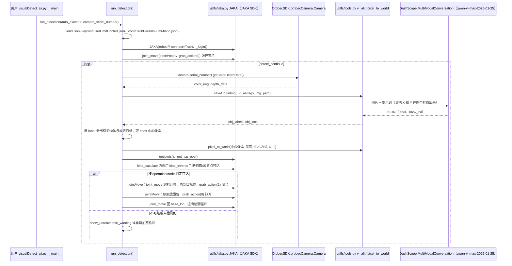

# JAKA_Lumi

## 一句话定义

**JAKA_Lumi** 是 [节卡机器人](https://github.com/JAKARobotics) 公开的 **具身Agent/规划** 开源项目：公开JAKA Lumi机器人平台相关开发内容，用于机械臂、移动平台与感知任务的系统集成。

## 英文缩写速查

| 缩写 | 英文全称 | 简要说明 |
|------|----------|----------|
| SDK | Software Development Kit | 真机控制与状态读取接口 |
| RL | Reinforcement Learning | 强化学习训练与策略优化 |
| VLA | Vision-Language-Action | 视觉–语言–动作统一策略 |
| Sim2Real | Simulation to Real | 仿真策略迁移真机 |
| URDF | Unified Robot Description Format | 机器人描述与仿真资产 |

## 为什么重要

- 收录于 [国内具身智能开源全景（76 家 · 424 项）](../overview/china-domestic-embodied-opensource-76-companies-technology-map.md) 的 **第五层** 分组。
- 与 [Humanoid Motion Intelligence](../entities/humanoid-motion-intelligence.md) 同源策展；本页为 **独立详情节点**，便于从公司清单跳到机制与入口说明。

## 核心原理

| 字段 | 内容 |
|------|------|
| 机构 | 节卡机器人 |
| 类别 | 具身Agent/规划 |
| 官方组织 | https://github.com/JAKARobotics |

## 工程实践

1. 从官方 GitHub/Gitee 组织检索 `JAKA_Lumi` 仓库并核对 README 许可与依赖。
2. 对照本库 [424 项覆盖索引](../queries/china-domestic-opensource-424-coverage.md) 查看同公司其它入口是否共用训练/部署链路。
3. 若与既有方法页（如 RL 框架、VLA、SDK）主题相同，优先读关联页中的「开源入口」小节，避免重复维护平行叙事。

## 局限与风险

- 公众号清单为 **策展快照**（2026-09-06）；仓库更名、归档或许可证变化须回官方组织页核实。
- **开源状态**：以仓库 README 与 release 为准（入库日按文章描述归纳，未逐仓 clone 验证）。

## 源码运行时序图

本仓库是 Demo 与资料合集，可运行代码集中在 `JAKA_Lumi_Demo_Case/compose/`（视觉抓取）、`LUMI_DEMO_BMW/`（智能体售货）和 `JAKA_Lumi_Demo_Case/{agv,body_head}/` 的小脚本。下图只画读过的视觉检测与抓取放置主流程；`LUMI_DEMO_BMW` 的 `LumiAgent/api.py`、`executer.py` 与 `video_analyser` 未读，`multi_station_demo.py`（仅 AGV 移动与站点初始位，未调用检测）也不在图中。

入口：`python visualDetect_ali.py --auto`（可加 `--camera-sn <序列号>`；工作目录需为 `compose/`，脚本用相对路径读取 `./conf/userCmdControl.json`）

图依据：JAKARobotics/JAKA_Lumi@2b3f730，读过 README.md、JAKA_Lumi_Demo_Case/README.md、JAKA_Lumi_Demo_Case/compose/{README.md、visualDetect_ali.py、multi_station_demo.py}、compose/utilfs/tools.py（vl_ali、simple_multimodal_conversation_call、pixel_to_world）、compose/utilfs/jaka.py（类定义与 grab_action）、LUMI_DEMO_BMW/README.md 与目录列表。

## 关联页面

- [国内具身开源全景技术地图](../overview/china-domestic-embodied-opensource-76-companies-technology-map.md)
- [HMI 开源项目主表导读](../queries/hmi-opensource-projects-coverage.md)
- [Humanoid Motion Intelligence](../entities/humanoid-motion-intelligence.md)

## 参考来源

- [JAKA_Lumi 源码归档](../../sources/repos/jaka_lumi.md)（<https://github.com/JAKARobotics/JAKA_Lumi>）

- [国内具身智能开源全景（微信公众号）](../../sources/blogs/wechat_embodied_station_domestic_opensource_panorama_2026-09-06.md)
- 源码核对（2026-11-02）：JAKARobotics/JAKA_Lumi@2b3f730，读过 README.md、JAKA_Lumi_Demo_Case/README.md、compose/{README.md,visualDetect_ali.py,multi_station_demo.py}、compose/utilfs/{tools,jaka}.py（部分）、LUMI_DEMO_BMW/README.md；LumiAgent 与 video_analyser 代码未读；时序图依据以上文件，未运行代码。

## 推荐继续阅读

- [节卡机器人 官方组织](https://github.com/JAKARobotics)
