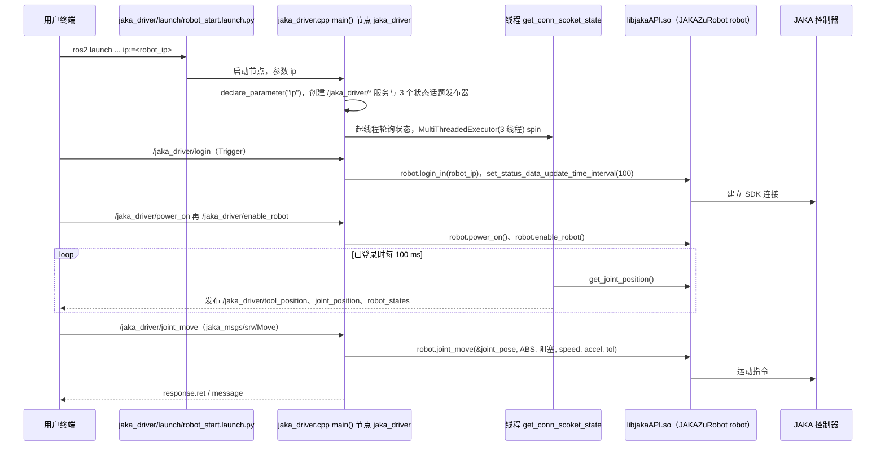
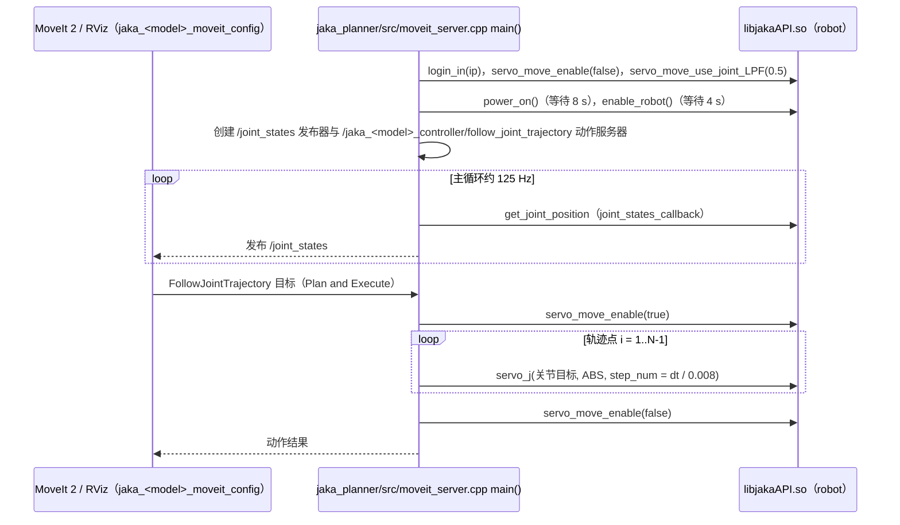

# jaka_ros2

## 一句话定义

**jaka_ros2** 是 [节卡机器人](https://github.com/JAKARobotics) 公开的 **工程与工具** 开源项目：为JAKA协作机器人提供ROS2驱动、机器人模型与上层规划控制接口。

## 英文缩写速查

| 缩写 | 英文全称 | 简要说明 |
|------|----------|----------|
| SDK | Software Development Kit | 真机控制与状态读取接口 |
| RL | Reinforcement Learning | 强化学习训练与策略优化 |
| VLA | Vision-Language-Action | 视觉–语言–动作统一策略 |
| Sim2Real | Simulation to Real | 仿真策略迁移真机 |
| URDF | Unified Robot Description Format | 机器人描述与仿真资产 |

## 为什么重要

- 收录于 [国内具身智能开源全景（76 家 · 424 项）](../overview/china-domestic-embodied-opensource-76-companies-technology-map.md) 的 **第五层** 分组。
- 与 [Humanoid Motion Intelligence](../entities/humanoid-motion-intelligence.md) 同源策展；本页为 **独立详情节点**，便于从公司清单跳到机制与入口说明。

## 核心原理

| 字段 | 内容 |
|------|------|
| 机构 | 节卡机器人 |
| 类别 | 工程与工具 |
| 官方组织 | https://github.com/JAKARobotics |

## 工程实践

1. 从官方 GitHub/Gitee 组织检索 `jaka_ros2` 仓库并核对 README 许可与依赖。
2. 对照本库 [424 项覆盖索引](../queries/china-domestic-opensource-424-coverage.md) 查看同公司其它入口是否共用训练/部署链路。
3. 若与既有方法页（如 RL 框架、VLA、SDK）主题相同，优先读关联页中的「开源入口」小节，避免重复维护平行叙事。

## 局限与风险

- 公众号清单为 **策展快照**（2026-09-06）；仓库更名、归档或许可证变化须回官方组织页核实。
- **开源状态**：以仓库 README 与 release 为准（入库日按文章描述归纳，未逐仓 clone 验证）。

## 源码运行时序图

`jaka_ros2` 的运行时是 C++ 的 `jaka_driver` 节点，经闭源的预编译 `libjakaAPI.so`（`jaka_driver/lib/`，`JAKAZuRobot robot` 对象）与控制器通信。`jaka_driver` 与 MoveIt 路径互斥（README 要求不能同时运行）。

### 路径一：服务式驱动

入口：`ros2 launch jaka_driver robot_start.launch.py ip:=<robot_ip>`，然后用 `ros2 service call` 调服务。

### 路径二：MoveIt 2 轨迹执行

入口：`ros2 launch jaka_planner moveit_server.launch.py ip:=<robot_ip> model:=<robot_model>`，再 `ros2 launch jaka_<robot_model>_moveit_config demo.launch.py` 打开 RViz。

图依据：JAKARobotics/jaka_ros2@f6b28c6，读过 README.md、jaka_ros2_documentation.md（login 相关段）、src/jaka_driver/launch/robot_start.launch.py、src/jaka_driver/src/jaka_driver.cpp（main、login/power_on/joint_move 回调、get_conn_scoket_state）、src/jaka_planner/src/moveit_server.cpp（main 与 goalCb）。libjakaAPI.so 为预编译库，内部未读。

## 关联页面

- [国内具身开源全景技术地图](../overview/china-domestic-embodied-opensource-76-companies-technology-map.md)
- [HMI 开源项目主表导读](../queries/hmi-opensource-projects-coverage.md)
- [Humanoid Motion Intelligence](../entities/humanoid-motion-intelligence.md)

## 参考来源

- [jaka_ros2 源码归档](../../sources/repos/jaka_ros2.md)（<https://github.com/JAKARobotics/jaka_ros2>）

- [国内具身智能开源全景（微信公众号）](../../sources/blogs/wechat_embodied_station_domestic_opensource_panorama_2026-09-06.md)
- 源码核对（2026-11-02）：JAKARobotics/jaka_ros2@f6b28c6，读过 README.md、jaka_ros2_documentation.md（部分）、src/jaka_driver/launch/robot_start.launch.py、src/jaka_driver/src/jaka_driver.cpp（部分）、src/jaka_planner/src/moveit_server.cpp（部分）；libjakaAPI.so 为预编译库未读；时序图依据以上文件，未运行代码。

## 推荐继续阅读

- [节卡机器人 官方组织](https://github.com/JAKARobotics)
