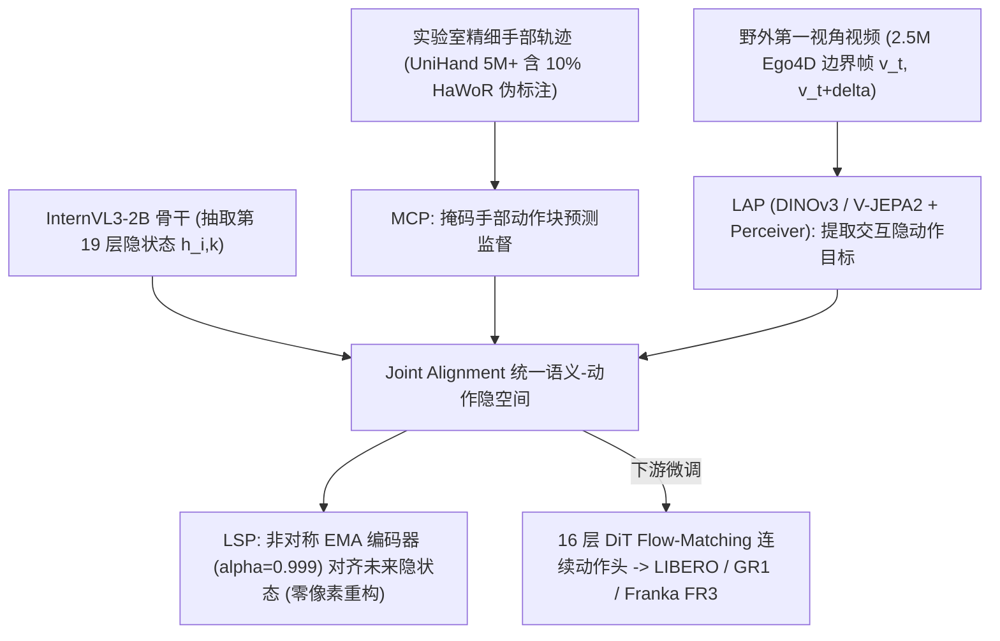

# JALA：面向野外人类视频的可扩展联合对齐隐动作 VLA 预训练

## 一句话定义

**JALA**（Joint-Aligned Latent Action，`arXiv:2602.21736`，CVPR 2026）是智在无界（BeingBeyond）提出的跨源人-机视频协同预训练框架：绕开高开销且易受背景干扰的像素重建，借助 **InternVL3-2B** 中间隐状态与 **MCP / LAP / LSP** 三重表征对齐，把无姿态标签的野外人类视频与实验室精细标注手部轨迹融合进同一动作语义潜空间。

## 英文缩写速查

| 缩写 | 英文全称 | 简要说明 |
|------|----------|----------|
| JALA | Joint-Aligned Latent Action | 有标实验室轨迹与无标野外人类视频在隐动作空间联合对齐的 VLA 预训练架构 |
| MCP | Masked Chunk Prediction | 针对有 3D 手部标注片段，掩码动作块并恢复显式运动表征的自监督任务 |
| LAP | Latent Action Perceiver | 用 DINOv3 / V-JEPA2 抽取视频边界帧变化生成隐动作目标的交叉注意力模块 |
| LSP | Latent State Perceiver | 借非对称 EMA 目标编码器（$\alpha=0.999$）对齐未来隐状态的隐世界约束 |

## 为什么重要

1. **突破实验室 3D 手-物真值标注规模瓶颈**：如 [Being-H0](paper-notebook-being-h0-vision-language-action-pretraining-from.md) 依赖精密标定的手部姿态数据集，互联网海量第一视角野外视频（如 Ego4D）若强行靠光流或 VQ-VAE 重建像素极易学到背景/相机抖动伪影。JALA 把野外视频监督转入特征级 JEPA/Perceiver 空间，成功撬动 **7.5M UniHand-Mix**（含 2.5M Ego4D）。
2. **直接衔接智在无界隐式世界-动作模型谱系**：JALA 验证了「隐空间预测对齐替代像素重建」在野外互联网视频扩展上的收益，为随后的双分支潜在查询模型 [Being-H0.7](../methods/being-h07.md) 提供了重要先验。

## 核心原理

1. **基于中间层的预测表征空间**：抽取 **InternVL3-2B 第 19 层隐藏状态** $h_{i,k}$ 作为同时承接视觉-语言上下文与动作语义预测的统一接口（而非只依赖最末词表输出层）。
2. **三项联合预训练对齐机制（UniHand-Mix 7.5M）**：
   - **MCP（Masked Chunk Prediction）**：面向 5M+ 实验室标注集（及少量 10% HaWoR 伪姿态片段），对动作块施加掩码并用预测嵌入恢复标准手-腕交互特征；
   - **LAP（Latent Action Perceiver）**：面向无动作标注的 2.5M Ego4D 视频片段，采用强空间编码器（`DINOv3` 或 `V-JEPA2`）读入边界帧对 $(v_t, v_{t+\delta})$，经 Perceiver 聚合出对相机/背景变化相对鲁棒的操作隐动作伪目标；
   - **LSP（Latent State Perceiver）**：利用高动量 **非对称 EMA 目标编码器（$\alpha=0.999$）** 生成未来隐状态基准并与策略预测隐状态对齐，在无任何像素解码器的条件下注入时序前瞻动态。
3. **连续流匹配策略微调**：预训练完成后接入 **16 层 DiT**（Diffusion Transformer）Flow-Matching 动作头进行下游仿真/真机连续轨迹精调。

## 工程实践

- **仿真与跨平台真机成绩**：
  - **LIBERO**：双视角 **96.9%**，单视角 **92.3%**；
  - **RoboCasa**：Human 分支 **35.42%**、Syn 分支 **27.58%**；
  - **GR1（仿人双手灵巧操作）**：达 **26.33%**，超过同期直接人类预训练基线 Being-H0（`12.91%`）与隐动作基线 LAPA†（`13.50%`）逾一倍；
  - **真机测试（Franka FR3 + Inspire Hand）**：在 Wipe-Board 任务上 Seen 达 **83.3%**、Unseen 泛化达 **80.0%**，显著改善遗漏污渍补擦与桌布纹理偏移自适应。
- **开源状态核查**：**源码运行时序图：不适用**（截至 2026-11-21，官方仓库 [BeingBeyond/JALA](https://github.com/BeingBeyond/JALA) commit `d80a1c6` 仅含 `README.md`、`LICENSE` 与 `docs/assets/` 展示图片，无训练或 DiT 微调脚本；已据此修正早期全景自动归档中的“已开源”误标）。

## 结论

**JALA 通过 MCP/LAP/LSP 三位一体隐空间联合对齐，打通了「高精度实验室手部标注 + 百万级无标注 Ego4D 野外第一视角视频」在同一 VLA 模型上的无像素重建扩展路径。**
- 在特征空间对齐（V-JEPA2 / DINOv3 + 非对称 EMA）避开光流/图像解码被环境背景噪声劫持的问题；
- 在高难度 GR1 灵巧基准翻倍领先 LAPA 与 Being-H0（26.33% vs 13.50%/12.91%）；
- 真机 Wipe-Board 跨色彩/纹理 Unseen 泛化高达 80.0%，主要遗憾为暂未公开代码权重。

## 局限与风险

1. **多视角与高遮挡手部细微抓握细节流失**：LAP 依靠边界帧提取变化，对帧间快速往复或掌心遮挡内的细微手指微调（如插拔校准）刻画不如显式触觉（如 [TTP](cn-os-ttp.md)）精确。
2. **源码暂未释出**：`d80a1c6` 仓库暂无模型定义与预训练脚本。

## 关联页面

- 所属机构实体：[智在无界（BeingBeyond）](beingbeyond.md)
- 上游显式手部基座：[Being-H0](paper-notebook-being-h0-vision-language-action-pretraining-from.md) 与 [VIPA-VLA](cn-os-vipa-vla.md)
- 后续隐式 WAM：[Being-H0.7](../methods/being-h07.md)

## 参考来源

- 一手论文：`arXiv:2602.21736v1`（CVPR 2026）全文归档（[jala_arxiv_2602_21736.md](../../sources/papers/jala_arxiv_2602_21736.md)）
- 代码仓库核查：[jala.md](../../sources/repos/jala.md)（`BeingBeyond/JALA @ d80a1c6`）
- 行业全景索引：[wechat_embodied_station_domestic_opensource_panorama_2026-09-06.md](../../sources/blogs/wechat_embodied_station_domestic_opensource_panorama_2026-09-06.md)

## 继续阅读

- [arXiv:2602.21736 论文页面](https://arxiv.org/abs/2602.21736)
- [JALA 官方项目主页](https://research.beingbeyond.com/jala)
- [BeingBeyond/JALA GitHub 仓库](https://github.com/BeingBeyond/JALA)
